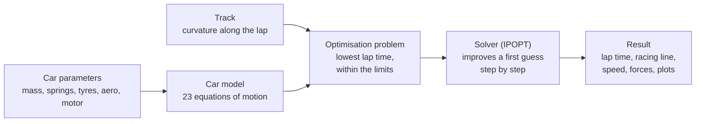
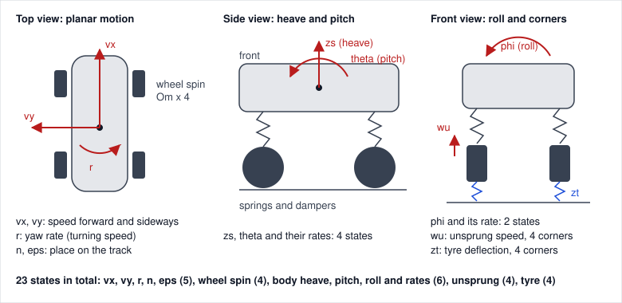
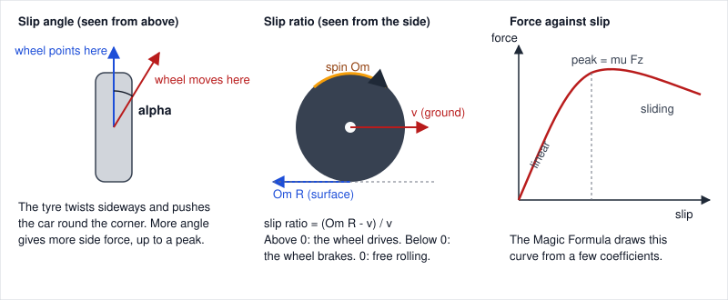
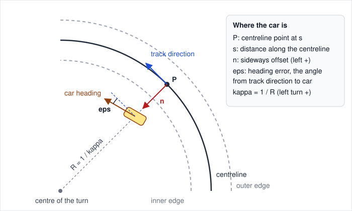
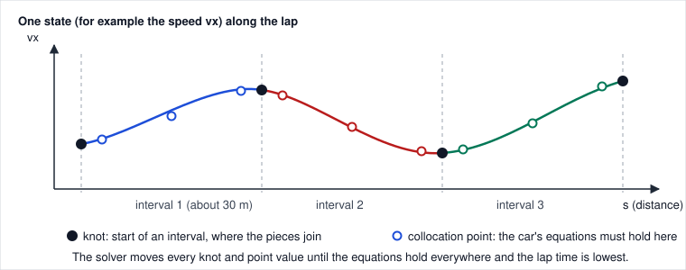

# FullModelSim

FullModelSim computes the fastest possible lap of a race car on a circuit. It finds the best racing line, and the best throttle, brake and steering at every metre of the lap. It also gives the lap time, the speed trace, the tyre forces and the motion of the suspension.

The program is a Python port of a MATLAB lap-time optimiser. The built-in car is an electric race car with one motor or four, a full suspension and a Magic Formula tyre at each corner. It can also read the car files and circuit files of an external lap simulator. You can use it in two ways:

1. **Python scripts** (`MLTP.py`, `MLTP_screen.py` and others). They write `.mat` result files and Plotly HTML plots.
2. **The FullModelSim desktop app**, a PySide6 program for Windows and Linux. The packaged app runs on a computer with no Python.

This README explains how the model works, in plain words, and how to use it. The [model reference](docs/model_reference.md) gives every equation and every parameter. [`CLAUDE.md`](CLAUDE.md) describes the code for developers.

| Area | State |
|---|---|
| Lap-time solver (7-state warm start, then the full 23-state model) | working |
| Setup optimisation and setup sweeps | working |
| HSL linear solvers (MA57, MA97, MA27) with MUMPS as the fallback | working |
| Desktop app (`app/`) | working |
| Packaged app (PyInstaller, `build/app.spec`) | Linux: builds, smoke checks pass. Windows: first run in CI |
| Coin-HSL inside the packaged app | found with a stand-in library. No run with real Coin-HSL |
| Test suite (`tests/`) | all pass on Linux. Windows: first run in CI |

A run of the packaged app on a clean computer (no Python, casadi or HSL) is still the final acceptance check. [`build/README.md`](build/README.md) describes it.

## Quick start

Do these steps to get a first lap:

1. Install Git.
2. Clone the repository.
3. Open a terminal in the repository root.
4. On Linux, run `./start.sh`. On Windows, run `.\start.bat`.
5. If the script asks to install uv, type `y`.
6. Wait until the app opens.
7. In the app, click Run.

The result and the plots go to the folder `FullModelSim` in your Documents folder.

## How it works

### The question

Think of a driver who knows the car perfectly and makes no mistakes. Where does this driver brake, and how hard? How much steering does each corner need? Where does the throttle go to full? FullModelSim computes the lap of this perfect driver.

It is not a simulator in which a virtual driver follows rules. It searches all the ways to drive the lap and finds the fastest one that the car can do. Mathematicians call this an optimal control problem.



### The car in the computer



At any moment, 23 numbers describe the car. These numbers are the **states**:

- the forward speed, the sideways speed and the turning speed (yaw rate) of the car,
- the spin speed of each wheel,
- the place of the car on the track: its sideways offset and its angle to the track,
- the up-and-down motion of the body, its pitch (nose up or down) and its roll (lean to one side), each with its rate,
- the up-and-down speed of each wheel, and how much each tyre is squashed.

The driver controls the car with the **inputs**: motor torque, brake torque and steering. The default car can also split the torque freely between the four wheels (torque vectoring). With active aero, the wing angles are inputs too.

The **equations of motion** tell how the states change for given inputs. They are Newton's laws:

- The tyre forces, the air drag and the rolling resistance push the body. The body accelerates and turns.
- The motor and brake torques turn each wheel, and the tyre force at the road resists it.
- The springs and dampers connect the body to the wheels. The tyres are springs between the wheels and the road. When the car brakes, corners or meets downforce, the body pitches and rolls, and the load moves between the tyres.

[Model reference, section 3](docs/model_reference.md#3-the-car-model) gives all the equations.

### Tyres: grip comes from slip



The tyres make every force that moves the car, and a tyre makes force only when it slips a little:

- In a corner, the wheel points in a slightly different direction from the one it moves in. This angle is the **slip angle**. The tyre twists and pushes the car sideways.
- Under throttle, the tyre surface turns a little faster than the road passes under it. Under braking, it turns slower. This difference is the **slip ratio**.

The force grows with the slip, reaches a peak, and then falls a little as the tyre slides. The **Magic Formula** of Pacejka draws this curve from a set of measured coefficients. A tyre that brakes and corners at the same time shares its grip between the two directions. A tyre with more load makes more force, but less force per kilogram of load. So the car loses grip when load moves to one side or one end. The model includes all of these effects ([section 4](docs/model_reference.md#4-the-tyre-model)).

### Where the car is on the track



The model gives the place of the car with three numbers that refer to the centreline of the track. They are the distance $s$ along it, the sideways offset $n$ from it, and the angle $\varepsilon$ between the car and the track direction. The track itself enters only through its **curvature**: how sharply it turns at each point.

The model uses distance as its clock, not time. The length of the lap is known, but its time is the unknown. So every equation tells how a state changes per metre of track. The time per metre is $s_f = (1 - n\kappa) / (v_x \cos\varepsilon - v_y \sin\varepsilon)$. The lap time is the sum of $s_f$ over the lap ([section 2](docs/model_reference.md#2-the-lap-time-problem)).

### From a smooth lap to a large set of equations



A computer cannot handle a smooth curve with infinitely many points. So the program cuts the lap into short intervals, about 30 m each. In each interval, each state follows a cubic curve. The car's equations must hold at three points inside each interval, and the curves must join at the ends of the intervals. This method is **direct collocation**.

The result is one large set of equations. On the 540 m test track Sturn, it has 1812 unknowns and 1904 constraints. On Barcelona, it has about 16 000 constraints. The program builds this set with CasADi, which also computes the exact derivatives ([section 5](docs/model_reference.md#5-the-numerical-method)).

### The solver

The solver IPOPT starts from a first guess of every unknown. Then it improves the guess step by step, with Newton's method. Each step solves a large sparse linear system, and this takes about 90 % of the time. IPOPT keeps every limit by a barrier that grows near the limit, so it approaches the limits from inside. After about 100 to 300 steps, the guess obeys all the equations and the lap time cannot fall any further. A solve takes about 15 s on Sturn and 2 to 5 minutes at Barcelona.

The problem has more than one solution: IPOPT finds a **local optimum**. Two solves from different first guesses can end 0.01 s apart at the default setup, and further apart for other setups. So compare two setups from one common starting point (see below).

### Good first guesses

A good first guess saves time and gives a better solution:

- **Cold start.** The program first solves a simple 7-state model of the car, without suspension. Its lap is the first guess of the full model.
- **Warm start.** The program starts from a stored lap. After a small setup change, such as 3 % more mass, the solve needs about 10 steps instead of several hundred. A stored lap of the same problem also gives its multipliers to the solver.
- **Continue from the default.** `continue_from='auto'` starts a setup change from the stored lap of the default setup.

### The quick estimate

The program also has a quick estimate (the QSS screen) that takes a few milliseconds. It treats the car as a point on the centreline. It computes the highest speed that the tyres allow in each corner. Then it accelerates and brakes as hard as the tyres and the motor allow between the corners. The estimate is 4 % to 11 % slower than the optimum, because it uses the centreline and has no transients. It is fast enough to rank thousands of setups, and the full solve then checks the best ones ([section 6](docs/model_reference.md#6-the-fast-lap-estimate)).

### Two physics modes

The default mode, `physics='matlab'`, keeps the equations of the MATLAB original term for term, with six known errors. For example, it uses the sprung mass in place of the total mass, and its dampers have about 200 times the critical damping. The mode `physics='corrected'` is free of the six errors. The corrected car is about 11 % slower. Use the corrected mode for physics studies. The default mode stays the default because the comparison tests against MATLAB need it ([section 3.13](docs/model_reference.md#313-original-model-behaviour-in-the-default-mode)).

### What a result tells you

A result gives the lap time, the racing line and the speed trace. It also gives every state and input along the lap, the forces at each tyre and the energy of the motor. It also gives the **price** of each limit: how much lap time one more unit of a limit would save. For example, one more metre of track width on each side saves 0.20 s on Sturn and 1.86 s at Barcelona. These prices come free from the solver ([section 8.3](docs/model_reference.md#83-prices-and-gradients)).

### What the model leaves out

Each item has the reason that would make it worth adding.

- 3D road (grade, bank, vertical curvature): before a drag or braking comparison on NBR or Spa, when usable altitude data exists.
- Ride-height aero map for the built-in car: when ride-height or damper data exists.
- Full-model g-g-v envelope by trim: together with a QSS estimate that has a free racing line.
- Regularisation that does not depend on the mesh: when refinement studies compare objectives across meshes.
- Seven-post rig and bump-grip derating: when road-profile data exists.
- Driver model, tyre temperature, wear and relaxation length: a thermal state when data shows a grip drift that load and slip cannot explain.
- Side-force roll moment of the tilted rear wing: when a run tilts that wing.
- Passive limited-slip differential: when the car has one, and TBR 2 costs 1 % or more against ideal torque vectoring. The measured cost is 0.15 % (Sturn) and 0.17 % (Barcelona).
- Grip against load for each axle: when wheel-load channels exist.
- Full Magic Formula 6.1 equations and a left-right tyre mirror: with the first real tyre file.
- Damper rate that includes the anti-roll bar: when a bar above 30 000 N/m runs with `physics='corrected'`.
- Curvature sampled along a consistent heading: when a circuit of the track builder needs it.
- A tracking objective inside the solve, which follows a logged lap: when a real log and its projection on the track exist.

## Using it

### Install

#### Requirements

- Git.
- Python 3.10 or later, or [uv](https://docs.astral.sh/uv/).
- Windows x64, or Linux x64 with glibc 2.34 or later (Ubuntu 22.04 or later).

The repository holds `Data/DATA_AA.mat` (the aero coefficients). A solve needs this file.

Run every command from the repository root. All paths are relative (`Circuits/`, `Data/`, `Results/`, `Plots/`).

#### One-command setup

Run the setup script:

```
./start.sh          # Linux. The command "sh start.sh" also works.
.\start.bat         # Windows, in PowerShell or in cmd
```

The script does these steps:

1. If uv is missing, it asks to install uv. Then it installs uv.
2. It creates `.venv` from `uv.lock`. If the computer does not have Python 3.13, uv downloads it.
3. It checks the Qt system libraries (Linux) and `Data/DATA_AA.mat`.
4. It reports the optional parts: Coin-HSL, the folder of an external lap simulator and a C compiler. A missing optional part does not stop the setup.
5. It builds the model and computes one QSS lap.
6. It runs the quick tests.
7. It opens the app.

The script has these flags:

- `--yes`: the script asks no questions.
- `--no-gui`: the script does not open the app.
- `--no-tests`: the script does not run the quick tests.

#### Manual setup

Run these commands:

```
uv sync                                     # create .venv from uv.lock
uv run fullmodelsim                         # start the app
uv run python tests/run_tests.py --quick    # run the quick tests
```

If your `.venv` is older than the change to PySide6-Essentials, `uv sync` can delete Qt files. In that case, run `uv sync --reinstall-package pyside6-essentials`, or delete `.venv` and run the setup again.

`requirements.txt` is for pip users. uv makes it from `uv.lock`, so do not edit it. To change a dependency, do these steps:

1. Edit `pyproject.toml`.
2. Run `uv lock`.
3. Run `uv export --no-dev --no-hashes --no-emit-project -o requirements.txt`.

#### Download the app

The release workflow attaches `FullModelSim-<tag>-windows.zip` and `FullModelSim-<tag>-linux.tar.gz` to the GitHub Release of each `v*` tag. To use a download, do these steps:

1. Extract the archive.
2. On Windows, start `FullModelSim.exe`. On Linux, start `FullModelSim`.

The Linux app needs glibc 2.35 or later and the system libraries libGL, libEGL and libxcb. The downloads use MUMPS and hold no vendor data. [`build/README.md`](build/README.md) gives the release steps.

### Run a solve from Python

The scripts have **no command-line arguments**. Their `__main__` block calls the function with constant arguments (`circuit='Sturn'`, `vi=60.0`). To change the circuit or the options, edit that call, or import the function and give keyword arguments.

Run a script:

```
uv run python MLTP.py             # full 23-state solve
uv run python MLTP_initial.py     # 7-state solve (the first guess)
uv run python MLTP_screen.py      # QSS lap estimate (no solver)
```

Give keyword arguments:

```
# another circuit and configuration
uv run python -c "from MLTP import MLTP; MLTP(circuit='BCN', AeroConfig='Static', ATD='On', Electric_4Motors='Off', TyreModel='CombinedSlip')"

# the corrected physics
uv run python -c "from MLTP import MLTP; MLTP(circuit='Sturn', physics='corrected')"

# setup parameters, optimised together with the racing line
uv run python -c "from MLTP_paramOptim import MLTP_paramOptim; MLTP_paramOptim(circuit='Sturn')"

# one setup change, started from the stored default result
uv run python -c "from MLTP import MLTP; MLTP(circuit='Sturn', continue_from='auto', vp_overrides={'LMUY': 0.95})"

# QSS lap estimate of a setup change
uv run python -c "from MLTP_screen import MLTP_screen; MLTP_screen(circuit='BCN', vp_overrides={'LMUY': 0.95})"
```

`MLTP()` writes `Results/<name>.mat` and the plots in `Plots/<circuit>/`. `MLTP_screen()` gives the QSS estimate in about 1 s and writes `Results/<name>_qss.mat`.

`continue_from='auto'` starts a setup change from the stored default result of the same circuit and configuration, with its multipliers. It stops with a `ValueError` before the solve in these cases:

- The default result is missing.
- The default result holds setup changes.
- The default result did not converge.
- The default result does not fit the new problem.

So solve the default setup first. A cold solve of a changed setup can end on a slower local optimum. On Sturn, a 3 % mass step continued from the default in 15 iterations. Its cold solve took 500 iterations, and its lap was 1.007 s slower.

**Circuits.** The real circuits are `.mat` files in `Circuits/`: `BCN` (Barcelona), its sectors `BCN_S1`, `BCN_S2` and `BCN_S3`, `Jarama`, `Spa` and `NBR` (Nurburgring GP). Each real circuit goes through a check when it loads. An error stops the load with a `ValueError`, and a smaller issue gives one warning. The synthetic tracks `Straight`, `Hairpin`, `Sturn`, `Circle`, `ZigZag`, `ZigZagMirror` and `VirtualTrack` need no file: a formula gives their curvature. [Section 9.9](docs/model_reference.md#99-circuits) tells how to make a new circuit file from GPS data.

### Change the car

Every vehicle parameter and every tyre coefficient has a name (see "Parameter overview" below). Give the changes in `vp_overrides`:

```
uv run python -c "from MLTP import MLTP; MLTP(circuit='Sturn', vp_overrides={'mb': 1750.0, 'k_arb_f': 20000.0, 'LMUY': 0.95})"
```

An unknown name stops the program with a `ValueError`. A changed value adds a short code to the result name, so the default result is never overwritten. In the app, the Setup tab holds the same parameters.

### External cars and circuits

The program can read the car files (`.car`) and circuit files of an external lap simulator. The repository holds no such files. To use them, do these steps:

1. Set the environment variable `EXT_SIM_DIR` to the install folder of the external program, or give the keyword `ext_dir`.
2. For an external circuit, give `circuit='ext:<name>'`. The name is the circuit name in the circuit list of the external program.
3. For an external car, give `car='ext:<path of the .car file>'` and `physics='corrected'`.

For example:

```
uv run python -c "from MLTP import MLTP; MLTP(circuit='ext:<name>', car='ext:<path>.car', physics='corrected', n_bounds=(-0.05, 0.05))"
```

`n_bounds=(-0.05, 0.05)` holds the car within 5 cm of the circuit line, for a comparison with the external lap. Without it, the solver finds its own racing line. An external car on an external circuit starts with a flying lap by default, when the curvature of the circuit joins at the line. An external car refuses the options that it cannot use, for example `start_state='rolling'`. The same keywords work for `MLTP_screen()`. [Section 10](docs/model_reference.md#10-external-cars-and-circuits) describes the car model and every record that it reads.

### The desktop app

Start the app:

```
uv run fullmodelsim
```

The app writes a JSON file of the options and starts the solve as a separate process. It shows the IPOPT log and lists the plots. To run a solve in the app, do these steps:

1. On the Main tab, select the circuit and the configuration.
2. Click Run.
3. When the solve ends, read the lap time in the summary. The Output tab lists the plots.

The app writes the results and the plots to the output folder of the Output tab. The default is the folder `FullModelSim` in your Documents folder, on Windows and on Linux. When you click Run, the app saves the folder for the next start.

**External cars and circuits.** To run an external car or circuit in the app, do these steps:

1. On the Advanced tab, set the folder of the external program. Or set the environment variable `EXT_SIM_DIR`.
2. On the Main tab, select an external circuit, or keep a built-in circuit.
3. Select a car in the Car list. Or click Browse, or use Load preset with a `.car` file.
4. Click Run.

A car sets Physics to `corrected` and locks it. It also locks the controls that a car cannot use: Aero, 4 Motors, ATD, Homotopy, the rolling start, the tyre model and the tyre set. The built-in car restores them. The Car list shows the `.car` files of the external folder, of the `Models` folder beside it and of `<Documents>/FullModelSim/presets/cars`.

**Edit a car.** With a car selected, the Setup tab shows the values of its `.car` file. The values keep the units of the file, for example N/m, m, mm and rpm. Edit a value and click Run. The app writes the edited car to `<Documents>/FullModelSim/presets/cars/<name>_<code>.car` and solves it. The source file does not change. To keep the edits, click Save preset: the app writes a new `.car` file. It never writes over a file or into the external folder. The editor does not show tables, curves and maps. A row that the solve does not read has a tooltip that says so.

**Powertrain group.** For the built-in car, the Setup tab has the group `Powertrain (physics corrected)`. It holds the gear ratio, the torque and power of one motor (`Tmax`, `Pmax`), the regeneration power `Preg` and the pack power limit `Ppack`. `Preg` and `Ppack` each have a check box. With `Preg` off, the motor does not regenerate. With `Ppack` off, the pack has no power limit. The group is active only when Physics is `corrected`. The app sends only the values that you change.

The Advanced tab has the group "Run, model and start":

- Run: `nlp` (the solve) or `qss` (the QSS estimate in about 1 s, with no plots).
- Physics: `matlab` (default) or `corrected`.
- Start state: `auto` (default), `matlab`, `rolling` or `periodic`. With `auto`, an external car on an external circuit starts with a flying lap when the curvature joins at the line. Every other run uses `matlab`.
- Homotopy: three solves with the tyre friction scaled by 1.2, 1.1 and 1.0. When you select 4 Motors, the app ticks this box.
- More options (JSON): a JSON object with the keys `n_bounds`, `ladder`, `ipopt_overrides`, `Steering`, `CamberGain`, `pt_overrides`, `between_knots`, `collocation`, `state_scaling`, `atd_tbr` and `continue_from`.

The Advanced tab also has the Coin-HSL folder field (see the next section). The Output tab finds the result file with the same name rule as the solve.

### Linear solver (HSL or MUMPS)

IPOPT ships inside the CasADi package. The solve uses HSL `ma57` by default, with automatic scaling, so that it converges on the stiff 23-state problem. MA57 is about 4 to 5 times faster per iteration than MUMPS. HSL solvers need a **Coin-HSL** library. The MinGW/`libgfortran5` build of `CoinHSL_jll` matches the CasADi package:

- On Windows, use the `bin/` folder of the MinGW build (`libhsl.dll`).
- On Linux, use the `lib/` folder of the `x86_64-linux-gnu-libgfortran5` build (`libhsl.so`).

The solve uses the first folder of this list that exists:

1. The `COINHSL_DIR` environment variable.
2. The Coin-HSL folder of the app (Advanced tab), or the `hsl_dir` keyword.
3. In a packaged app, the `hsl` folder of the bundle.

If no Coin-HSL library works, the solve uses MUMPS, which needs no extra library, and gives a warning. A missing library never stops a solve. To select the solver for one call, give `linear_solver`, for example `MLTP(circuit='BCN', linear_solver='ma97')` or `'mumps'`. To compare the solvers, run:

```
uv run python bench_linear_solver.py
```

## Parameter overview

The tables list every vehicle parameter, and the options of `userOpts`, `MLTP`, `MLTP_initial` and `MLTP_screen`. "Effect" gives a measured effect on the lap where one exists. A price is the first-order change of the lap objective per unit, on Sturn (18.016 s) and Barcelona (116.444 s), from the stored default results. The [model reference](docs/model_reference.md#9-parameter-and-option-reference) gives the units, the equations and more detail.

### Vehicle

| Parameter | Default | What it changes in the car | Effect |
|---|---|---|---|
| `mb` | 1820 kg | body mass. The car weighs 2085 kg with the driver and the wheels. | +2.8e-3 s/kg (Sturn, solve of a 3 % step) |
| `md` | 75 kg | driver mass, part of the sprung mass | as `mb` |
| `muf` | 90 kg | mass of the front wheels, brakes and hubs (unsprung) | - |
| `mur` | 100 kg | mass of the rear wheels, brakes and hubs (unsprung) | - |
| `I_z` | 1960 kg m² | resistance to yaw (turning) | - |
| `I_y` | 1600 kg m² | resistance to pitch | - |
| `I_x` | 1000 kg m² | resistance to roll | - |
| `l` | 3.0 m | wheelbase | - |
| `wB` | 0.5 | position of the CG along the wheelbase (the front weight share) | - |
| `t` | 1.8 m | track width | - |
| `hcg` | 0.5 m | height of the CG: more height, more load transfer | - |
| `hRCf` | 0.07 m | front roll-centre height: the part of the front load transfer in a corner that goes through the links, not the springs | - |
| `hRCr` | 0.11 m | rear roll-centre height: the same at the rear | - |
| `hw` | 1.28 m | height of the rear wing, where its drag pitches the car (corrected physics) | - |
| `A` | 1.95 m² | frontal area for drag and downforce | - |
| `huf` | 0.297 m | front unsprung CG height. No model reads it. | none |
| `hur` | 0.297 m | rear unsprung CG height. No model reads it. | none |
| `hride` | 0.117 m | static ride height. No model reads it. | none |
| `Rw` | 0.355 m | wheel radius | - |
| `Jw` | 3.6 kg m² | spin inertia of one wheel | - |
| `f` | 0.01 | rolling resistance | - |
| `kt` | 300 000 N/m | vertical stiffness of a tyre | - |
| `Fz0` | 4905 N | nominal tyre load of the Magic Formula | - |
| `Fz0_shift` | 1.0 | load scale into the tyre forces (the tyre optimisation changes it) | - |
| `k_fl` | 75 000 N/m | front left spring rate | - |
| `k_fr` | 75 000 N/m | front right spring rate | - |
| `k_rl` | 80 000 N/m | rear left spring rate | - |
| `k_rr` | 80 000 N/m | rear right spring rate | - |
| `zeta_fl` | 0.7 | damping ratio, front left | - |
| `zeta_fr` | 0.7 | damping ratio, front right | - |
| `zeta_rl` | 0.7 | damping ratio, rear left | - |
| `zeta_rr` | 0.7 | damping ratio, rear right | - |
| `k_arb_f` | 0 N/m | front anti-roll bar: more roll stiffness at the front | -5.96e-8 s per N/m (Sturn) |
| `k_arb_r` | 0 N/m | rear anti-roll bar: more roll stiffness at the rear | +1.12e-8 s per N/m (Sturn) |
| `ksD` | 0.462 | roll stiffness share of the MATLAB original. No model reads it. | none |
| `gamma_fl` | 0 deg | static camber of the front wheels (the right wheel mirrors the left) | - |
| `gamma_rl` | 0 deg | static camber of the rear wheels (the right wheel mirrors the left) | - |
| `toe_front` | 0 deg | front toe | - |
| `toe_rear` | 0 deg | rear toe | - |
| `Tbrake_max` | 4000 N m | brake torque limit. The total at the wheels is twice this value. | -1.40e-4 / -3.73e-4 s per N m |
| `brkB` | 0.6766 | front brake share. No effect with torque vectoring on. | 0 with ATD on |
| `Tdist` | 0.7281 | rear drive share. No effect with torque vectoring on. | 0 with ATD on |
| `alpha_FL` | 10 deg | front left wing angle | -4.60e-4 s/deg (Sturn) |
| `alpha_FR` | 10 deg | front right wing angle | -4.53e-4 s/deg (Sturn) |
| `alpha_RW` | 8 deg | rear wing angle: more downforce and more drag | +1.90e-4 s/deg (Sturn) |
| `alpha_TW` | 0 deg | rear wing tilt: a left-right downforce difference | -7.01e-5 s/deg (Sturn) |
| `Cd_scale` | 1.0 | scales the drag | +0.045 / +0.99 s per unit |
| `Cl_scale` | 1.0 | scales the downforce | -0.032 / -0.66 s per unit |
| `Cd` | 0.75 | placeholder. The aero file replaces it, and only the 7-state model reads it. | none |
| `Cl` | 1.45 | placeholder. The aero file replaces it, and only the 7-state model reads it. | none |
| `rho` | 1.204 kg/m³ | air density | - |
| `g` | 9.81 m/s² | gravity | - |
| `eps_x` | 1e-6 | prevents a division by zero in the longitudinal tyre force | none |
| `eps_y` | 1e-6 | prevents a division by zero in the lateral tyre force | none |
| `eps_K` | 1e-6 | prevents a division by zero in the camber shift of the tyre | none |

### Powertrain

| Parameter | Default | What it changes in the car | Effect |
|---|---|---|---|
| `Pmax` | 456 kW | rated power of one motor | -4.78e-7 / -1.30e-5 s per W |
| `Tmax` | 602 N m | rated torque of one motor | -3.39e-3 / -6.71e-3 s per N m |
| `OMmax` | 17 750 rpm | top motor speed | - |
| `Vmax` | 290 km/h | top car speed | - |
| `eff` | 0.9 | motor efficiency, for the energy only | none |
| `gear` | 7.252 | final drive ratio (`vp_overrides`, corrected physics) | - |
| `Preg` | off | regeneration power per motor (corrected physics) | 50 kW: -0.23 % (Sturn) |
| `Ppack` | off | limit on the sum of the motor powers (corrected physics) | 456 kW: +4.9 % / +4.1 % (QSS estimate, four motors) |

### Tyre coefficients

The default tyre set is `'MF205'`. The groups hold the Magic Formula 5.2 coefficients, the Magic Formula 6.1 pressure terms and the scale factors. The [model reference, section 4.11](docs/model_reference.md#411-coefficient-table) lists every value.

| Group | Keys | What it changes in the tyre | Effect |
|---|---|---|---|
| Longitudinal peak | `pDx1` to `pDx3` | peak grip under drive and braking, and its fall with load. The model does not read `pDx3`. | - |
| Longitudinal shape | `pCx1`, `pEx1` to `pEx4` | shape of the force curve near and after the peak | - |
| Longitudinal stiffness | `pKx1` to `pKx3` | force per unit of slip ratio at small slip | - |
| Longitudinal shifts | `pHx1`, `pHx2`, `pVx1`, `pVx2` | small offsets of the curve | - |
| Lateral peak | `pDy1` to `pDy3` | peak cornering grip, its fall with load and with camber | - |
| Lateral shape | `pCy1`, `pEy1` to `pEy5` | shape of the cornering curve | - |
| Cornering stiffness | `pKy1` to `pKy5` | side force per unit of slip angle at small slip | - |
| Camber force | `pKy6`, `pKy7`, `pVy3`, `pVy4` | side force from camber | - |
| Lateral shifts | `pHy1`, `pHy2`, `pVy1`, `pVy2` | small offsets of the cornering curve | - |
| Combined slip | `rBx1` to `rBx3`, `rCx1`, `rEx1`, `rEx2`, `rHx1`, `rBy1` to `rBy4`, `rCy1`, `rEy1`, `rEy2`, `rHy1`, `rHy2`, `rVy1` to `rVy6` | how braking or drive takes away cornering grip, and the reverse | - |
| Scale factors | `LMUX`, `LMUY`, `LFZO`, `LKX`, `LKY` | peak grip (`LMUX`, `LMUY`), nominal load (`LFZO`), slip stiffness (`LKX`, `LKY`) | `LMUY` -3.29 / -26.7 s per unit. `LMUX` = `LMUY` = 0.95: +1.24 % (Sturn) |
| Pressure | `ppx1` to `ppx4`, `ppy1` to `ppy5`, `NOMPRES`, `INFLPRES` | change of grip and stiffness with the inflation pressure | none at the defaults |

### Run options

| Option | Default | What it changes | Effect |
|---|---|---|---|
| `circuit` | `'Sturn'` (`MLTP`) | the track | - |
| `vi` | 60 m/s | start speed | -0.0114 / -0.0700 s per m/s |
| `ni` | free | start offset from the centreline | - |
| `AeroConfig` | `'Static'` | wing angles as inputs: `'Active_RW'`, `'Active'`, `'AALB'` | `'AALB'`: -0.39 s at Barcelona |
| `ATD` | `'On'` | torque vectoring over the four wheels | `'Off'`: +2.06 % / +2.95 % |
| `Electric_4Motors` | `'Off'` | one motor at each wheel | - |
| `physics` | `'matlab'` | the MATLAB equations, or `'corrected'` physics | `'corrected'`: +11.1 % / +11.7 % |
| `tyre_set` | `'MF205'` | tyre coefficients: `'MF205'`, the legacy `'CopyB'`, or `'file:<path>.tir'` | `'CopyB'`: Sturn 25.57 s (before the constraint change of 2026-10-04) |
| `vp_overrides` | none | changes of the parameters above | - |
| `TyreModel` | `'CombinedSlip'` | combined slip, or `'PureSlip'` with friction circles | - |
| `Steering` | `'NA'` | both front wheels steer equally, or `'Ackermann'` | - |
| `CamberGain` | `'Off'` | camber change with body motion: `'Linear'` or `'Table'` | - |
| `start_state` | `None` (auto) | the start of the lap: `'matlab'`, `'rolling'` or `'periodic'` (flying lap) | `'rolling'`: +0.045 / +0.285 s |
| `n_bounds` | ±4 m | track width for the centre of gravity | -0.2025 / -1.861 s per m |
| `atd_tbr` | none | limits the left-right torque split (torque bias ratio) | TBR 2: +0.15 % / +0.17 % |
| `OPT_ds` | 30 m | length of the intervals | Barcelona +0.20 %, NBR -0.04 % against a fine reference |
| `OPT_d` | 3 | degree of the polynomial in each interval | - |
| `OPT_e` | 0.01 | half-width of the start box (scaled) | - |
| `mesh` | `'auto'` | knot placement: `'uniform'`, `'curvature'` | curvature: 1.7 times faster at Barcelona (older tyre proxy, before the constraint change) |
| `mesh_opts` | none | settings of the curvature mesh | - |
| `between_knots` | `'matlab'` | inputs between the knots: `'linear'`, `'linear+power'` | `'linear+power'`: +0.20 % / +0.029 % |
| `collocation` | `'legendre'` | collocation points, or `'radau'` | Radau: -0.146 % (Sturn) |
| `state_scaling` | `'matlab'` | scales of the body states, or `'typical'` | - |
| `warm_start` | none | first guess from a stored result | about 10 iterations in place of hundreds |
| `warm_start_duals` | True | also use the multipliers of the warm start | - |
| `continue_from` | none | `'auto'`: first guess from the stored default result | - |
| `ladder` | `'auto'` | cold-start chain: `'qss7'`, `'qss23'` | - |
| `homotopy` | none | three solves with scaled friction, for hard cases | - |
| `refine` | none | adaptive mesh refinement | - |
| `max_iter` | 6000 | IPOPT iteration limit | - |
| `tol` | 1e-4 | IPOPT tolerance | - |
| `screening` | False | looser IPOPT tolerances, for ranking | - |
| `ipopt_overrides` | none | any IPOPT option | - |
| `linear_solver` | `'ma57'` | `'ma97'`, `'ma27'`, `'mumps'` | - |
| `hsl_dir` | none | Coin-HSL folder | - |
| `cse` | False | CasADi common-subexpression option | about 1 % |
| `jit` | False | CasADi just-in-time compiling (needs a C compiler) | a few per cent at most |
| `car` | built-in car | `'ext:<path>.car'`: an external car | - |
| `ext_dir` | none | install folder of the external program | - |
| `seed` (`MLTP_initial`) | `'const'` | first guess of the 7-state model: constants, or `'qss'` for the QSS speed profile | - |
| `load_model` (`MLTP_screen`) | `'vehModel'` | loads of the QSS estimate, or `'nominal'` | - |
| `ds_fine` (`MLTP_screen`) | 1 m | step of the QSS estimate | - |
| `verbose` (`MLTP_screen`) | True | print the summary of the estimate | - |
| `save` | True | write the result file | - |
| `plot` | True | write the plots | - |
| `results_dir` | `Results` | folder of the result files | - |
| `plots_dir` | `Plots` | folder of the plots | - |
| `circuits_dir` | `Circuits` | folder of the circuit files | - |
| `data_dir` | `Data` | folder of the aero file | - |

The model reference ([section 9.7](docs/model_reference.md#97-script-arguments)) gives the arguments of the sweep and optimisation functions.

## Outputs

A solve writes `Results/<name>.mat`. The default setup keeps the name `<circuit>_<AeroConfig>_ATD<On|Off>_EM4<On|Off>`, for example `Results/Sturn_Static_ATDOn_EM4Off.mat`. A choice other than the default adds a part to the name, in this order:

1. `_<tyre set>`: for example `_CopyB`, or `_tir_<name>` for a tyre file.
2. `_car_<name>` for an external car.
3. `_physCorrected` for `physics='corrected'`.
4. `_startRolling` or `_startPeriodic` for another start.
5. `_hw<W>` or `_nbCustom` for a track width (`n_bounds`).
6. `_mesh<Mesh>` for a mesh other than `'auto'`.
7. `_<8 hex digits>` for any other setup change, such as `vp_overrides`, `vi` or `OPT_ds`.

The 8 hex digits are the start of a SHA-256 hash of the setup changes, so a changed run never overwrites the default result. After a solve, `ctx.out_path` holds the name of the file. Some inputs do not count as setup changes, so two runs that differ only in them share one file name. For example:

- `ipopt_overrides`,
- the parameters that `MLTP_paramOptim` and `MLTP_TyreOptim` optimise,
- the `refine` settings (every refined result gets `_meshAdaptive`).

A result file holds:

- the lap time, and the time at every point of the lap,
- every state and input at every point,
- the output channels: speeds, accelerations, steer angle, tyre forces and loads, slip, strut travel, motor power and energy,
- the track, the racing line and the track edges,
- the solver data: solution, multipliers, iterations, status,
- the provenance: the code version, the setup changes, the run options and every parameter value.

Other outputs:

- `Results/<name>_qss.mat`: the QSS estimate.
- `Plots/<circuit>/<rest of the name>/*.html`: Plotly pages of the racing line, speed, tyre forces, friction circle, suspension, powertrain, inputs and g-g diagrams.
- `functions/telemetry.py`: export a result as a CSV file or a 50 Hz text file. The module also reads logs and plots a log lap against a solved lap.
- `functions/sensitivity.py`: the price of each limit, and the gradient of the lap with respect to most parameters, without a new solve.

## For developers

### Tests

There is no pytest. The files `tests/test_*.py` are plain scripts. Their asserts run at module top level, so the smallest unit that you can run is a whole file. Every test starts with `import _bootstrap` (`tests/_bootstrap.py`). That module puts the repository root first on `sys.path` and makes it the working directory. So a test runs from any folder, and it writes its scratch files to a temporary folder.

Run the tests:

```
uv run python tests/test_foundation.py        # one file
uv run python tests/run_tests.py --quick      # every file but the four that iterate IPOPT on a vehicle NLP
uv run python tests/run_tests.py --all        # every file
```

`CLAUDE.md` lists each file and what it needs (casadi, `Data/DATA_AA.mat`, PySide6). Only `test_setup_sweep.py` (about a minute), `test_paramoptim_warmstart.py` and `test_ladder.py` (both limited to 5 iterations) solve the real 23-state problem with IPOPT. `test_refine.py` runs one small real solve. The `--quick` run skips these four files.

To check the symbolic model, run:

```
uv run python -c "from functions.context import Ctx; from Powertrain import Powertrain; from vehParams import vehParams; from userOpts import userOpts; from vehModel import vehModel; ctx=Ctx(); Powertrain(ctx); vehParams(ctx); userOpts(ctx); vehModel(ctx); print(ctx.m23.nx, ctx.m23.nu)"
```

### Build the packaged app

To build the app, do these steps:

1. If you want MA57 or MA97 in the app, set `COINHSL_DIR` to the Coin-HSL folder.
2. Run `uv run pyinstaller build/app.spec`.

The output is `dist\FullModelSim\FullModelSim.exe` on Windows and `dist/FullModelSim/FullModelSim` on Linux (one folder). The program starts the app. To solve and exit with no window, run `FullModelSim --headless cfg.json`. The Run button of the app starts this command. The Windows build has no console window. For a debug build with a console, set `FMS_CONSOLE=1` at build time. [`build/README.md`](build/README.md) gives the build notes and the release steps.

### Project layout

```
MLTP.py, MLTP_initial.py                  # the full solve and the 7-state first-guess solve
MLTP_screen.py                            # QSS lap estimate
MLTP_paramOptim.py, MLTP_TyreOptim.py     # setup optimisation with the lap
setup_sweep.py                            # setup sweeps (QSS estimate, then NLP checks)
vehModel.py, vehModel_initial.py          # 23-state and 7-state car models
vehModel_cs.py                            # model of an external car file
vehParams.py, Powertrain.py, userOpts.py  # parameters, motor ratings, run options
plotSDI.py, gg_plots.py                   # plots
bench_linear_solver.py                    # linear solver benchmark
headless_solve.py                         # JSON options -> solve (used by the app)
start.py, start.sh, start.bat             # one-command setup
pyproject.toml, uv.lock                   # dependencies (requirements.txt is made from uv.lock)

functions/      # collocation, transcription, mesh, warm starts, QSS estimate, tyre files,
                #   track tools, sensitivity, telemetry, external file readers
app/            # PySide6 app
build/          # PyInstaller spec, runtime hook, version info, build notes
tests/          # plain-script tests: test_*.py, _bootstrap.py, run_tests.py
docs/           # model reference, figures, studies and plans
.github/workflows/  # CI: tests.yml (pushes, pull requests), release.yml (v* tags)

Circuits/   Data/DATA_AA.mat    # inputs: circuit files, aero coefficients
Results/    Plots/              # outputs: result files, plots
```

[`docs/model_reference.md`](docs/model_reference.md) gives the equations and every parameter. [`CLAUDE.md`](CLAUDE.md) describes the code structure, the conventions and the traps for developers.
