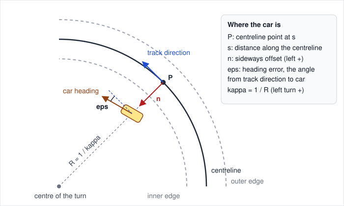
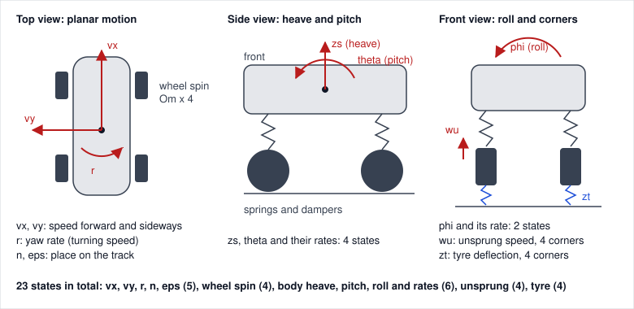
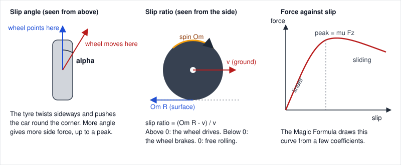
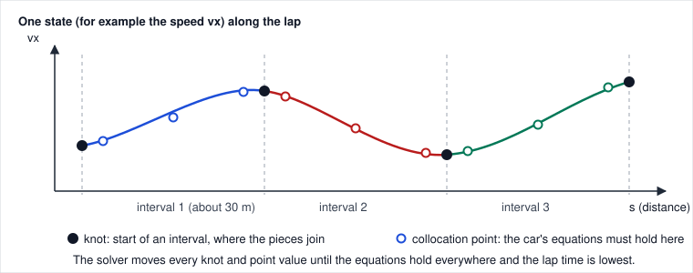

# FullModelSim model reference

This document gives the mathematics of FullModelSim in full. It lists every vehicle parameter and every run option. For each one, it tells what the parameter changes in the car and which equation it enters. The [README](../README.md) explains the same ideas in plain words.

Section 9 is the parameter list. Sections 2 to 8 give the equations that the parameters enter. Section 10 describes the model of external car files.

## Contents

1. [Conventions](#1-conventions)
2. [The lap-time problem](#2-the-lap-time-problem)
3. [The car model](#3-the-car-model)
4. [The tyre model](#4-the-tyre-model)
5. [The numerical method](#5-the-numerical-method)
6. [The fast lap estimate](#6-the-fast-lap-estimate)
7. [The warm-start model](#7-the-warm-start-model)
8. [Design optimisation and sensitivities](#8-design-optimisation-and-sensitivities)
9. [Parameter and option reference](#9-parameter-and-option-reference)
10. [External cars and circuits](#10-external-cars-and-circuits)
11. [Result files](#11-result-files)

## 1. Conventions

### 1.1 Units, axes and names

- The model uses SI units. This document names the exceptions where they occur. For example, the parameter set stores wing angles, camber and toe in degrees.
- Body axes: x points forward, y points to the left, z points up. A positive yaw rate turns the car to the left.
- The wheel order is front left (fl), front right (fr), rear left (rl), rear right (rr). The index $i$ runs over the four wheels.
- A name in `code font` is the name in the code or in a call. A symbol in math font is the name in an equation. Table 1.4 links the two.

### 1.2 Two physics modes

The Python model is a port of a MATLAB model. The default mode, `physics='matlab'`, reproduces the MATLAB equations term for term. These equations contain six known errors. The mode `physics='corrected'` removes the errors. Section 3.13 lists the six items, A1 to A6. Where the two modes differ, this document gives both forms. The labels are **Default** and **Corrected**.

The corrected mode makes the car slower. The lap time increases by 11.1 % on the Sturn test track and by 11.7 % at Barcelona (NLP solves). The default mode stays the default because the comparison tests against the MATLAB original need it.

### 1.3 Scaled variables

The solver does not work with physical values. Each state $x_j$ and each input $u_j$ has a constant scale, $\bar x_j$ or $\bar u_j$ (code `x_s` and `u_s`). The solver variable is the ratio $x_{n,j} = x_j / \bar x_j$. The scales bring rows 0 to 8 near 1. Rows 9 to 22 have the scale 1 by default (section 5.6), and the steer input is an exception (section 3.2). The equations compute the physical values inside. At the end, they divide each derivative by its scale. Tables 3.1 and 3.2 give the scales.

### 1.4 Symbols

| Symbol | Code | Meaning | Unit |
|---|---|---|---|
| $s$ | `s` | distance along the track centreline | m |
| $n$ | `n` | lateral offset of the centre of gravity (CG) from the centreline, left positive | m |
| $\varepsilon$ | `eps` | heading error: the angle from the track direction to the body x axis | rad |
| $\kappa$ | `kappa`, `k` | curvature of the centreline, positive in a left turn | 1/m |
| $s_f$ | `sf` | time per metre of track, $dt/ds$ | s/m |
| $v_x$, $v_y$ | `vx`, `vy` | velocity of the CG in body axes | m/s |
| $r$ | `r` | yaw rate | rad/s |
| $\Omega_i$ | `Om_fl` to `Om_rr` | wheel spin speed | rad/s |
| $z_s$, $\theta$, $\phi$ | `zs`, `theta`, `phi` | body heave (up positive), pitch (nose down positive), roll (left side up positive) | m, rad, rad |
| $w_{u,i}$ | `wu_fl` to `wu_rr` | vertical speed of a wheel, up positive | m/s |
| $z_{t,i}$ | `zt_fl` to `zt_rr` | tyre deflection, compression positive | m |
| $x_{s,i}$ | `xs_fl` to `xs_rr` | strut travel from the static position, bump positive | m |
| $\delta$ | `delta` | steer angle of the front wheels | rad |
| $\alpha_i$ | `sa_fl` to `sa_rr` | tyre slip angle | rad |
| $\lambda_i$ | `sx_fl` to `sx_rr` | tyre slip ratio | - |
| $\gamma_i$ | `dynamic_camber_*` | camber angle | rad |
| $F_{x,i}$, $F_{y,i}$ | `fx_fl`, `fy_fl` | tyre forces in the wheel frame | N |
| $F^g_{x,i}$, $F^g_{y,i}$ | `fxg_fl`, `fyg_fl` | tyre forces in body axes | N |
| $F_{z,i}$ | `fz_fl` | vertical tyre load | N |
| $F_{s,i}$ | `fzs_fl` | strut force on the body, up positive | N |
| $F_{j,i}$ | `fj_fl` | jacking force through the roll centre | N |
| $F_{\mathrm{down},i}$ | `f_lift_fl` | aerodynamic downforce at a corner, down positive | N |
| $T_i$ | `T_fl` | drive torque plus brake torque at a wheel | N m |
| $m$, $m_s$ | `m`, `ms` | total mass, sprung mass | kg |
| $m_{uf}$, $m_{ur}$ | `muf`, `mur` | unsprung mass of the front axle, of the rear axle | kg |
| $I_x$, $I_y$, $I_z$ | `I_x`, `I_y`, `I_z` | roll, pitch and yaw inertia | kg m² |
| $l_f$, $l_r$, $l$ | `l_f`, `l_r`, `l` | CG to front axle, CG to rear axle, wheelbase | m |
| $t$ | `t` | track width (the same on both axles) | m |
| $h_{cg}$ | `hcg` | CG height | m |
| $R_w$ | `Rw` | wheel radius | m |
| $g$ | `g` | gravity, 9.81 | m/s² |
| $\rho$, $A$ | `rho`, `A` | air density, aerodynamic reference area | kg/m³, m² |
| $q$ | - | dynamic pressure, $\tfrac12 \rho v_x^2$ | Pa |

## 2. The lap-time problem

### 2.1 What the solver computes

The solver computes the fastest way to drive one lap. At every point of the lap, it chooses the inputs. The inputs are the motor torque, the brake torque, the steer angle and the torque split between the wheels. With active aero, the wing angles are inputs too. It also computes the motion that these inputs give, as 23 states. The motion must obey the equations of motion of section 3. The car must stay inside the track and inside the limits of the motor, the brakes and the inputs. Of all the motions that obey these rules, the solver finds the one with the lowest lap time.

This is an optimal control problem. Section 5 shows how the program changes it into a finite nonlinear program (NLP). The solver IPOPT then solves the NLP.

### 2.2 Track coordinates



The model gives the position of the car with three numbers that refer to the track centreline:

- $s$ is the distance along the centreline from the start line.
- $n$ is the sideways offset of the CG from the centreline. Left is positive.
- $\varepsilon$ is the heading error, the angle from the track direction to the car's x axis.

The track enters the equations only through its curvature $\kappa(s)$. A straight has $\kappa = 0$. A left turn of radius $R$ has $\kappa = 1/R$, and a right turn of radius $R$ has $\kappa = -1/R$. The program reads $\kappa(s)$ from a circuit file, or computes it for a synthetic test track.

### 2.3 From time to distance

A circuit has a known length, but the lap time is unknown. If time were the free variable, the end time would be one more unknown. With distance as the free variable, the end point is the end of the lap, and the lap time becomes an integral to minimise. For this reason, every equation of the model uses $s$ as its free variable.

Let $\mathbf c(s)$ be the centreline, $\mathbf e_t(s)$ its unit tangent and $\mathbf e_n(s)$ the unit normal to the left. Along a plane curve,

$$
\frac{d\mathbf e_t}{ds} = \kappa\, \mathbf e_n, \qquad \frac{d\mathbf e_n}{ds} = -\kappa\, \mathbf e_t .
$$

The CG is at $\mathbf p = \mathbf c(s) + n\, \mathbf e_n(s)$. Its time derivative is

$$
\dot{\mathbf p} = \dot s\, \mathbf e_t + \dot n\, \mathbf e_n - n \kappa \dot s\, \mathbf e_t = \dot s\, (1 - n\kappa)\, \mathbf e_t + \dot n\, \mathbf e_n .
$$

In body axes the same velocity is $(v_x, v_y)$, and the body x axis is at the angle $\varepsilon$ to $\mathbf e_t$. So, in track axes,

$$
\dot{\mathbf p} = (v_x \cos\varepsilon - v_y \sin\varepsilon)\, \mathbf e_t + (v_x \sin\varepsilon + v_y \cos\varepsilon)\, \mathbf e_n .
$$

The two forms must agree, component by component:

$$
\dot s = \frac{v_x \cos\varepsilon - v_y \sin\varepsilon}{1 - n\kappa}, \qquad \dot n = v_x \sin\varepsilon + v_y \cos\varepsilon .
$$

The time per metre of track is the inverse of $\dot s$:

$$
s_f = \frac{dt}{ds} = \frac{1 - n\kappa}{v_x \cos\varepsilon - v_y \sin\varepsilon} .
$$

Let $\psi$ be the car heading and $\psi_t$ the track direction, with $d\psi_t/ds = \kappa$. Then $\varepsilon = \psi - \psi_t$ and $\dot\varepsilon = r - \kappa \dot s$. A state $x$ changes along the track as $dx/ds = s_f\, dx/dt$. This gives the two position equations:

$$
\frac{dn}{ds} = s_f\, (v_x \sin\varepsilon + v_y \cos\varepsilon), \qquad \frac{d\varepsilon}{ds} = s_f\, r - \kappa .
$$

The model applies the same factor to every state. With the scales of section 1.3, the model gives the solver

$$
\frac{dx_{n,j}}{ds} = \frac{s_f\, f_j(x, u, \kappa)}{\bar x_j},
$$

where $f_j$ is the time derivative of state $j$. Two conditions keep the change of variable valid. The first is $1 - n\kappa > 0$: the car stays on its side of the centre of the turn. The second is a positive speed along the track. The track-width check of section 2.7 uses the first condition.

The lap time is the integral of $s_f$ over the lap length $L$:

$$
T = \int_0^{L} s_f\, ds .
$$

### 2.4 The objective

The solver minimises

$$
J = \underbrace{\sum_{k=0}^{N-1} \Delta s_k \sum_{j=1}^{d} B_j\, s_f(s_{k,j})}_{\text{lap time } T} + \underbrace{\sum_{k=0}^{N-1} \left( \lVert r_u \circ U_k \rVert^2 + \lVert r_{du} \circ U'_k \rVert^2 + \lVert r_{du2} \circ (U'_{k+1} - U'_k) \rVert^2 \right)}_{\text{regularisation } R} .
$$

- The lap has $N$ intervals of length $\Delta s_k$. Each interval has $d$ collocation points $s_{k,j}$ with quadrature weights $B_j$ (section 5.1).
- $U_k$ is the vector of scaled inputs at knot $k$, and $U'_k = (U_{k+1} - U_k)/\Delta s_k$ is its slope per metre. In the last interval, the code repeats the previous change of slope.
- The symbol $\circ$ is the product element by element.

The file `userOpts.py` sets the weights:

| Input | $r_u$ | $r_{du}$ | $r_{du2}$ |
|---|---|---|---|
| motor torque, brake torque | 0 | 0 | 0 |
| steer `delta` | 0 | 8.0 | 15.0 |
| torque split `ATD` | 0 | 0 | 1.5 |
| front wing `FW` | 0 | 0 | 0.3 |
| rear wing `RW` | 0 | 0 | 0.9 |
| rear wing tilt `TW` | 0.005 | 0 | 0.4 |

The first term is the lap time $T$, computed by Gauss quadrature in each interval. The second term, $R$, makes fast changes of the inputs cost a little. Without it, the solver could move the steer, the torque split and the wings back and forth at no cost in time. That makes the problem badly posed and the solver slow.

$R$ is small. At the optimum it is 0.27 % of the Sturn lap and 0.12 % of the Barcelona lap. The sum has no weight $\Delta s_k$, as in the MATLAB original. So $J$ depends on the mesh: $R$ is 0.26 % to 0.34 % of the lap and grows with $N$. The lap time that the program reports is $T$ alone (code `compute_time`).

### 2.5 Constraints

The NLP has these constraints. Section 5.1 gives their order in the NLP.

1. The equations of motion hold at every collocation point (section 5.1).
2. The state polynomials join at every knot (continuity).
3. Each state and each input stays inside its bounds (tables 3.1 and 3.2).
4. The rate of each input in time stays inside its limit (table 3.2).
5. The path rows hold: motor power, motor speed, no throttle together with brake, and the sum of the torque split (section 3.11).
6. The start box (section 2.6) and the track width (section 2.7) hold.

### 2.6 The start of the lap

The option `start_state` sets the state of the car at $s = 0$. The end of the lap is free, except with the periodic start.

The half-width of every box is `OPT_e` = 0.01 in scaled units. In physical units, the half-widths are:

- ±1 m/s for $v_x$ (scale 100),
- ±0.1 m/s for $v_y$ (scale 10),
- ±0.05 m for $n$ (scale 5),
- ±0.01 for each body state (scale 1).

| `start_state` | What the start box holds |
|---|---|
| `'matlab'` | $v_x$ = `vi`, $v_y$ = 0 and $n$ = `ni` (free when `ni` is NaN). Heave, pitch, roll and their rates are 0. All other states are free. This is the MATLAB start box. |
| `'rolling'` | The straight-line coast equilibrium of the model at `vi` (code `vehModel.rolling_start`). It holds $r = 0$. $v_y$ and the wheel spin speeds stay within ±0.01 (scaled) of the equilibrium, and rows 9 to 22 within ±0.001. The $v_x$ box stays `vi` ± 1 m/s. |
| `'periodic'` | No start box, except $n$ = `ni` when `ni` is given. Every state and every input at the end of the lap equals its value at the start: $X(N) = X(0)$ and $U(N) = U(0)$. This is a flying lap. |
| `None` (default) | `'periodic'` for an external car on an external circuit whose curvature joins at the line ($\lvert\kappa(L) - \kappa(0)\rvert \le 10^{-3}$ 1/m). `'matlab'` for every other run. |

Notes:

- The MATLAB box leaves the wheel speeds free at the start. The MATLAB solution on Sturn starts all four wheels at their upper bound: 226.9 rad/s, against 171.8 rad/s for rolling wheels at 61 m/s. The spinning wheels give the car energy at no cost. Use `'rolling'` when you compare the physics of two runs.
- For an external car, the `'matlab'` start also holds each wheel speed at `vi`$/R$, within the box.
- The periodic start needs a closed circuit: BCN, Jarama, Spa, NBR or Circle, or an external circuit that joins. Spa and NBR get a closing sample of 5 m.
- The Barcelona curvature does not close the lap (it turns -1.023 laps). So the periodic Barcelona lap is provisional.
- The rolling start warns when the start speed is above the braking limit of the first corner. It also warns when the start is in a corner.

Measured effects (Linux, MUMPS). Each change is against the stored default result (Sturn 18.01633 s, Barcelona 116.44407 s):

| Run | Iterations | Lap time | Change |
|---|---|---|---|
| Sturn, `'matlab'`, cold | 152 | 18.01857 s | +0.002 s |
| Sturn, `'rolling'`, cold | 149 | 18.06169 s | +0.045 s |
| Barcelona, `'rolling'`, warm start | 118 | 116.72927 s | +0.285 s |
| Barcelona, `'periodic'`, warm start | 74 | 116.91133 s | +0.467 s |

The start speed `vi` (default 60 m/s) has a price of -0.0114 s per m/s on Sturn and -0.0700 s per m/s at Barcelona (section 8.3).

### 2.7 Track width

The option `n_bounds` sets the lateral space for the CG path. It is a bound on $n$, the offset of the CG, not on the tyre edges.

| `n_bounds` | Bound on $n$ |
|---|---|
| `None` (default) | $-4 \le n \le 4$ m |
| a number $W$ | $-W \le n \le W$. The result name gets `_hw<W>`. |
| a pair `(lo, hi)` | $lo(s) \le n \le hi(s)$. Each entry is a number or an array on the track points. |

Rules and checks:

- The lower bound must be less than the upper bound at every point. Equal bounds hold the polynomial of $n$ at one value in an interval, so its continuity row becomes a constant.
- The band must stay inside the radius of every corner: $\max(\lvert lo\rvert, \lvert hi\rvert)\, \lvert\kappa\rvert < 1$. Otherwise $s_f$ changes sign, and the program stops with a `ValueError`.
- The bounds act at the knots and at the collocation points only.
- To make the car follow a given line, use a narrow band $(n_{ref} - b,\ n_{ref} + b)$. With Legendre collocation of degree 3, the band is feasible when $b$ is at least the largest mismatch of the line divided by 4.67.

The width has a price of -0.2025 s per metre on Sturn and -1.8611 s per metre at Barcelona. A check with $W$ = 4.2 m on Sturn gave -0.04014 s, against -0.04050 s from the price.

## 3. The car model



The built-in car is an electric race car. It has one motor, or four motors with one at each wheel. It has a full suspension and a Magic Formula tyre at each corner. The default car has a mass of 2085 kg, a wheelbase of 3.0 m and a track width of 1.8 m. Its motor gives 456 kW and 602 N m. The model has 23 states in three groups:

- planar motion: $v_x$, $v_y$, $r$, and the spin of the four wheels,
- position on the track: $n$ and $\varepsilon$,
- vertical motion: body heave, pitch and roll with their rates, the vertical speed of each wheel, and the deflection of each tyre.

The code is in `vehModel.py`. External car files use their own model (section 10).

### 3.1 States

| # | State | Meaning | Unit | Scale $\bar x$ | Bounds |
|---|---|---|---|---|---|
| 0 | `vx` | forward speed | m/s | 100 | 0.01 to 80.556 |
| 1 | `vy` | sideways speed | m/s | 10 | -10 to 10 |
| 2 | `r` | yaw rate | rad/s | 1 | $-\pi/2$ to $\pi/2$ |
| 3 | `n` | lateral offset | m | 5 | -4 to 4, or `n_bounds` |
| 4 | `eps` | heading error | rad | 1 | $-\pi/4$ to $\pi/4$ |
| 5 to 8 | `Om_fl` to `Om_rr` | wheel spin speed | rad/s | $100/R_w$ = 281.7 | $0.01/R_w$ to $80.556/R_w$ |
| 9 | `zs` | body heave | m | 1 | -0.1 to 0.1 |
| 10 | `zsdot` | heave rate | m/s | 1 | -10 to 10 |
| 11 | `theta` | body pitch | rad | 1 | -0.1 to 0.1 |
| 12 | `thetadot` | pitch rate | rad/s | 1 | -10 to 10 |
| 13 | `phi` | body roll | rad | 1 | -0.09 to 0.09 |
| 14 | `phidot` | roll rate | rad/s | 1 | -10 to 10 |
| 15 to 18 | `wu_fl` to `wu_rr` | vertical speed of a wheel | m/s | 1 | -1 to 1 |
| 19 to 22 | `zt_fl` to `zt_rr` | tyre deflection | m | 1 | 0 to 0.1 |

The upper speed bound is the top-speed rating `Vmax` = 80.556 m/s (290 km/h). The option `state_scaling='typical'` changes the scales of rows 9 to 22 (section 5.6). The model has no algebraic variables.

### 3.2 Inputs

The input vector depends on the configuration. Its order is: motor torques, brake torque, torque split, wing angles, steer. The default configuration (one motor, torque split on, static aero) has 7 inputs: `T_motor`, `T_brake`, four `ATD` shares and `delta`.

| Input | Present when | Unit | Scale $\bar u$ | Bounds | Rate limit |
|---|---|---|---|---|---|
| `T_motor` | one motor (default) | N m at the motor | 602 | 0 to 602 | ±20 000 N m/s |
| `T_motor_fl` to `T_motor_rr` | `Electric_4Motors='On'` | N m per motor | 602 | 0 to 602 | ±20 000 N m/s |
| `T_brake` | always | N m, negative | 4000 | -4000 to 0 | ±145 000 N m/s |
| `ATD_FL` to `ATD_RR` | `ATD='On'` (default) | share | 1 | 0 to 1 | ±20 000 1/s |
| `RW` | `AeroConfig` `'Active_RW'`, `'Active'`, `'AALB'` | deg | 30 | 0 to 30 | ±60 deg/s |
| `FW` | `'Active'` | deg | 10 | 0 to 10 | ±20 deg/s |
| `FL`, `FR` | `'AALB'` | deg | 10 | 0 to 10 | ±20 deg/s |
| `TW` | `'AALB'` | deg | 12 | -12 to 12 | ±24 deg/s |
| `delta` | always, last | see below | $\pi/8$ | $\delta_n$ from -1 to 1 | 0.1 per second, see below |

The rate limits act in time. For interval $k$ and input $j$, the NLP holds

$$
\left\lvert \frac{U'_{j,k}}{s_f(s_k)} \right\rvert \le \frac{\dot u_{j,\max}}{\bar u_j},
$$

where $U'_{j,k}$ is the slope per metre of the scaled input (section 2.4). The limit of the torque split cannot act: a share changes by at most 1, and an interval lasts much longer than 1/20 000 s.

Two unit traps:

- **Steer.** The physical steer angle is $\delta = 35^\circ \cdot \delta_n$, with $\delta_n$ from -1 to 1. The scale for the rate limit is $\pi/8$, as in the MATLAB original. So the limit on $\delta_n$ is $0.1/(\pi/8)$ = 0.2546 per second, which is 0.1556 rad/s of steer. The stored input row of `delta` holds $\delta_n \pi/8$, which is 9/14 of the physical angle. The physical angle is the output channel `data.vehicle['delta']`.
- **Brake.** The input `T_brake` is half of the total brake torque at the wheels (section 3.11). The bound -4000 N m gives a total of 8000 N m.

With regenerative braking (`Preg`, corrected mode only, section 3.11) the motor torque bound becomes -602 to 602 N m.

### 3.3 Planar motion

Newton's law in a frame that turns with the body at the yaw rate $r$ gives

$$
m (\dot v_x - v_y r) = \sum F_x, \qquad m (\dot v_y + v_x r) = \sum F_y, \qquad I_z \dot r = \sum M_z .
$$

The model multiplies each line by $s_f$ to change from time to distance. The forces are the tyre forces in body axes $F^g$ (section 3.9), the drag $F_{drag}$ and the side force $F_{side}$ (section 3.10). The rolling resistance is $F_{roll} = f \sum_i F_{z,i}$, with $f$ = 0.01.

**Default:**

$$
\frac{dv_x}{ds} = \frac{s_f}{m_s} \left( \sum_i F^g_{x,i} - F_{drag} - F_{roll} + m_s v_y r - m_s \dot\theta \dot z_s + m_s g \sin\theta \right)
$$

$$
\frac{dv_y}{ds} = \frac{s_f}{m_s} \left( \sum_i F^g_{y,i} + F_{side} - m_s v_x r - m_s g \sin\phi \cos\theta \right)
$$

**Corrected:**

$$
\frac{dv_x}{ds} = \frac{s_f}{m} \left( \sum_i F^g_{x,i} - F_{drag} - F_{roll} + m v_y r \right), \qquad \frac{dv_y}{ds} = \frac{s_f}{m} \left( \sum_i F^g_{y,i} + F_{side} - m v_x r \right)
$$

**Both modes:**

$$
\frac{dr}{ds} = \frac{s_f}{I_z} \Big[ \big(F^g_{y,fl} + F^g_{y,fr} + F_{side,fl} + F_{side,fr}\big)\, l_f - \big(F^g_{y,rl} + F^g_{y,rr} + F_{side,rl} + F_{side,rr}\big)\, l_r + \big(-F^g_{x,fl} + F^g_{x,fr} - F^g_{x,rl} + F^g_{x,rr}\big)\, \tfrac{t}{2} \Big]
$$

The two modes differ in two items:

- **A1, mass.** The default mode divides by the sprung mass $m_s$ = 1895 kg, but the unsprung masses (190 kg) move with the car. The corrected mode divides by the total mass $m$ = 2085 kg.
- **A3, attitude terms.** The default mode adds the gravity parts of body pitch and roll, and the term $-m_s \dot\theta \dot z_s$. These terms mix a tilted body frame with tyre forces in the road plane. On a flat road they are wrong, so the corrected mode removes them.

The yaw equation has no tyre aligning moment. A forward force on a left wheel turns the car to the right, because the left wheels are at $y = +t/2$.

### 3.4 Wheel spin

The torque balance of one wheel about its axle gives, in both modes,

$$
\frac{d\Omega_i}{ds} = s_f\, \frac{T_i - F_{x,i} R_w}{J_w} .
$$

$T_i$ is the sum of drive torque and brake torque at the wheel (section 3.11). $F_{x,i}$ is the tyre force in the wheel frame. $J_w$ = 3.6 kg m² is the spin inertia of one wheel. The radius $R_w$ = 0.355 m does not change with load. The balance has no rolling-resistance torque and no bearing friction, and $J_w$ does not include the motor inertia.

### 3.5 Body heave, pitch and roll

The three body states follow their rates: $dz_s/ds = s_f \dot z_s$, $d\theta/ds = s_f \dot\theta$ and $d\phi/ds = s_f \dot\phi$. The strut forces $F_{s,i}$ (section 3.7), the jacking forces $F_{j,i}$ and the moments $M_{x,i}$, $M_{y,i}$ of the tyre forces (section 3.9) move the body. $F_{down} = \sum_i F_{\mathrm{down},i}$ is the total downforce.

**Heave, default:**

$$
\frac{d\dot z_s}{ds} = \frac{s_f}{m_s} \left( -F_{down} + \sum_i F_{s,i} + \sum_i F_{j,i} - m_s g \cos\phi \cos\theta - m_s \dot\phi v_y + m_s \dot\theta v_x \right)
$$

**Heave, corrected:**

$$
\frac{d\dot z_s}{ds} = \frac{s_f}{m_s} \left( -F_{down} + \sum_i F_{s,i} + \sum_i F_{j,i} - m_s g \right)
$$

**Pitch, default:**

$$
\frac{d\dot\theta}{ds} = \frac{s_f}{I_y} \left( \sum_i M_{y,i} + (F_{s,rl} + F_{s,rr})\, l_r - (F_{s,fl} + F_{s,fr})\, l_f \right)
$$

**Pitch, corrected:** the default terms, plus the downforce moment and the drag moment of the rear wing:

$$
\frac{d\dot\theta}{ds} = \frac{s_f}{I_y} \Big( \sum_i M_{y,i} + (F_{s,rl} + F_{s,rr})\, l_r - (F_{s,fl} + F_{s,fr})\, l_f + (F_{\mathrm{down},fl} + F_{\mathrm{down},fr})\, l_f - (F_{\mathrm{down},rl} + F_{\mathrm{down},rr})\, l_r - q A\, k_{Cd}\, C_{d,rw} (h_w - h_{cg}) \Big)
$$

**Roll, default:**

$$
\frac{d\dot\phi}{ds} = \frac{s_f}{I_x} \left( \sum_i M_{x,i} + (F_{s,fl} + F_{s,rl} - F_{s,fr} - F_{s,rr})\, \tfrac{t}{2} \right)
$$

**Roll, corrected:** the default terms, minus the downforce moment $(F_{\mathrm{down},fl} + F_{\mathrm{down},rl} - F_{\mathrm{down},fr} - F_{\mathrm{down},rr})\, t/2$.

Notes:

- In the default mode, each strut force contains its corner downforce (section 3.7). In the heave sum this cancels the term $-F_{down}$, so the body does not feel the downforce. The downforce reaches the tyres through the wheel equation (section 3.6). This is item A4.
- The drag of the rear wing acts at the height $h_w$ = 1.28 m, and the body drag acts at $h_{cg}$. A rearward force above the CG lifts the nose. $C_{d,rw}$ is the drag coefficient of the rear wing (section 3.10), and $k_{Cd}$ is `Cd_scale`.
- With $\theta$ positive nose down, front downforce pushes the nose down in the corrected mode.

The vertical modes of the body differ between the modes. The corrected mode has heave at 1.9 Hz (damping ratio 0.53), roll at 3.0 Hz (0.57) and pitch at 5.2 Hz (0.35). Its fastest eigenvalue is 191 1/s. The default mode has modes at 3.38, 3.90 and 4.55 Hz, plus four modes that decay in 37 to 77 µs. Its fastest eigenvalue is 27 000 1/s, which makes the default model stiff.

### 3.6 Wheels and tyres in the vertical direction

Each wheel is a mass $m_{u,i}$ that moves up and down. The tyre is a linear spring of rate $k_t$ = 300 000 N/m with no damping. The tyre load is $F_{z,i} = k_t z_{t,i}$. In both modes,

$$
\frac{dw_{u,i}}{ds} = s_f\, \frac{k_t z_{t,i} - m_{u,i} g - F_{j,i} - F_{s,i}}{m_{u,i}}, \qquad \frac{dz_{t,i}}{ds} = -s_f\, w_{u,i} .
$$

| Mode | Unsprung mass of one corner |
|---|---|
| Default | $m_{u,i} = m_{uf} + m_{ur}$ = 190 kg at every corner |
| Corrected | $m_{uf}/2$ = 45 kg at the front, $m_{ur}/2$ = 50 kg at the rear |

The default mode uses the unsprung mass of the whole car at each corner (item A1). At rest, each tyre then carries the strut force plus 190 kg. So the four static tyre loads add up to $(m_s + 4 \cdot 190)\, g$ = 26.05 kN. The car weighs only $m g$ = 20.45 kN. The bound $z_t \ge 0$ keeps every tyre load at or above zero. The model has no lift-off.

### 3.7 Suspension forces

Each corner has a spring, a damper and, in the corrected mode, smooth bump and rebound stops. The body corner heights are

$$
h_{fl} = z_s - l_f \theta + \tfrac{t}{2} \phi, \quad h_{fr} = z_s - l_f \theta - \tfrac{t}{2} \phi, \quad h_{rl} = z_s + l_r \theta + \tfrac{t}{2} \phi, \quad h_{rr} = z_s + l_r \theta - \tfrac{t}{2} \phi .
$$

The default mode uses $\sin\theta$ and $\sin\phi$ in place of $\theta$ and $\phi$. The strut rate is, in both modes,

$$
\dot x_{s,i} = w_{u,i} - \dot h_i, \qquad \dot h_{fl} = \dot z_s - l_f \dot\theta + \tfrac{t}{2} \dot\phi \ \text{ (and the same pattern at the other corners).}
$$

| Item | Default | Corrected |
|---|---|---|
| Strut travel $x_{s,i}$ | $-h_i$, clipped to -0.05 to 0.075 m | $-h_i - (z_{t,i} - z_{t0,i})$ |
| Strut force $F_{s,i}$ | $k_i (x_{s,i} + x_{s0,i}) + c_i \dot x_{s,i} + F_{\mathrm{down},i}$, and 0 when $x_{s,i} \ge$ 0.075 m | $k_i (x_{s,i} + x_{s0,i}) + c_i \dot x_{s,i} + F_{stop}(x_{s,i})$ |
| Damper rate $c_i$ | $\zeta_i \cdot 2 \sqrt{m_{eff}/2} \cdot k_i$ | $2 \zeta_i \sqrt{k_i\, m_{c,i}}$ |
| Value at defaults | 2.40e6 N s/m front, 2.56e6 N s/m rear | 8345 N s/m front, 8619 N s/m rear |
| Wheel torque at full bump | $T_i = 0$ when $x_{s,i} \ge$ 0.075 m | no cut |

Here $x_{s0,i}$ is the static spring deflection and $z_{t0,i}$ the static tyre deflection (section 3.8). In the default damper, $m_{eff}$ is $m (1 - w_B)$ at the front and $m w_B$ at the rear. In the corrected damper, $m_{c,i}$ is the sprung mass on one corner, $m_s \cdot \mathrm{share}/2$, with the front share $l_r/l$ and the rear share $l_f/l$.

The smooth stops of the corrected mode are

$$
F_{stop}(x) = K W \left[ \operatorname{softplus}\!\left(\frac{x - g_b}{W}\right) - \operatorname{softplus}\!\left(\frac{-x - g_r}{W}\right) \right], \qquad \operatorname{softplus}(z) = \ln(1 + e^z),
$$

with $K = 10^6$ N/m, $W$ = 0.002 m, bump gap $g_b$ = 0.075 m and rebound gap $g_r$ = 0.05 m. These four values are constants in the code, not parameters.

Why the corrected mode changes these items (item A2):

- In the default mode, the spring acts from the body to the ground, because $x_s$ does not include the tyre deflection. The damper acts from the body to the wheel, because $\dot x_s$ uses $w_u$. So $\dot x_s$ is not the time derivative of $x_s$. In the corrected mode, $x_s$ includes the tyre deflection, and $\dot x_s = dx_s/dt$ exactly.
- A mass $m_c$ on a spring $k$ has the critical damping $2\sqrt{k\, m_c}$. The ratio $\zeta$ sets the damping as a part of the critical value. The default formula puts $k$ outside the root. Its damping ratio is about 200, so the dampers lock the suspension.

**Anti-roll bars** act in both modes:

$$
F_{s,fl} \mathrel{+}= k_{arb,f}\, (x_{s,fl} - x_{s,fr}), \qquad F_{s,fr} \mathrel{-}= k_{arb,f}\, (x_{s,fl} - x_{s,fr}),
$$

and the same at the rear with $k_{arb,r}$. A roll angle $\phi$ gives $x_{s,l} - x_{s,r} = -t\phi$. The bar forces then give the roll moment $(F_l - F_r)\, t/2 = -k_{arb} t^2 \phi$. So each bar adds the roll stiffness $k_{arb} t^2$. The bars give no heave or pitch force. The default rates are 0, because the MATLAB car has no bars.

Measured effects of the bars:

- QSS estimate on Sturn: a front bar of 20 000 N/m gives +0.119 %, a rear bar +0.494 %, both bars -0.026 %.
- NLP gradient on Sturn (torque split on): -5.96e-8 s per N/m at the front, +1.12e-8 s per N/m at the rear. This is about 100 times less than the QSS slope.
- A bar lowers the roll damping ratio, because the damper rate uses the spring rate only. A front bar of 20 000 N/m lowers it from 0.56 to 0.48 (corrected mode).

### 3.8 Static equilibrium

The parameter set computes the static loads and deflections before the solve.

| Value | Default | Corrected |
|---|---|---|
| Static tyre load, front wheel | $W_{0,f} = \tfrac12 g\, (m_{uf} + w_B m_s)$ | $W_{0,f} = g\, (m_{uf}/2 + m_s\, (l_r/l)/2)$ |
| Static tyre load, rear wheel | $W_{0,r} = \tfrac12 g\, (m_{ur} + (1 - w_B)\, m_s)$ | $W_{0,r} = g\, (m_{ur}/2 + m_s\, (l_f/l)/2)$ |
| Static spring deflection, front | $x_{s0,f} = \tfrac12 g\, m_s l_f / (l\, k_f)$ | $x_{s0,f} = g\, m_s (l_r/l) / (2 k_f)$ |
| Static spring deflection, rear | $x_{s0,r} = \tfrac12 g\, m_s l_r / (l\, k_r)$ | $x_{s0,r} = g\, m_s (l_f/l) / (2 k_r)$ |
| Static tyre deflection | $z_{t0,i} = W_{0,i} / k_t$ | the same |
| Strut length at rest | $l_{s0,i} = h_{cg} - (R_w - z_{t0,i})$ | the same |

At the defaults, both modes give the same values:

- $W_{0,f}$ = 5088.94 N and $W_{0,r}$ = 5137.99 N,
- $z_{t0}$ = 16.96 mm front and 17.13 mm rear,
- $x_{s0}$ = 61.97 mm front and 58.09 mm rear,
- $l_{s0}$ = 0.162 m.

The geometry uses $l_f = l (1 - w_B)$ and $l_r = l\, w_B$. So $w_B$ is the part of the wheelbase behind the CG, and it equals the front weight share. The default mode uses $w_B$ as the front share in the tyre loads, but $l_f/l$ in the spring deflections. The two agree only at $w_B$ = 0.5, the default value. The corrected mode uses the lever rule everywhere.

### 3.9 Tyre forces on the body

The tyre model (section 4) gives the forces $F_{x,i}$ and $F_{y,i}$ in the frame of each wheel. The front forces turn with the steer angle into body axes:

$$
F^g_{x,i} = F_{x,i} \cos\delta - F_{y,i} \sin\delta, \qquad F^g_{y,i} = F_{y,i} \cos\delta + F_{x,i} \sin\delta \qquad (i = fl, fr).
$$

The rear forces need no rotation: $F^g_i = F_i$. With Ackermann steering, each front wheel has its own steer angle in the slip angle, but this rotation still uses the single angle $\delta$.

**Jacking forces.** A lateral tyre force acts on the body through the suspension links. The links meet the car centre plane at the roll-centre height $h_{RC}$. So the force has a vertical part $F_y h_{RC}/(t/2)$ on the body:

$$
F_{j,fl} = -F^g_{y,fl}\, \frac{2 h_{RCf}}{t}, \qquad F_{j,fr} = +F^g_{y,fr}\, \frac{2 h_{RCf}}{t},
$$

and the same at the rear with $h_{RCr}$. The jacking force enters the heave equation and the wheel equation, but not the roll equation. So it moves load from the inner tyre to the outer tyre without a roll of the body. This is the geometric part of the lateral load transfer.

**Roll moments.** The rest of the lateral force acts with the arm $h_{cg} - h_{RC}$ about the roll axis:

$$
M_{x,i} = F^g_{y,i}\, (h_{cg} - h_{RC,\mathrm{axle}}) .
$$

This moment rolls the body and compresses the springs. This is the elastic part of the lateral load transfer.

**Pitch moments.** A longitudinal force at the contact patch acts with the arm $R_w - z_{t,i} + l_{s,i}$. At rest this arm is $h_{cg} + x_{s0,i}$, about 0.56 m, an inherited quirk:

$$
M_{y,i} = -F^g_{x,i}\, (R_w - z_{t,i} + l_{s,i}), \qquad l_{s,i} = l_{s0,i} - (x_{s,i} - x_{s0,i}) .
$$

So the full longitudinal load transfer goes through the springs. The built-in car has no anti-dive or anti-squat geometry. Under braking, $F^g_x < 0$ gives $M_y > 0$, and the nose goes down.

### 3.10 Aerodynamics

The aero coefficients come from the file `Data/DATA_AA.mat`. They depend on the wing angles in degrees: front left $a_{FL}$, front right $a_{FR}$, rear wing $a_{RW}$ and rear wing tilt $a_{TW}$. With static aero (the default), the angles are the parameters `alpha_FL`, `alpha_FR`, `alpha_RW` and `alpha_TW`. With active aero, inputs replace them.

The wing terms are:

- Each front wing adds lift to the front and to the rear, linear in its angle. Its part on its own side is the sum of the two.
- The rear wing adds polynomials in $a_{RW}$ with no constant term. They have degree 3 on the front, degree 5 on the rear and degree 2 on the drag. Half of its total lift goes to each side.
- The tilt $a_{TW}$ adds $c_1 a^2 + c_2 a$ on the left and $c_1 a^2 - c_2 a$ on the right. Both go to the rear. It also adds a rear side force, linear in $a_{TW}$.

The totals add the base values of the car body:

$$
\begin{aligned}
C_{l,front} &= C_{l0,front} + \Delta_{FL,front} + \Delta_{FR,front} + \Delta_{RW,front} \\
C_{l,rear} &= C_{l0,rear} + \Delta_{FL,rear} + \Delta_{FR,rear} + \Delta_{RW,rear} + \Delta_{TW,rear} \\
C_{l,left} &= C_{l0,left} + \Delta_{FL,left} + \Delta_{RW,left} + \Delta_{TW,left} \\
C_{l,right} &= C_{l0,right} + \Delta_{FR,right} + \Delta_{RW,right} + \Delta_{TW,right} \\
C_d &= k_{Cd}\, (C_{d0} + C_{d,rw})
\end{aligned}
$$

All four lift totals are multiplied by `Cl_scale`, and $k_{Cd}$ is `Cd_scale`. The side coefficients are $C_{s,front} = C_{s0,front}$ and $C_{s,rear} = C_{s0,rear} + \Delta_{TW,s}$. With $C_l = C_{l,front} + C_{l,rear}$, the corner coefficients are

$$
C_{l,fl} = C_{l,front}\, \frac{C_{l,left}}{C_l}, \quad C_{l,fr} = C_{l,front}\, \frac{C_{l,right}}{C_l}, \quad C_{l,rl} = C_{l,rear}\, \frac{C_{l,left}}{C_l}, \quad C_{l,rr} = C_{l,rear}\, \frac{C_{l,right}}{C_l} .
$$

The forces depend on $v_x$ only:

$$
F_{\mathrm{down},i} = -q A\, C_{l,i}, \qquad F_{drag} = q A\, C_d, \qquad F_{side,i} = -\tfrac12\, q A\, C_{s,\mathrm{axle}} .
$$

A negative lift coefficient is downforce, so $F_{\mathrm{down},i}$ is positive for downforce. The air density is $\rho$ = 1.204 kg/m³ and the area is $A$ = 1.95 m². The model has no ride-height effect, no yaw-angle effect and no wake.

At the default angles (10, 10, 8 and 0 deg), the lift coefficients are $C_{l,front}$ = -0.36332, $C_{l,rear}$ = -0.18006 and $C_l$ = -0.54338. The drag coefficient is $C_d$ = 0.37451, and the rear wing gives 0.02828 of it. At 60 m/s the drag is 1583 N and the downforce is 2296 N, with 66.9 % on the front axle.

| Rear wing angle | 0 deg | 10 deg | 20 deg | 30 deg |
|---|---|---|---|---|
| $C_{l,rear}$ | -0.0716 | -0.1909 | -0.2419 | -0.3827 |
| $C_{l,front}$ | -0.3834 | -0.3606 | -0.3508 | -0.3281 |
| $C_d$ | 0.3462 | 0.3832 | 0.4358 | 0.5043 |

**Where the downforce goes.** In the default mode, each corner downforce goes into its strut force and cancels in the heave equation. Front downforce then pitches the nose up. In the steady state, the axles share the total downforce in the ratio $l_r : l_f$, whatever the front and rear split is. In the corrected mode, the downforce acts on the body in heave, pitch and roll, and the springs carry it (item A4). The QSS estimate moves by +0.03 % on Sturn and +0.13 % at Barcelona with A4. The drag moment of the rear wing moves it by -0.003 % and -0.012 %. At 60 m/s the coast pitch changes from 2.2569 to 2.0886 mrad with the drag moment.

**Active aero.** The option `AeroConfig` makes wing angles into inputs:

| `AeroConfig` | Inputs | Replaces |
|---|---|---|
| `'Static'` (default) | none | - |
| `'Active_RW'` | `RW` | $a_{RW}$ |
| `'Active'` | `FW`, `RW` | $a_{FL} = a_{FR}$ = `FW`, and $a_{RW}$ |
| `'AALB'` | `FL`, `FR`, `RW`, `TW` | all four angles |

In the MATLAB original, the active inputs have no effect on the dynamics. Here they act. With `'AALB'`, Barcelona took 169 iterations to 116.05468 s, against 116.44407 s with static aero.

### 3.11 Powertrain and brakes

The powertrain ratings are in `Powertrain.py`:

| Rating | Code | Value |
|---|---|---|
| Rated power of one motor | `pt.Pmax` | 456 kW |
| Rated torque of one motor | `pt.Tmax` | 602 N m |
| Top motor speed | `pt.OMmax` | 1858.78 rad/s (17 750 rpm) |
| Top car speed | `pt.Vmax` | 80.556 m/s (290 km/h) |
| Motor efficiency | `pt.eff` | 0.9 (energy only) |
| Final drive ratio | `vp.gear` | 7.252 |

The ratio comes from $\mathrm{gear} = \Omega_{max} R_{w0} / V_{max}$ with an old wheel radius $R_{w0}$ = 0.3142857 m. The parameter set then sets $R_w$ = 0.355 m and keeps the ratio. So the motor reaches its top speed at 91.0 m/s, above $V_{max}$, and the speed bound acts first. This behaviour comes from the MATLAB original, and a test pins it.

**Motor speed.**

- One motor: $\Omega_m = \mathrm{gear} \cdot \tfrac14 \sum_i \Omega_i$.
- Four motors, default: $\Omega_{m,i} = \Omega_i / \mathrm{gear}$. This is item A5. The power and speed rows of each motor become $\mathrm{gear}^2$ = 52.6 times too loose and never act.
- Four motors, corrected: $\Omega_{m,i} = \mathrm{gear} \cdot \Omega_i$.

**Wheel torques.**

| Configuration | Wheel torque |
|---|---|
| One motor, torque split on (default) | $T_i = \mathrm{ATD}_i\, (\mathrm{gear}\, T_{motor} + 2 T_{brake})$ |
| One motor, torque split off | front: $T_i = \tfrac12 \mathrm{gear}\, T_{motor} (1 - T_{dist}) + T_{brake}\, b_B$, rear: $T_i = \tfrac12 \mathrm{gear}\, T_{motor} T_{dist} + T_{brake} (1 - b_B)$ |
| Four motors | front: $T_i = \mathrm{gear}\, T_{motor,i} + T_{brake}\, b_B$, rear: $T_i = \mathrm{gear}\, T_{motor,i} + T_{brake} (1 - b_B)$ |

Here $b_B$ is `brkB`, the front brake share (0.6766), and $T_{dist}$ is `Tdist`, the rear drive share (0.7281). The total brake torque at the four wheels is $2 T_{brake}$ in every configuration. With the torque split on, `brkB` and `Tdist` have no effect. In the default mode only, a wheel gets no torque when its strut is at full bump.

The torque split `ATD` (active torque distribution) is ideal torque vectoring. The solver chooses any split of the motor torque and the brake torque over the four wheels. The same shares apply to drive and to brake.

**Path rows.** These constraints hold at every knot:

| Row | Expression | Range | Meaning |
|---|---|---|---|
| `motor_power` | $(P_{max} - \Omega_m T_{motor}) / P_{max}$ | 0 to 1 | power at most $P_{max}$, and no regeneration |
| `motor_rpm` | $(\Omega_{max} - \Omega_m) / \Omega_{max}$ | 0 to 1 | motor speed at most $\Omega_{max}$ |
| `BrTh_1` | $T_{motor,n} T_{brake,n} / 10^{-3}$ | -1 to 1 | no drive torque together with brake torque |
| `ATD_eq` | $1 - \sum_i \mathrm{ATD}_i$ | $-10^{-3}$ to $10^{-3}$ | the four shares add up to 1 (torque split on) |

With four motors there are 12 rows: power, speed and `BrTh` for each motor. With `TyreModel='PureSlip'`, four friction-circle rows come first (section 4.7).

**Torque bias rows** (`atd_tbr`, torque split on and one motor only). A torque bias ratio TBR limits the left-right split of each axle. With $k = (\mathrm{TBR} - 1)/(\mathrm{TBR} + 1)$ and the shares $a$, $b$ of the left and right wheel,

$$
\lvert a - b \rvert \le k\, (a + b) .
$$

This is $\lvert T_l - T_r \rvert \le k\, \lvert T_l + T_r \rvert$ for drive and for brake. TBR = 1 is an open differential: the rows hold $a = b$.

**Regeneration and pack limit** (`vp_overrides` keys, corrected mode only):

- `Preg` (W per motor) allows regeneration. The motor torque bound becomes $-T_{max}$, the `motor_power` row allows $P \ge -P_{reg}$, and `BrTh` has no upper bound.
- `Ppack` (W) limits the sum of the motor powers with one more row, $(P_{pack} - \sum P)/P_{pack} \ge 0$, last in the NLP.
- `gear`, `Tmax` and `Pmax` replace the ratings.

**Energy.** The program integrates the motor power after the solve. Drive costs $P/\eta$, and regeneration returns $\eta \lvert P \rvert$, with $\eta$ = 0.9. The result stores the energy in Wh. With four motors, the energy is valid only in the corrected mode, because the default motor speed is $\mathrm{gear}^2$ too low.

Measured effects:

| Change | Effect |
|---|---|
| Torque split off against on | +0.371 s (+2.06 %) on Sturn, +3.434 s (+2.95 %) at Barcelona |
| TBR 3, 2, 1 on Sturn | 18.02621 s, 18.04571 s, 18.33339 s |
| Half ratings, 301 N m and 228 kW (QSS, corrected, four motors) | +1.10 % Sturn, +0.89 % Barcelona |
| `Ppack` 456 kW (same setup) | +4.88 % Sturn, +4.07 % Barcelona |
| `Preg` 456 kW (same setup) | -0.58 % Sturn, -0.44 % Barcelona |
| `Preg` 50 kW, one motor, corrected, Sturn (NLP) | -0.04571 s (-0.23 %), 49 iterations |

Prices from the NLP (section 8.3): `Pmax` -4.78e-7 s/W on Sturn and -1.30e-5 s/W at Barcelona. `Tmax` -3.39e-3 s/(N m) and -6.71e-3 s/(N m). `Tbrake_max` -1.40e-4 s/(N m) and -3.73e-4 s/(N m).

### 3.12 Output channels

After the solve, the program evaluates the model at every knot and collocation point. It stores the channels in `data.vehicle_full`. The knot values are in `data.vehicle`, which is the slice `[::OPT_d+1]`. The program evaluates the channels with the same inputs that the NLP used between knots (section 5.2).

| Channel | Meaning |
|---|---|
| `Lon_acc`, `Lat_acc` | $dv_x/dt$ and $dv_y/dt$, derivatives of the body velocities. These are not accelerometer values. |
| `ax`, `ay` | accelerometer values on a flat road: $a_x = \dot v_x - v_y r$, $a_y = \dot v_y + v_x r$ |
| `delta` | physical steer angle, rad |
| `Om_fl` to `Om_rr` | wheel speeds, rad/s |
| `om_gear` | mean wheel speed times the gear ratio, rad/s |
| `throttle` | scaled motor torque, the mean of four with four motors |
| `xs_fl` to `xs_rr` | strut travel, m, bump positive |
| `sf` | time per metre, s/m |
| `P_motor`, `E_motor` | motor power in W, energy in Wh |

At Barcelona, the stored solution has an RMS of $v_x r$ of 10.6 m/s² and a peak $\lvert a_y \rvert$ of 1.45 g. The channels $a_x$, $a_y$ and the forces depend on the 30 m mesh.

### 3.13 Original-model behaviour in the default mode

The default mode keeps these items of the MATLAB original. The corrected mode changes the items A1 to A6. A test pins each item.

| Item | Default mode | Corrected mode | Effect of the change |
|---|---|---|---|
| A1 | planar equations divide by $m_s$, every corner uses 190 kg of unsprung mass | total mass $m$, 45 kg or 50 kg per corner, lever-rule static loads | QSS lap about +10 % |
| A2 | spring to ground, damper to wheel, damper about 200 times critical, hard strut cap, force and torque cut at full bump | spring and damper to the wheel, $c = 2\zeta\sqrt{k m_c}$, smooth stops | see the modes in section 3.5 |
| A3 | gravity of body pitch and roll, and frame terms, in the planar and heave equations | flat road, no attitude terms | QSS lap about 0.8 % to 1.0 % faster |
| A4 | downforce in the strut forces, cancelled in heave, no aero moments | downforce on the body, aero pitch and roll moments, rear-wing drag moment | +0.03 % Sturn, +0.13 % Barcelona (QSS) |
| A5 | four motors: motor speed $\Omega/\mathrm{gear}$ | motor speed $\mathrm{gear} \cdot \Omega$, and the keys `gear`, `Tmax`, `Pmax`, `Preg`, `Ppack` | power rows of four motors act |
| A6 | Ackermann front wheels use the rear toe, and the right rear wheel uses the front toe | each wheel uses the toe of its own axle | none at the default toe of 0 |

All six together: Sturn 18.019 s to 20.024 s (+11.1 %), Barcelona 116.444 s to 130.035 s (+11.7 %), NLP solves with MUMPS. The QSS estimate forecast +10.0 % and +11.1 %.

Other items that both modes keep:

- The gear ratio comes from the old wheel radius (section 3.11).
- The steer scale $\pi/8$ differs from the physical scale of 35 deg (section 3.2).
- With the torque split on, `brkB` and `Tdist` have no effect in the 23-state model. Only the warm-start model reads them.
- The active wing inputs act here, but not in the MATLAB original.

## 4. The tyre model



Each tyre uses the Magic Formula 5.2 (PAC2002) for pure slip and combined slip, with camber. The pressure terms of Magic Formula 6.1 come on top. All four tyres use one coefficient set. Only the camber and toe signs mirror left and right. The shifts $S_{Hy}$ and $S_{Vy}$ keep one sign, so at zero slip every tyre pushes to the left. The tyre formulas are the same in both physics modes. Only their inputs differ: the toe angles (item A6) and the static loads and masses (items A1 and A2).

A tyre makes force only when it slips. The slip angle $\alpha$ is the angle between the direction the wheel points and the direction it moves. The slip ratio $\lambda$ compares the speed of the tyre surface with the speed of the ground. The force grows almost linearly with small slip, reaches a peak of about $\mu F_z$, and then falls a little as the tyre slides.

### 4.1 Slip angle and slip ratio

The speed of each wheel centre includes the yaw rate:

$$
\begin{aligned}
v_{fl} &= \sqrt{(v_y + l_f r)^2 + (v_x - r t/2)^2}, &\quad v_{fr} &= \sqrt{(v_y + l_f r)^2 + (v_x + r t/2)^2}, \\
v_{rl} &= \sqrt{(v_y - l_r r)^2 + (v_x - r t/2)^2}, &\quad v_{rr} &= \sqrt{(v_y - l_r r)^2 + (v_x + r t/2)^2} .
\end{aligned}
$$

With the default steering (`Steering='NA'`), both front wheels turn by $\delta$. With toe angles $\tau_f$ and $\tau_r$ in radians, the slip angles are

$$
\begin{aligned}
\alpha_{fl} &= \delta - \arctan\frac{l_f r + v_y}{v_x - r t/2} + \tau_f, &\quad \alpha_{fr} &= \delta - \arctan\frac{l_f r + v_y}{v_x + r t/2} - \tau_f, \\
\alpha_{rl} &= \arctan\frac{l_r r - v_y}{v_x - r t/2} + \tau_r, &\quad \alpha_{rr} &= \arctan\frac{l_r r - v_y}{v_x + r t/2} - \tau_{rr} .
\end{aligned}
$$

A positive slip angle gives a positive (left) lateral force. Toe adds to the left wheel and subtracts from the right wheel. The formulas use the exact arc tangent, not a small-angle form.

- **Ackermann** (`Steering='Ackermann'`): each front wheel gets its own angle, which replaces $\delta$ in its slip angle. The formula divides by $\tan\delta$, so the rolling start seeds $\delta = 10^{-6}$:

$$
\delta_{fl} = \arctan\frac{l_f}{l_f/\tan\delta - t/2}, \qquad \delta_{fr} = \arctan\frac{l_f}{l_f/\tan\delta + t/2} .
$$

- **Toe, item A6**: in the default mode, the Ackermann front wheels use the rear toe, and $\tau_{rr}$ is the front toe. In the corrected mode, each wheel uses the toe of its own axle. At the default toe of 0, the two modes agree.

The slip ratio uses the speed of the wheel centre along the wheel, $v_{ix} = v_i \cos\alpha_i$:

$$
\lambda_i = \frac{R_w \Omega_i - v_{ix}}{v_{ix}} .
$$

$\lambda > 0$ when the wheel drives, $\lambda < 0$ when it brakes, and $\lambda = 0$ when it rolls freely. The formula has no guard against $v_{ix} = 0$. The speed bounds keep $v_x \ge$ 0.01 m/s.

### 4.2 Camber

The camber of each wheel is its static camber plus a change with body motion:

$$
\begin{aligned}
\gamma_{fl} &= \gamma_{0,fl} + C_h z_s + C_r \phi + C_p \theta, &\quad \gamma_{fr} &= \gamma_{0,fr} + C_h z_s - C_r \phi + C_p \theta, \\
\gamma_{rl} &= \gamma_{0,rl} + C_h z_s + C_r \phi - C_p \theta, &\quad \gamma_{rr} &= \gamma_{0,rr} + C_h z_s - C_r \phi - C_p \theta .
\end{aligned}
$$

The static camber of a right wheel mirrors its left wheel: $\gamma_{0,fr} = -\gamma_{0,fl}$ and $\gamma_{0,rr} = -\gamma_{0,rl}$. The defaults are 0 deg. The option `CamberGain` sets the gains:

| `CamberGain` | Gains |
|---|---|
| `'Off'` (default) | $C_h = C_r = C_p = 0$ |
| `'Linear'` | -0.03 deg/mm of heave, 0.1 deg/deg of roll, 0.05 deg/deg of pitch |
| `'Table'` | piecewise-linear tables of heave, roll and pitch, with linear extrapolation as in the MATLAB original |

### 4.3 Vertical load and load sensitivity

The tyre load is $F_z = k_t z_t$ (section 3.6). The Magic Formula compares it with a nominal load $F_{z0}$ = 4905 N (`vp.Fz0`, the `FNOMIN` of a tyre file):

$$
F'_{z0} = \mathrm{LFZO} \cdot F_{z0}, \qquad df_z = \frac{F_z - F'_{z0}}{F'_{z0}}, \qquad \tilde F_z = \frac{F_z}{S} .
$$

$S$ is `Fz0_shift` (default 1). It divides the load in every term that is proportional to the load, but not in $df_z$. The peak friction falls as the load increases, because $p_{Dx2}$ and $p_{Dy2}$ are negative. At $F_z = F_{z0}$, $\mu_x$ = 1.1703 and $\mu_y$ = 1.0283, before the scale factors and camber.

### 4.4 Longitudinal force, pure slip

All curves use the Magic Formula kernel

$$
F = D \sin\!\big( C \arctan( B x - E\, (B x - \arctan(B x)) ) \big) + S_V .
$$

$D$ is the peak, $C$ sets the shape, $E$ sets the curvature near the peak, and $S_V$ is a vertical shift. Near $x = 0$ the curve is $F \approx B C D\, x$. So the slope at zero slip, the slip stiffness $K$, is $B C D$. The model computes $K$ first and then sets $B = K/(C D)$. For the longitudinal force:

$$
\begin{aligned}
\kappa_x &= \lambda + S_{Hx}, &\quad S_{Hx} &= p_{Hx1} + p_{Hx2}\, df_z, \\
C_x &= p_{Cx1}, &\quad \mu_x &= (p_{Dx1} + p_{Dx2}\, df_z) \cdot \mathrm{LMUX} \cdot P_{\mu x}, \\
D_x &= \mu_x \tilde F_z, &\quad E_x &= (p_{Ex1} + p_{Ex2}\, df_z + p_{Ex3}\, df_z^2)\, (1 - p_{Ex4} \operatorname{sgn}\kappa_x), \\
K_x &= \tilde F_z\, (p_{Kx1} + p_{Kx2}\, df_z)\, e^{p_{Kx3} df_z} \cdot \mathrm{LKX} \cdot P_{Kx}, &\quad B_x &= \frac{K_x}{C_x D_x + \epsilon_x}, \\
S_{Vx} &= \tilde F_z\, (p_{Vx1} + p_{Vx2}\, df_z) \cdot \mathrm{LMUX},
\end{aligned}
$$

$$
F_{x0} = D_x \sin\!\big( C_x \arctan( B_x \kappa_x - E_x (B_x \kappa_x - \arctan(B_x \kappa_x)) ) \big) + S_{Vx} .
$$

$P_{\mu x}$ and $P_{Kx}$ are pressure factors (section 4.9). The small values $\epsilon_x = \epsilon_y = \epsilon_K = 10^{-6}$ prevent a division by zero. At the nominal load, $K_x$ = 36.4 times the load per unit of slip ratio. Because $B_x = K_x/(C_x D_x)$, a change of `LMUX` moves the peak but keeps the slope at zero slip.

### 4.5 Lateral force, pure slip

$$
\begin{aligned}
\alpha_y &= \alpha + S_{Hy}, &\quad C_y &= p_{Cy1}, \\
\mu_y &= \frac{p_{Dy1} + p_{Dy2}\, df_z}{1 + p_{Dy3} \gamma^2} \cdot \mathrm{LMUY} \cdot P_{\mu y}, &\quad D_y &= \mu_y \tilde F_z, \\
K_y &= \frac{p_{Ky1} F'_{z0} \sin\!\Big( p_{Ky4} \arctan \dfrac{\tilde F_z}{(p_{Ky2} + p_{Ky5} \gamma^2)\, F'_{z0}\, P_{loc}} \Big)}{1 + p_{Ky3} \gamma^2} \cdot \mathrm{LKY} \cdot P_{Ky}, &\quad B_y &= \frac{K_y}{C_y D_y + \epsilon_y}, \\
K_{y\gamma 0} &= \tilde F_z\, (p_{Ky6} + p_{Ky7}\, df_z)\, P_\gamma, &\quad S_{Vy\gamma} &= \tilde F_z\, (p_{Vy3} + p_{Vy4}\, df_z)\, \gamma \cdot \mathrm{LMUY}, \\
S_{Vy} &= \tilde F_z\, (p_{Vy1} + p_{Vy2}\, df_z) \cdot \mathrm{LMUY} + S_{Vy\gamma}, &\quad S_{Hy} &= p_{Hy1} + p_{Hy2}\, df_z + \frac{K_{y\gamma 0}\, \gamma - S_{Vy\gamma}}{K_y + \epsilon_K}, \\
E_y &= (p_{Ey1} + p_{Ey2}\, df_z)\, \big(1 + p_{Ey5} \gamma^2 - (p_{Ey3} + p_{Ey4} \gamma) \operatorname{sgn}\alpha_y\big),
\end{aligned}
$$

$$
F_{y0} = D_y \sin\!\big( C_y \arctan( B_y \alpha_y - E_y (B_y \alpha_y - \arctan(B_y \alpha_y)) ) \big) + S_{Vy} .
$$

Notes:

- $K_y$ is the cornering stiffness, in N/rad. With $p_{Ky4}$ = 2, it reaches its largest value, $p_{Ky1} F'_{z0}$, at the load $p_{Ky2} F'_{z0}$. At the nominal load and zero camber, $K_y$ is about 80 000 N/rad.
- Camber makes a lateral force through $K_{y\gamma 0}$ and $S_{Vy\gamma}$. At small slip, the term $-S_{Vy\gamma}$ in $S_{Hy}$ cancels $S_{Vy\gamma}$ in $S_{Vy}$. So the camber force at small slip is $K_{y\gamma 0}\, \gamma$, and `LMUY` does not change it.
- The legacy tyre set `'CopyB'` has $p_{Ky4} = 0$. Then $K_y = 0$, and the tyre makes lateral force only from the shifts. The car corners by drift.

### 4.6 Combined slip

With the default `TyreModel='CombinedSlip'`, slip in one direction reduces the force in the other direction:

$$
F_x = G_{x\alpha}\, F_{x0}, \qquad F_y = G_{y\kappa}\, F_{y0} + S_{Vy\kappa} .
$$

The longitudinal weight depends on the slip angle:

$$
G_{x\alpha} = \frac{\cos\!\big( C_{x\alpha} \arctan( B_{x\alpha} \alpha_S - E_{x\alpha} (B_{x\alpha} \alpha_S - \arctan(B_{x\alpha} \alpha_S)) ) \big)}{\text{the same expression with } \alpha_S = S_{Hx\alpha}},
$$

with

$$
\alpha_S = \alpha + S_{Hx\alpha}, \quad S_{Hx\alpha} = r_{Hx1}, \quad C_{x\alpha} = r_{Cx1}, \quad B_{x\alpha} = (r_{Bx1} + r_{Bx3} \gamma^2) \cos(\arctan(r_{Bx2} \lambda)), \quad E_{x\alpha} = r_{Ex1} + r_{Ex2}\, df_z .
$$

The division makes $G_{x\alpha} = 1$ at zero slip angle.

The lateral weight $G_{y\kappa}$ has the same form in the slip ratio, with

$$
\kappa_S = \lambda + S_{Hy\kappa}, \quad S_{Hy\kappa} = r_{Hy1} + r_{Hy2}\, df_z, \quad C_{y\kappa} = r_{Cy1}, \quad B_{y\kappa} = (r_{By1} + r_{By4} \gamma^2) \cos(\arctan(r_{By2} (\alpha - r_{By3}))), \quad E_{y\kappa} = r_{Ey1} + r_{Ey2}\, df_z .
$$

The slip ratio also makes a lateral force:

$$
S_{Vy\kappa} = D_{Vy\kappa} \sin(r_{Vy5} \arctan(r_{Vy6} \lambda)), \qquad D_{Vy\kappa} = \mu_y \tilde F_z\, (r_{Vy1} + r_{Vy2}\, df_z + r_{Vy3} \gamma) \cos(\arctan(r_{Vy4} \alpha)) .
$$

The tyre-frame forces then turn into body axes (section 3.9).

### 4.7 The friction-circle option

With `TyreModel='PureSlip'`, the model uses $F_x = F_{x0}$ and $F_y = F_{y0}$, and the NLP adds four friction-circle rows before the powertrain rows:

$$
\rho_i = \sqrt{ \left( \frac{F_{x,i}}{\mu_x F_{z,i}} \right)^2 + \left( \frac{F_{y,i}}{\mu_y F_{z,i}} \right)^2 } \le 1 .
$$

The path rows are then 7 (torque split off), 8 (torque split on) or 16 (four motors). With combined slip, the Magic Formula limits the forces itself, and the plots compute the friction use from the output channels.

### 4.8 Scaling factors

Five scale factors of Magic Formula 5.2 are parameters of the tyre set. Each has the default 1.0. Set them with `vp_overrides`, for example `vp_overrides={'LMUY': 0.95}`.

| Factor | Scales | Does not change | Measured effect |
|---|---|---|---|
| `LMUX` | peak $\mu_x$ and $S_{Vx}$ | the slope at zero slip | `LMUX` = `LMUY` = 0.95 on Sturn: +0.22377 s (+1.24 %), 20 iterations from the default result. The QSS estimate gives +1.26 %. |
| `LMUY` | peak $\mu_y$, $S_{Vy}$ and $S_{Vy\gamma}$ | the cornering stiffness, the camber force at small slip | gradient -3.29 s per unit on Sturn |
| `LFZO` | the nominal load: $F'_{z0} = \mathrm{LFZO} \cdot F_{z0}$ | - | `LFZO` = $a$ gives the same model as `Fz0` = $4905 a$. QSS on Sturn at 0.9: +0.80 %. |
| `LKX` | the slip stiffness $K_x$ | the peaks | at 1.2 the slope at zero slip is 1.2 times larger |
| `LKY` | the cornering stiffness $K_y$ | the peaks | gradient -0.640 s per unit on Sturn. At 0.9: objective +0.07146 s (lap +0.07384 s), against +0.06404 s from the gradient. |

Notes:

- The fast QSS estimate (section 6) reads only the peak friction. So it can rank `LMUX`, `LMUY` and `LFZO`, but not `LKX` or `LKY`.
- Lap times alone cannot identify `LKX`, `LKY` or `LFZO`. Keep them at 1 unless you have tyre or vehicle data for them.
- The warm-start model (section 7) ignores all five factors.
- An external circuit can carry a base grip factor. The model multiplies `LMUX` and `LMUY` by it (section 10).
- The model holds the other scale factors of the Magic Formula at 1. These are `LCX`, `LEX`, `LHX`, `LVX`, `LCY`, `LEY`, `LHY`, `LVY`, `LKYC`, `LXAL`, `LYKA` and `LVYKA`.

### 4.9 Tyre pressure

The pressure terms follow Magic Formula 6.1. With $dp = (\mathtt{INFLPRES} - \mathtt{NOMPRES}) / \mathtt{NOMPRES}$, the six factors are

$$
\begin{aligned}
P_{\mu x} &= 1 + p_{px3}\, dp + p_{px4}\, dp^2, &\quad P_{Kx} &= 1 + p_{px1}\, dp + p_{px2}\, dp^2, \\
P_{\mu y} &= 1 + p_{py3}\, dp + p_{py4}\, dp^2, &\quad P_{Ky} &= 1 + p_{py1}\, dp, \\
P_{loc} &= 1 + p_{py2}\, dp, &\quad P_\gamma &= 1 + p_{py5}\, dp .
\end{aligned}
$$

They multiply the peak friction, the slip stiffness, the cornering stiffness, the load at its peak and the camber stiffness. They do not enter $S_V$, $E$ or $C$. All `pp` terms default to 0, and `NOMPRES` = `INFLPRES` = 220 000 Pa, so all factors are 1. Use the same pressure basis (for example hot gauge pressure) for both values.

Checks:

- $\lvert dp \rvert \ge 0.9$ or a factor of 0 or less stops the program with a `ValueError`.
- A pressure change with all `pp` terms at 0 gives a warning, because it has no effect.
- A pressure outside `PRESMIN` to `PRESMAX` of a tyre file gives a warning.

A test with made-up `pp` terms at +10 % pressure gave $\mu_x$ × 0.9855, $K_x$ × 0.971 and $\mu_y$ × 0.9884. The QSS lap on Sturn increased by 0.29 %, and the gradient was +1.5086e-6 s/Pa.

### 4.10 Tyre sets and tyre files

The option `tyre_set` selects the coefficients:

| `tyre_set` | Coefficients |
|---|---|
| `'MF205'` (default) | the set MF_205_60R15_V91, which the MATLAB original runs |
| `'CopyB'` | the legacy set. It differs in nine lateral values and has zero cornering stiffness. Sturn takes 3209 iterations to 25.57 s, against 18.01 s with `'MF205'`. Use it only to reproduce old results. |
| `'file:<path>'` | a `.tir` file |

A `.tir` file must meet these rules:

- The units must be meter, newton and radians.
- `FNOMIN` sets $F_{z0}$. A missing or non-numeric coefficient stops the program with a `ValueError` that lists the keys.
- The signs must follow the convention of this model. A file in ISO signs has $p_{Ky1} < 0$, so $K_y(F_{z0}) \le 0$, and the program stops with a `ValueError`.
- An entry that the model does not read gives a warning when its value is not neutral (for example `PDX3`, `PHY3`, `LMUV`).

The model takes $R_w$, $k_t$, $J_w$, $f$ and the gear ratio from the parameter set, not from the file. The result name gets `_tir_<file name>`. The warm-start model and the friction homotopy ignore the file and the pressure, except that the warm-start model reads $F_{z0}$ = `FNOMIN`. Do not commit `.tir` files: the repository ignores them.

### 4.11 Coefficient table

The default set `'MF205'` and the legacy set `'CopyB'` share every value except the nine marked ones.

**Longitudinal force, pure slip**

| Key | Value | Role |
|---|---|---|
| `pCx1` | 1.6055 | shape $C_x$ |
| `pDx1` | 1.1703 | peak $\mu_x$ at the nominal load |
| `pDx2` | -0.081328 | change of $\mu_x$ with load |
| `pDx3` | 0.0 | camber effect on $\mu_x$. The model does not read it. |
| `pEx1`, `pEx2`, `pEx3` | 0.53409, -0.019956, 0.18089 | curvature $E_x$: constant, linear and quadratic in load |
| `pEx4` | 0.0 | difference of $E_x$ between drive and brake |
| `pKx1`, `pKx2`, `pKx3` | 36.411, 0.12615, 0.51289 | slip stiffness $K_x$: level, load term, exponential load term |
| `pHx1`, `pHx2` | 0.0, 0.0 | horizontal shift $S_{Hx}$ |
| `pVx1`, `pVx2` | 0.0, 0.0 | vertical shift $S_{Vx}$ |

**Longitudinal weight of combined slip**

| Key | Value | Role |
|---|---|---|
| `rBx1`, `rBx2`, `rBx3` | 18.456, 16.314, 0.0 | stiffness $B_{x\alpha}$, its change with slip ratio and with camber |
| `rCx1` | 1.091 | shape $C_{x\alpha}$ |
| `rEx1`, `rEx2` | 0.0, 0.0 | curvature $E_{x\alpha}$ |
| `rHx1` | 0.0058715 | shift $S_{Hx\alpha}$ |

**Lateral force, pure slip**

| Key | `'MF205'` | `'CopyB'` | Role |
|---|---|---|---|
| `pCy1` | 2.1322 | same | shape $C_y$ |
| `pDy1` | 1.0283 | same | peak $\mu_y$ at the nominal load |
| `pDy2` | -0.16758 | same | change of $\mu_y$ with load |
| `pDy3` | -1.5821 | same | change of $\mu_y$ with camber squared |
| `pEy1` | 0.33443 | **0.15** | curvature $E_y$, constant |
| `pEy2` | -1.8733 | same | curvature, load term |
| `pEy3`, `pEy4`, `pEy5` | 0.0, 0.0, 0.0 | same | curvature, sign and camber terms |
| `pKy1` | 20.505 | **-20.505** | largest cornering stiffness, in units of $F'_{z0}$ |
| `pKy2` | 2.0284 | same | load at the largest stiffness, in units of $F'_{z0}$ |
| `pKy3` | 0.89994 | same | loss of stiffness with camber squared |
| `pKy4` | 2.0 | **0.0** | curvature of stiffness against load |
| `pKy5` | 0.0 | **0.002** | camber shift of the load at the largest stiffness |
| `pKy6` | 0.0 | **-0.002** | camber stiffness |
| `pKy7` | 0.0 | same | camber stiffness, load term |
| `pHy1`, `pHy2` | 0.0031377, 0.00051596 | same | horizontal shift $S_{Hy}$ |
| `pVy1` | 0.026365 | **0.0** | vertical shift $S_{Vy}$, constant |
| `pVy2` | -0.0062119 | **0.0** | vertical shift, load term |
| `pVy3` | -0.41389 | **0.0** | camber part $S_{Vy\gamma}$ |
| `pVy4` | -0.048038 | **0.08** | camber part, load term |

**Lateral weight of combined slip**

| Key | Value | Role |
|---|---|---|
| `rBy1`, `rBy2`, `rBy3`, `rBy4` | 22.003, -13.623, -0.0093616, 0.0 | stiffness $B_{y\kappa}$, its change with slip angle, the slip-angle offset, the camber term |
| `rCy1` | 0.98294 | shape $C_{y\kappa}$ |
| `rEy1`, `rEy2` | 0.0, 0.0 | curvature $E_{y\kappa}$ |
| `rHy1`, `rHy2` | -9.1492e-11, 0.0 | shift $S_{Hy\kappa}$ |
| `rVy1`, `rVy2`, `rVy3`, `rVy4` | 22.965, 0.37981, 1.8552, 0.08767 | level of $D_{Vy\kappa}$: constant, load, camber, slip angle |
| `rVy5`, `rVy6` | -8.8234e-11, 0.90374 | shape and gain of $S_{Vy\kappa}$ against slip ratio |

**Scale factors and pressure**

| Key | Default | Role |
|---|---|---|
| `LMUX`, `LMUY`, `LFZO`, `LKX`, `LKY` | 1.0 | scale factors (section 4.8) |
| `ppx1` to `ppx4`, `ppy1` to `ppy5` | 0.0 | pressure terms (section 4.9) |
| `NOMPRES`, `INFLPRES` | 220 000 Pa | nominal and actual inflation pressure |

### 4.12 What the tyre model leaves out

- The model has no aligning moment, no overturning moment and no rolling-resistance moment.
- The forces follow the slip at once. The model has no relaxation length and no turn slip.
- Friction does not change with speed, temperature or wear.
- The tyre is a linear vertical spring with no damping.
- The rolling resistance is a separate force $f F_z$ at the body (section 3.3). It is not in the wheel torque balance.

## 5. The numerical method

The equations of section 3 hold at every point of the lap, so the problem has infinitely many unknowns. Direct collocation changes it into a finite NLP. The code is in `functions/transcription.py`.

### 5.1 Direct collocation



The program cuts the lap into $N$ intervals $[s_k, s_{k+1}]$ of length $\Delta s_k$. In each interval, each state is a polynomial of degree $d$. The polynomial passes through the knot value $X_k$ at $\tau_0 = 0$. It also passes through $d$ collocation values $X_{k,j}$ at the points $\tau_j \in (0, 1]$. The local variable is $\tau = (s - s_k)/\Delta s_k$. With the Lagrange basis $\ell_i(\tau)$ and $Z = [X_k, X_{k,1}, \dots, X_{k,d}]$,

$$
p_k(\tau) = \sum_{i=0}^{d} Z_i\, \ell_i(\tau), \qquad \frac{dp_k}{ds} = \frac{1}{\Delta s_k} \sum_{i=0}^{d} Z_i\, \ell'_i(\tau) .
$$

The NLP asks the polynomial to obey the equations of motion at each collocation point. It asks the polynomial to end at the next knot value. It computes the lap time by quadrature. With $C_{ij} = \ell'_i(\tau_j)$, $D_i = \ell_i(1)$ and $B_j = \int_0^1 \ell_j(\tau)\, d\tau$:

$$
\begin{aligned}
\text{defect:} &\quad \Delta s_k\, f(X_{k,j}, U(s_{k,j}), \kappa(s_{k,j})) - \sum_{i=0}^{d} Z_i\, C_{ij} = 0, \qquad j = 1, \dots, d, \\
\text{continuity:} &\quad \sum_{i=0}^{d} Z_i\, D_i - X_{k+1} = 0, \\
\text{lap time:} &\quad T_k = \Delta s_k \sum_{j=1}^{d} B_j\, s_f(s_{k,j}) .
\end{aligned}
$$

Here $f$ is the right side $dx/ds$ of section 2.3. The defaults are `OPT_ds` = 30 m, so $N = \operatorname{round}(L/\Delta s)$ with $\Delta s$ = `OPT_ds`, and `OPT_d` = 3. Sturn (540 m) has $N$ = 18.

**Decision vector.** The NLP variables are, in this order and column by column,

$$
w = [\, X_k \ (n_x \times (N{+}1)),\ U_k \ (n_u \times (N{+}1)),\ X_{k,j} \ (n_x \times N d),\ P \,],
$$

where $P$ holds design parameters when there are any (section 8.1). So $n_w = (n_x + n_u)(N + 1) + n_x N d$. The default Sturn NLP has $n_w$ = 1812.

**Constraint vector.** The rows of $g$ come in this order:

1. the start box ($n_x$ rows) and the end box ($n_x$ rows),
2. per interval, $n_x d$ defect rows and $n_x$ continuity rows,
3. the path rows at the $N + 1$ knots (section 3.11),
4. the rate rows, $n_u$ per interval (section 3.2),
5. the periodic rows, $n_x + n_u$, with the periodic start (section 2.6),
6. the power rows at the collocation points, with `between_knots='linear+power'` (section 5.2),
7. the energy rows of a hybrid external car (section 10).

The default Sturn NLP has $n_g$ = 46 + 1656 + 4 · 19 + 7 · 18 = 1904.

**Legendre or Radau.** The option `collocation` selects the points:

| | `'legendre'` (default) | `'radau'` |
|---|---|---|
| Points | roots of a Legendre polynomial, all inside the interval | Radau IIA, the last point at $\tau = 1$ |
| Order of accuracy | $2d$ | $2d - 1$ |
| Needs casadi | no (numpy fallback) | yes |
| `OPT_d` | 1 or more | 2 or more |
| Fast modes | not damped | damped |

With Radau, the last point of each interval is a copy of the next knot, with free bounds. The NLP sizes stay the same. Radau damps the fast body modes of the default physics, so the comparison runs against MATLAB stay on Legendre. Measured on Sturn (cold, MUMPS): Radau took 278 iterations to 17.99226 s (-0.146 %), with a solve of 19.5 s against 12.5 s for Legendre. With corrected physics, Radau took 249 iterations to 20.05447 s, in 12.0 s against 75.3 s.

After the solve, the program unpacks $w$, rebuilds the state at every point, and computes the time at every knot and collocation point. The time at the knots equals the lap-time sum exactly.

### 5.2 Inputs between knots

The inputs are variables at the knots only. The option `between_knots` sets their value at the collocation points:

| `between_knots` | Input at a collocation point | Path rows hold at |
|---|---|---|
| `'matlab'` (default) | $U_k + U'_k\, \tau_j$, with $U'_k$ the slope per metre | the knots |
| `'linear'` | $U_k + (U_{k+1} - U_k)\, \tau_j$ | the knots |
| `'linear+power'` | the same as `'linear'` | the knots, and the motor power rows at every collocation point |

The default is the MATLAB form. Because $U'_k$ is a change per metre and $\tau$ has no unit, the input is almost constant inside an interval: a near hold of $U_k$. The `'linear'` form gives the dynamics a true linear input. The `'linear+power'` form also checks the motor power between the knots.

Measured (cold, MUMPS): Sturn with `'linear'` took 143 iterations to 18.05249 s (+0.188 %). Sturn with `'linear+power'` took 125 iterations to 18.05521 s (+0.203 %). Barcelona with `'linear+power'` took 117 iterations to 116.47793 s (+0.029 %). Design optimisation, setup gradients and setup sweeps accept only `'matlab'`.

### 5.3 The mesh

The option `mesh` places the knots:

| `mesh` | Knots |
|---|---|
| `'auto'` (default) | `'curvature'` when the lap is 2000 m or longer, else `'uniform'` |
| `'uniform'` | equal intervals of about `OPT_ds` |
| `'curvature'` | the same number $N$, placed densely in corners and sparsely on straights |

The curvature mesh equidistributes a monitor function:

$$
M(s) = 1 + a\, \frac{\lvert\kappa\rvert}{\kappa_{ref}} + b\, \frac{\lvert d\kappa/ds \rvert}{\kappa'_{ref}} + w\, \frac{\lvert dv/ds \rvert}{v'_{ref}} .
$$

Each interval gets the same integral of $M$. The references $\kappa_{ref}$ and $\kappa'_{ref}$ are the 90th percentiles of the smoothed track signals. A signal that is zero up to rounding drops its term, so a straight or a circle gets a uniform mesh. The interval length stays between 0.25 and 2.5 times `OPT_ds`.

The option `mesh_opts` changes the monitor. Its keys are `a`, `b` (default 1), `ds_min`, `ds_max`, `smooth_window`, `N`, `pct` (default 90), `grid_ds` and `speed`. The speed weight $w$ (`speed`, default 0) uses the speed profile of the QSS estimate (section 6). With it, the knots depend on the setup, so setup sweeps refuse it and warm starts across it use the primal values only.

Measured:

- Barcelona with the default `'auto'` mesh ($N$ = 155) took 165 iterations to 116.444 s. With the default `OPT_ds` = 30 m, the lap is +0.20 % at Barcelona and -0.04 % at NBR against a fine reference.
- At equal $N$, the curvature mesh is also more accurate. On Sturn ($N$ = 18), the lap error against a fine reference was +0.85 % with the uniform mesh. With the curvature mesh, it was +0.15 %.
- Fewer intervals save time. Barcelona with `OPT_ds=45` and the curvature mesh ($N$ = 103) gave 117.40 s in 497 iterations and 392 s. The uniform mesh with `OPT_ds=30` ($N$ = 155) gave 117.42 s in 852 iterations and 968 s. These two runs used an older tyre proxy.
- The speed weight $w$ = 1 at Barcelona gave 218 iterations and 116.35533 s (-0.076 %).

After each solve, the program prints a mesh report of three lines. It gives the interval durations, the vertical modes of the car and the number of intervals that are short enough to resolve a mode. On Sturn and Barcelona, no interval resolves a mode: the vertical motion is quasi-static on the mesh.

### 5.4 Adaptive refinement

The option `refine` of `MLTP` (off by default) refines the mesh where the solution is least accurate. Each pass scores every interval by the defect of the $n$ and $\varepsilon$ polynomials. The defect is the largest gap between the polynomial and the integral of the dynamics. The pass halves the intervals above the tolerance and solves again from the previous solution.

| Key | Default | Meaning |
|---|---|---|
| `passes` | 2 | number of refinement passes |
| `tol` | 1e-2 | defect tolerance, in scaled units: 5 cm of $n$, 10 mrad of $\varepsilon$ |
| `max_N` | 4 times the first $N$ | largest number of intervals |
| `merge` | False | join neighbour intervals far below the tolerance |
| `ds_min`, `ds_max` | 0.125 and 2.5 times `OPT_ds` | interval length limits |
| `max_split` | 2 | parts per refined interval |
| `pass_max_iter` | 1000 | IPOPT iteration limit of one pass |
| `states` | `('n', 'eps')` | states of the defect score |
| `max_lap_rise` | 3e-3 | a pass that is slower by more than this part counts as failed |

The model scores only $n$ and $\varepsilon$, because the wheel and body states are stiff. Their defect is large in every interval, so it cannot show where to refine. A pass that fails is tried once more from a cold start. If it fails again, the program keeps the last good pass. A refined result gets `_meshAdaptive` in its name.

On Sturn, the uniform mesh with $N$ = 18 was +0.85 % against a fine reference. From it, `refine=True` stopped at $N$ = 24 after one pass, at -0.02 % against that reference, in 278 iterations and 33 s. A one-shot curvature mesh at $N$ = 18 was at +0.15 %, in 109 iterations and 17 s. So use the curvature mesh for speed at a given $N$. Use refinement to reach meshes of $N$ = 24 to 30 that a cold solve does not converge on. Lap differences below about 0.1 % do not rank two meshes.

### 5.5 The solver

The program builds the NLP with CasADi and solves it with IPOPT. CasADi supplies exact first and second derivatives. The options that `userOpts` gives IPOPT are:

| IPOPT option | Value |
|---|---|
| `max_iter` | `max_iter` (default 6000) |
| `tol` | `tol` (default 1e-4) |
| `acceptable_tol` | 1e-3 |
| `constr_viol_tol`, `dual_inf_tol`, `compl_inf_tol` | 1e-4 each |
| `mu_strategy`, `mu_init` | adaptive, 0.1 |
| `bound_push`, `bound_frac` | 0.01, 0.01 |
| `fixed_variable_treatment` | `make_constraint` |
| `linear_solver` | `linear_solver` (default `ma57`) |

Other options:

- `screening=True` loosens five tolerances: `tol` 1e-3, `acceptable_tol` 1e-2, `dual_inf_tol` 1e-2, `constr_viol_tol` 1e-3 and `compl_inf_tol` 1e-3. It is a looser stop rule, not a sure saving: five pairs on Sturn moved by -41 % to +16 % in iterations. Use it to rank setups, not for final numbers.
- `ipopt_overrides` is a dictionary of any IPOPT options. It comes last, so it overrides every default, the screening values and the warm-start values.
- `cse=True` and `jit=True` (also the environment variables `MLTP_CSE=1` and `MLTP_JIT=1`) change how CasADi builds its functions. They save a few per cent at most. JIT needs a C compiler.
- The environment variable `MLTP_SYM_TYPE=MX` builds the NLP about 15 times faster, but evaluates the derivatives about 8 times slower.

**Linear solver.** IPOPT spends about 90 % of its time in the sparse linear solver. The default `ma57` comes from the Coin-HSL library and factorises about 4 to 5 times faster per iteration than MUMPS. The program looks for the library in the first of these folders that exists:

1. the folder in the environment variable `COINHSL_DIR`,
2. the folder in the option `hsl_dir`,
3. the `hsl` folder of a packaged app.

If the library does not load, the program warns and uses MUMPS, so a solve never stops for a missing library. With `ma57`, the program sets `ma57_automatic_scaling='yes'`, because the unscaled factorisation can stall on this stiff NLP. The other choices are `ma97`, `ma27` and `mumps`.

**Local optima.** The NLP is not convex, and IPOPT finds a local optimum. A change of one bit in the Hessian can lead IPOPT to another optimum. At the default setup, most cold solves land within about 0.01 s of each other. In 5 starts with `vi` changed by 1 to 2 mm/s, one landed about 1 s slower. Away from the default setup, a cold solve can end on a slower optimum. A 3 % mass step took 500 iterations cold and ended 1.007 s slower than its warm start. So compare two setups with a warm start from one common solution (section 5.7). Check a solver change against a fine reference, not against an exact lap time.

### 5.6 State scaling

The option `state_scaling` sets the scales of the 14 body, wheel and tyre states (rows 9 to 22):

| `state_scaling` | Scales of rows 9 to 22 |
|---|---|
| `'matlab'` (default) | 1 for every row |
| `'typical'` | heave, pitch and roll 0.01, their rates 0.1, wheel vertical speeds 0.3, tyre deflections 0.02 |

Both give the same physical NLP in other units. The start box keeps its physical width. The IPOPT tolerances act on the scaled errors, so the two settings stop at different physical accuracy. Iteration counts across the two settings are for exploration only. On Sturn, the median of five cold starts was 207 iterations with `'typical'` and 178 with `'matlab'`.

### 5.7 Starting points

IPOPT needs a first guess for every variable. A good guess saves iterations and can lead to a better local optimum.

**Cold start ladder.** Without a warm start, the option `ladder` builds the guess from simpler models:

| `ladder` | Chain | Notes |
|---|---|---|
| `'auto'` = `'legacy'` (default) | constant guesses, then the 7-state model (section 7), then the 23-state NLP | the original path |
| `'qss7'` | QSS speed profile (section 6), then the 7-state model, then the 23-state NLP | |
| `'qss23'` | QSS speed profile, then the 23-state NLP | no 7-state solve |

The QSS seeds hold the QSS speed, with the motor or brake torque that gives the QSS acceleration. Measured results (vi = 60 m/s, ma57, an older steer scale):

| Track | `'legacy'` | `'qss7'` | `'qss23'` |
|---|---|---|---|
| Sturn | 250 + 179 iterations, 20.0 s | 255 + 626 iterations, 55.5 s, +3 ms | 166 iterations, 14.9 s, +12 ms |
| Barcelona | 1072 + 247 iterations, 305 s | 840 + 188 iterations, 301 s, +1 ms | 313 iterations, 292 s, +27 ms |

No QSS seed gives a large saving, so `'legacy'` stays the default. Use `'qss23'` for a quick cold start.

**Friction homotopy.** The option `homotopy=True` solves the problem three times, with the peak friction ($p_{Dx1}$, $p_{Dx2}$, $p_{Dy1}$, $p_{Dy2}$) scaled by 1.2, 1.1 and 1.0. Each step starts from the previous one with its multipliers. Use it when a cold solve fails. With four motors and the torque split off, Sturn ran to the iteration limit of 6000 without it. With it, Sturn converged in 250 + 165 + 65 + 70 iterations and 35 s, to 16.611 s.

**Warm starts.** The option `warm_start` takes a 7-state init file, a full result file, or a result in memory. The program picks a mode and stores it in `data.nlp.warm_start`:

| Mode | When | What the solver gets |
|---|---|---|
| `cold` | no usable source | the ladder guess |
| `init7` | a 7-state init file | its solution, interpolated by distance |
| `full+duals` | a full result of the same NLP structure | its solution and its multipliers, with the IPOPT warm-start options |
| `full-primal` | the same, with `warm_start_duals=False` | its solution only |
| `full-interp` | a full result of another structure | its solution, interpolated by distance |

The same structure means the same sizes, input names, collocation grid and path rows, and the same `start_state`, `between_knots`, `collocation`, `state_scaling` and car. Setup values such as `vp_overrides` may differ: this is the sweep case. The warm-start options are `warm_start_init_point='yes'`, all `warm_start_*_push` and `*_frac` values at 1e-10, and `mu_init` = 1e-6.

Measured on Sturn: an identical resolve with multipliers converges at iteration 0. A 3 % change of the body mass took 10 iterations warm, 109 with the primal only, and 505 cold.

**Continue from the default.** The option `continue_from='auto'` starts one solve away from the default setup from the stored default result, with its multipliers. It is strict. The program stops with a `ValueError` before the solve in these cases:

- the default result is missing,
- the default result holds other setup changes,
- the default solve did not converge,
- the default result does not fit the new NLP.

 On Sturn, `LMUX` = `LMUY` = 0.95 took 20 iterations and 4.1 s to 18.24010 s. A 3 % mass change took 15 iterations to 18.16919 s. The same mass change from a cold start took 500 iterations to 19.17591 s, a slower local optimum.

## 6. The fast lap estimate

The QSS (quasi-steady-state) estimate computes a lap time in milliseconds, without the NLP: 7 ms on Sturn and 30 ms at Barcelona. It is an estimate, not an optimum. The car is a point mass on the centreline ($n = 0$), with no transients. The estimate is 4.0 % slower than the NLP on Sturn (18.744 s against 18.016 s). At Barcelona it is 11.2 % slower (129.467 s against 116.444 s). Its changes between two setups can be up to about 1.5 times too large (Sturn sweep). For the mass, the ratio is 1.1. Use it to rank setups, and check the best ones with the NLP. The code is in `functions/ggv.py` and `MLTP_screen.py`.

### 6.1 The envelope

The first stage computes the limits of the car on a grid of 40 speeds from 2 m/s to $V_{max}$:

- **Aero.** $F_{down} = -q A C_l$ and $F_{drag} = q A C_d$, at the static wing angles.
- **Loads, default mode.** The mass is $m_s$. The static load of the front axle is $2 m_u g + m_s g\, l_r/l$. The rear axle has $2 m_u g + m_s g\, l_f/l$. Here $m_u$ = 190 kg (section 3.6). The downforce goes to the axles in the ratio $l_r : l_f$.
- **Loads, corrected mode.** The mass is $m$, the static loads follow the lever rule, and the downforce goes to the axles in the ratio of $C_{l,front}$ to $C_{l,rear}$. The drag moment of the rear wing moves load to the rear axle.
- **Tyre peaks.** $\mu_x$ and $\mu_y$ of section 4 at each axle load, times the scale factors and the pressure factors. The peak force is $\mu F_z / S$.
- **Lateral limit.** The largest lateral acceleration $a_{y,max}(v)$ that both axles can hold. The axle forces follow the yaw balance, $F_{y,f} = M a_y\, l_r/l$ and $F_{y,r} = M a_y\, l_f/l$. The load transfer of the two axles is:

$$
\Delta F_{z,f} = \frac{\phi_{split} \sum M_x + F_{y,f}\, h_{RCf}}{t}, \qquad \Delta F_{z,r} = \frac{(1 - \phi_{split}) \sum M_x + F_{y,r}\, h_{RCr}}{t}, \qquad \phi_{split} = \frac{k_{fl} + k_{fr} + 4 k_{arb,f}}{\sum k + 4 k_{arb,f} + 4 k_{arb,r}} .
$$

  A bisection solves for the limit.
- **Longitudinal limits.** The tyre capacity in drive and in braking, with the pitch load transfer $\pm F h_x / l$. Here $h_x$ is the static pitch arm $R_w - z_t + l_s$ of the 23-state model (about 0.555 m), or $h_{cg}$ with `load_model='nominal'`.
- **Powertrain, one motor.** $F_{mot} = \min(T_{max}\, \mathrm{gear} / R_w,\ P_{max}/v)$, and 0 above the speed limit $\Omega_{max} R_w / \mathrm{gear}$.
- **Powertrain, four motors, corrected.** $F_{mot} = \min(4 T_{max}\, \mathrm{gear} / R_w,\ 4 P_{max}/v)$, with the speed limit $\Omega_{max} R_w / \mathrm{gear}$.
- **Powertrain, four motors, default.** $F_{mot} = \min(4 T_{max}\, \mathrm{gear} / R_w,\ 4 P_{max}\, \mathrm{gear}^2 / v)$, with the speed limit $\Omega_{max}\, \mathrm{gear}\, R_w$. This copies item A5.
- **Brakes.** The brake torque limit is $2 T_{brake,max} / R_w$. In the corrected mode, `Ppack` caps the motor power at $P_{pack}$. `Preg` adds the regeneration force $\min(F_{mot,T},\ P_{regen}/v)$ to the brake limit, with $P_{regen}$ = `Preg` times the number of motors.
- **Inertia.** The powertrain and brake limits act on $M_{eff} = M + 4 J_w / R_w^2$. The tyre limits act on $M$.
- **Resistance.** $F_{res} = f (F_{z,f0} + F_{z,r0}) + \tfrac12 \rho A (C_d - f C_l)\, v^2$.

### 6.2 The march

The second stage computes the speed profile on a grid of `ds_fine` = 1 m:

1. **Apex speeds.** At each point, the largest speed with $v^2 \lvert\kappa\rvert \le a_{y,max}(v)$.
2. **Acceleration.** The tyre part uses the friction ellipse $e = \sqrt{1 - (v^2 \lvert\kappa\rvert / a_{y,max})^2}$: $a_{tyre} = (F_x(v)\, e \mp F_{res})/M$. The powertrain part is $(F_{mot} - F_{res})/M_{eff}$. The acceleration is the smaller of the two.
3. **Forward pass.** From the start speed, integrate $d(v^2)/ds = 2a$ with the Heun method, and cap the speed at the apex speeds.
4. **Backward pass.** From the end, integrate the braking limit backward in the same way.
5. **Profile.** The speed is the smaller of the two passes. The time is $\sum 2\,\Delta s / (v_i + v_{i+1})$.

With the periodic start, the march starts again from the end speed. It repeats until the start and end speeds agree within 0.01 m/s, in at most three marches.

### 6.3 Options and use

- `MLTP_screen(circuit=..., vp_overrides=...)` computes one estimate and saves `Results/<name>_qss.mat`.
- `load_model='vehModel'` (default) copies the loads of the 23-state model, quirks included. `'nominal'` uses the textbook loads.
- `screen_sweep(circuit, [overrides, ...])` returns the lap time of each setup in a list.
- `screen_batch(...)` does the same with several worker processes and marks failed rows as invalid.

The QSS estimate has no site for `LKX`, `LKY`, the stiffness pressure terms, the torque bias rows, the track width or the `'rolling'` start. Of the start states, it reads only the periodic start (section 6.2). It gives 1/17 of the NLP effect of the torque split. It gives 100 times the NLP effect of the anti-roll bars. Do not rank these with it.

## 7. The warm-start model

The 7-state model of `vehModel_initial.py` gives the default cold start of the 23-state NLP (section 5.7). It is a single-track model with no suspension.

- **States:** $v_x$, $v_y$, $r$, $n$, $\varepsilon$ and one wheel speed per axle. One algebraic variable holds the longitudinal load transfer.
- **Inputs:** drive torque (0 to $T_{max}$), brake torque and steer (scale $\pi/8$, bound $\pm\pi/4$).
- **Tyre:** one tyre per axle with a simple Magic Formula. Its friction is $\mu$ = 1.41, with a load sensitivity of -0.6. Its shape values are $B_x$ = 6.0, $C_x$ = 2.3, $E_x$ = 0.9, $B_y$ = 6.0, $C_y$ = 2.5 and $E_y$ = 0.5. It has no camber, no shifts and no combined slip. Each axle has a friction-circle row, $\mu^2 - (F_x^2 + F_y^2)/F_z^2 \ge 0$.
- **Loads:** the static axle load, plus or minus the load transfer, plus 45 % (front) or 55 % (rear) of the aero force.
- **Dynamics:** the lateral forces are multiplied by 0.85, as in the MATLAB original.

The model ignores the five tyre scale factors, the aero scales, the state scaling and the physics mode. It ignores the tyre file too, except `FNOMIN`, which sets its $F_{z0}$. It reads `vp.Cd` and `vp.Cl`, which `DATA_AA.mat` sets to the body values $C_{d0}$ = 0.3462 and $C_{l0,front} + C_{l0,rear}$ = -0.2917, with no wing terms. Because this $C_l$ is negative, its aero force reduces the axle loads. The placeholders 0.75 and 1.45 act only without that file. The model only gives a first guess for the full model.

## 8. Design optimisation and sensitivities

### 8.1 Optimising setup parameters with the lap

`optimise_design(param_specs, tag, ...)` in `MLTP_paramOptim.py` makes setup parameters into variables of the NLP. Each entry `(field, lower, upper)` names a vehicle parameter or a Magic Formula key. The parameter is constant over the lap and stays inside its bounds. The solver then finds the best line and the best setup together.

- `MLTP_paramOptim(...)` optimises `brkB`, `Tdist`, `alpha_FL`, `alpha_FR`, `alpha_RW` and `alpha_TW` by default. With the torque split on, `brkB` and `Tdist` have no effect. From the default Sturn result, it took 5 iterations to 18.01610 s.
- `MLTP_TyreOptim(...)` optimises only `Fz0_shift`, between 0.5 and 1.5. As in the MATLAB original, it also scales the nominal load: `Fz0` becomes `Fz0 · Fz0_shift`. From the default Sturn result, it took 51 iterations to 17.49913 s at `Fz0_shift` = 0.787.

A full result of the same NLP gives a warm start with multipliers. Design optimisation refuses external cars, the rolling start and `between_knots` other than `'matlab'`.

### 8.2 Setup sweeps

`setup_sweep(param_specs, n_samples=256, circuit=...)` in `setup_sweep.py` explores many setups in stages:

1. A Sobol design of `n_samples` setups inside the bounds.
2. A QSS estimate of every setup (section 6).
3. A shortlist: the 8 best setups and 4 probes spread over the rest of the ranking.
4. An NLP check of each shortlisted setup, as one warm hop from a common hub solution.
5. Round trips back to the hub, which show when a hop landed on another local optimum.
6. A report with the rank agreement between the QSS estimate and the NLP.

The hops start from one hub, because cold solves away from the default setup can end on slower optima (section 5.5). Run a sweep from a function or under `if __name__ == "__main__":`, because the worker processes need it on Windows.

### 8.3 Prices and gradients

At an optimum, the multiplier $\lambda$ of an active bound gives the change of the objective per unit of that bound. This is the envelope theorem. With the Lagrangian $\mathcal L = J + \lambda^T (g - b)$,

$$
\frac{dJ^*}{dp} = \frac{\partial \mathcal L}{\partial p}\bigg\rvert_{w^*, \lambda^*}, \qquad \frac{dJ^*}{db} = -\lambda \quad \text{for a bound } g \le b .
$$

So the stored multipliers give the price of each limit without a new solve. The functions are in `functions/sensitivity.py`:

| Function | Result |
|---|---|
| `limit_prices(data)` | price of the track width (s/m), `Tmax` (s/(N m)), `Tbrake_max` (s/(N m)), `Pmax` (s/W) and the start speed (s per m/s) |
| `lateral_prices(data)` | price of the track edges at each point (s/m) |
| `costates(data)` | the costate of each state along the lap |
| `setup_gradients(data, params, **kw)` | $dJ^*/dp$ for vehicle parameters or Magic Formula keys |

`setup_gradients` rebuilds the NLP with the parameters as variables, at the stored point and multipliers. It takes 0.11 s on Sturn and 1.01 s at Barcelona. Give it the options of the original solve in `kw`. It refuses derived parameters (for example `ms`), parameters that other parameters derive from (for example `mb`, `k_fl`, `Rw`), and `Tbrake_max` (use `limit_prices`).

Prices and gradients are first order, and they include the regularisation $R$. They are wrong across a change of the active set. A check with `LKY` = 0.9 on Sturn changed the objective by +0.07146 s (the lap by +0.07384 s), against +0.06404 s from the gradient. At 0.95 the gap fell from 10.4 % to 5.2 %, so it is a second-order term.

Values in s per unit. The NLP values come from the stored default results, unless the row says otherwise:

| Parameter | Sturn | Barcelona |
|---|---|---|
| track half-width `W` | -0.2025 | -1.8611 |
| `Tmax` | -3.39e-3 | -6.71e-3 |
| `Pmax` | -4.78e-7 | -1.30e-5 |
| `Tbrake_max` | -1.40e-4 | -3.73e-4 |
| `LMUX`, `LMUY` | -1.06, -3.29 | -5.00, -26.7 |
| `LFZO` | -1.37 | -10.3 |
| `LKX`, `LKY` | -0.192, -0.640 | -1.54, -4.48 |
| `Cd_scale`, `Cl_scale` | +0.045, -0.032 | +0.99, -0.66 |
| `mb` (s/kg) | +2.8e-3 (NLP solve, 3 % step) | +1.9e-2 (QSS estimate) |
| `alpha_FL`, `alpha_FR`, `alpha_RW`, `alpha_TW` (s/deg) | -4.60e-4, -4.53e-4, +1.90e-4, -7.01e-5 | - |
| start speed `vi` (s per m/s) | -0.0114 | -0.0700 |

### 8.4 Telemetry and data fitting

- `functions/telemetry.py` resamples a result by distance or by time. It also writes a CSV file or a 50 Hz text file of 11 columns for other tools.
- The same module reads logs: whitespace text files, CSV files with a channel map, and MoTeC `.ld` logs. It projects a log onto the track and plots a lap of the log against a solved lap.
- `functions/correlate.py` fits effective QSS values from logs in stages: grip (`LMUX`, `LMUY`), drag (`Cd_scale`) and downforce (`Cl_scale`, corrected mode only). A JSON ledger keeps the stages of one car. The fits apply to the QSS estimate only.

## 9. Parameter and option reference

### 9.1 How to change a parameter

The vehicle parameters live in `vehParams.py` (`default_primaries()`). Change any of them, and any Magic Formula key, with `vp_overrides`:

```python
from MLTP import MLTP
MLTP(circuit='BCN', vp_overrides={'mb': 1750.0, 'k_arb_f': 20000.0, 'LMUY': 0.95})
```

The program computes the derived values (section 9.3) from the changed primaries. An unknown key stops the program with a `ValueError`. A value that differs from its default adds a setup tag to the result name (section 11). In the app, the Setup tab holds the same parameters.

### 9.2 Vehicle parameters

The column "Section" gives the equations that the parameter enters. The measured effects are NLP gradients on Sturn unless the row says otherwise (section 8.3).

**Masses and inertias**

| Parameter | Default | Unit | Meaning | Section | Measured effect |
|---|---|---|---|---|---|
| `mb` | 1820 | kg | body mass without the driver | 3.3, 3.5, 3.8 | +2.8e-3 s/kg (solve of a 3 % step) |
| `md` | 75 | kg | driver mass | 3.3, 3.5, 3.8 | as `mb` |
| `muf` | 90 | kg | unsprung mass of the front axle (both wheels) | 3.6, 3.8 | - |
| `mur` | 100 | kg | unsprung mass of the rear axle (both wheels) | 3.6, 3.8 | - |
| `I_z` | 1960 | kg m² | yaw inertia | 3.3 | - |
| `I_y` | 1600 | kg m² | pitch inertia | 3.5 | - |
| `I_x` | 1000 | kg m² | roll inertia | 3.5 | - |

**Dimensions**

| Parameter | Default | Unit | Meaning | Section | Note |
|---|---|---|---|---|---|
| `l` | 3.0 | m | wheelbase | 3.8 | $l_f = l(1 - w_B)$, $l_r = l\, w_B$ |
| `wB` | 0.5 | - | part of the wheelbase behind the CG, equal to the front weight share | 3.8 | The app calls it "Weight balance (rear)". Only 0.5 gives the same static state in both modes. |
| `t` | 1.8 | m | track width, both axles | 3.3, 3.7, 3.9, 4.1 | - |
| `hcg` | 0.5 | m | CG height | 3.8, 3.9 | roll arm and pitch arm |
| `hRCf` | 0.07 | m | front roll-centre height | 3.9 | jacking force and roll arm |
| `hRCr` | 0.11 | m | rear roll-centre height | 3.9 | jacking force and roll arm |
| `hw` | 1.28 | m | height of the rear wing, where its drag acts | 3.5 | corrected mode only |
| `A` | 1.95 | m² | aero reference area | 3.10 | - |
| `huf`, `hur` | 0.2968771 | m | unsprung CG heights | - | no model reads them |
| `hride` | 0.117 | m | static ride height | - | no model reads it |

**Wheels and tyres** (the Magic Formula keys are in section 4.11)

| Parameter | Default | Unit | Meaning | Section | Note |
|---|---|---|---|---|---|
| `Rw` | 0.355 | m | wheel radius | 3.4, 4.1 | The gear ratio does not follow it (section 3.11). |
| `Jw` | 3.6 | kg m² | spin inertia of one wheel | 3.4 | - |
| `f` | 0.01 | - | rolling resistance coefficient | 3.3 | - |
| `kt` | 300 000 | N/m | vertical tyre stiffness | 3.6, 3.8 | static deflection 17 mm |
| `Fz0` | 4905 | N | nominal load of the Magic Formula | 4.3 | a tyre file sets it |
| `Fz0_shift` | 1.0 | - | divides the load in the tyre force terms | 4.3 | Tyre optimisation on Sturn: 0.787, 17.49913 s (section 8.1) |

**Suspension**

| Parameter | Default | Unit | Meaning | Section | Measured effect |
|---|---|---|---|---|---|
| `k_fl`, `k_fr` | 75 000 | N/m | front spring rates at the wheel | 3.7, 3.8 | - |
| `k_rl`, `k_rr` | 80 000 | N/m | rear spring rates at the wheel | 3.7, 3.8 | - |
| `zeta_fl`, `zeta_fr`, `zeta_rl`, `zeta_rr` | 0.7 | - | damping ratio of each corner | 3.7 | - |
| `k_arb_f` | 0 | N/m at the wheel | front anti-roll bar | 3.7 | -5.96e-8 s per N/m |
| `k_arb_r` | 0 | N/m at the wheel | rear anti-roll bar | 3.7 | +1.12e-8 s per N/m |
| `ksD` | 0.4620 | - | roll stiffness share of the MATLAB original | - | no model reads it. Use the bars. |

**Camber and toe** (degrees here, radians in the model)

| Parameter | Default | Unit | Meaning | Section |
|---|---|---|---|---|
| `gamma_fl` | 0 | deg | static camber of the front left wheel. The front right wheel gets the negative value. | 4.2 |
| `gamma_rl` | 0 | deg | static camber of the rear left wheel. The rear right wheel gets the negative value. | 4.2 |
| `toe_front` | 0 | deg | front toe | 4.1 |
| `toe_rear` | 0 | deg | rear toe | 4.1 |

**Brakes and torque split**

| Parameter | Default | Unit | Meaning | Section | Measured effect |
|---|---|---|---|---|---|
| `Tbrake_max` | 4000 | N m | bound and scale of the input `T_brake`. The total at the wheels is twice this value. | 3.2, 3.11 | -1.40e-4 s/(N m) |
| `brkB` | 0.6766 | - | front share of the brake torque | 3.11 | no effect with the torque split on |
| `Tdist` | 0.7281 | - | rear share of the drive torque | 3.11 | one motor with the torque split off only |

**Aerodynamics and environment**

| Parameter | Default | Unit | Meaning | Section | Measured effect |
|---|---|---|---|---|---|
| `alpha_FL`, `alpha_FR` | 10 | deg | front wing angles, left and right | 3.10 | -4.60e-4 and -4.53e-4 s/deg |
| `alpha_RW` | 8 | deg | rear wing angle | 3.10 | +1.90e-4 s/deg |
| `alpha_TW` | 0 | deg | rear wing tilt: a left-right lift difference and a side force | 3.10 | -7.01e-5 s/deg |
| `Cd_scale` | 1.0 | - | multiplies the drag coefficient | 3.10 | +0.045 s per unit |
| `Cl_scale` | 1.0 | - | multiplies the four lift totals | 3.10 | -0.032 s per unit |
| `Cd`, `Cl` | 0.75, 1.45 | - | placeholders. The aero file replaces them. Only the warm-start model reads them. | 7 | - |
| `rho` | 1.204 | kg/m³ | air density | 3.10 | - |
| `g` | 9.81 | m/s² | gravity | 3 | - |

**Numerical values**

| Parameter | Default | Meaning |
|---|---|---|
| `eps_x` | 1e-6 | prevents a zero denominator in $B_x$ (section 4.4) |
| `eps_y` | 1e-6 | prevents a zero denominator in $B_y$ (section 4.5) |
| `eps_K` | 1e-6 | prevents a zero denominator of $K_y$ in $S_{Hy}$ (section 4.5) |

### 9.3 Derived values

The program computes these values from the primaries. You cannot set them directly.

| Value | Formula | Default |
|---|---|---|
| `ms` | `mb` + `md` | 1895 kg |
| `m` | `ms` + `muf` + `mur` | 2085 kg |
| `mus` | `muf` + `mur` | 190 kg. The default mode uses it at every corner (section 3.6). |
| `l_f`, `l_r` | $l (1 - w_B)$, $l\, w_B$ | 1.5 m, 1.5 m |
| `Wfl0`, `Wrl0` | static tyre loads (section 3.8) | 5088.94 N, 5137.99 N |
| `xti_*` | static tyre deflection $W_0 / k_t$ | 16.96 mm, 17.13 mm |
| `xsi_*` | static spring deflection (section 3.8) | 61.97 mm, 58.09 mm |
| `lsi_*` | strut length at rest, $h_{cg} - (R_w - z_{t0})$ | 0.162 m |
| `c_*` | damper rate (section 3.7) | default mode 2.40e6 N s/m, corrected 8345 N s/m (front) |
| `gamma_*_rad`, `toe_*_rad` | the angles in radians | 0 |
| `m_eff_f`, `m_eff_r` | $m (1 - w_B)$, $m\, w_B$: the default-mode damper only | 1042.5 kg |
| `m_c_*` | sprung mass of one corner, $m_s \cdot \mathrm{share}/2$ (corrected mode) | 473.75 kg |
| `m_u_*` | unsprung mass of one corner, `muf`/2 or `mur`/2 (corrected mode) | 45 kg, 50 kg |
| `Rw_f`, `Rw_r` | `Rw` (an external car sets each axle) | 0.355 m |
| `hRC`, `d` | $(l_f h_{RCr} + l_r h_{RCf})/l$ and $h_{cg} - h_{RC}$. No model reads them. | 0.09 m, 0.41 m |
| `Cd0`, `Cl0_*`, `Cs0_*` | base aero values from the aero file (section 9.5) | 0.346235, ... |
| `gear` | $\Omega_{max} R_{w0} / V_{max}$ with $R_{w0}$ = 0.3142857 m | 7.252 |

### 9.4 Powertrain

| Rating | Default | Unit | Meaning | Section | Measured effect |
|---|---|---|---|---|---|
| `Pmax` | 456 000 | W | rated power of one motor | 3.11 | -4.78e-7 s/W |
| `Tmax` | 602 | N m | rated torque of one motor, at the motor | 3.2, 3.11 | -3.39e-3 s/(N m) |
| `OMmax` | 1858.78 | rad/s | top motor speed (17 750 rpm) | 3.11 | - |
| `Vmax` | 80.556 | m/s | top car speed (290 km/h): the gear ratio and the speed bounds | 3.1, 3.11 | - |
| `eff` | 0.9 | - | motor efficiency, for the energy only | 3.11 | - |

With `physics='corrected'`, `vp_overrides` also takes these keys. In the app, the Powertrain group of the Setup tab sends them.

| Key | Unit | Effect |
|---|---|---|
| `gear` | - | replaces the final drive ratio |
| `Tmax` | N m per motor | replaces the torque rating |
| `Pmax` | W per motor | replaces the power rating |
| `Preg` | W per motor | allows regeneration up to this power. 0 means no regeneration. |
| `Ppack` | W | limits the sum of the motor powers |

The program refuses these keys in the default mode, and refuses values that are not finite and positive (`Preg` may be 0).

### 9.5 Aero data file

`Data/DATA_AA.mat` holds the struct `aero`. The program needs it for a solve: without it, the 23-state model stops with a `RuntimeError`. Angles are in degrees.

| Field | Default value | Use |
|---|---|---|
| `veh.Cl0_front`, `veh.Cl0_rear` | -0.188429, -0.103321 | base lift of the body, front and rear |
| `veh.Cl0_left`, `veh.Cl0_right` | -0.145875 each | base lift, left and right |
| `veh.Cd0` | 0.346235 | base drag |
| `veh.Cs0_front`, `veh.Cs0_rear` | 0, 0 | base side force |
| `FW_L.Cl_front`, `FW_L.Cl_rear` | -0.0097506, +0.0015845 per deg | front left wing (the right wing has the same values) |
| `RW.Cl_front` | 3 coefficients on $a^3, a^2, a$ | rear wing lift on the front |
| `RW.Cl_rear` | 5 coefficients on $a^5$ to $a$ | rear wing lift on the rear |
| `RW.Cd` | 2 coefficients on $a^2, a$ | rear wing drag |
| `TW.Cl_left`, `TW.Cl_right` | $3.5526 \cdot 10^{-5} a^2 \pm 4.3009 \cdot 10^{-3} a$ | tilt lift, left and right |
| `TW.Cs_rear` | 0.0071945 per deg | tilt side force |

The program builds the left and right parts of the wings itself. It does not read `FW_*.Cl_left`, `FW_*.Cl_right`, `RW.Cl_left`, `RW.Cl_right` or `TW.Cl_rear`.

### 9.6 Run options

These are the arguments of `userOpts`. `MLTP`, `MLTP_initial` and `MLTP_screen` pass them on.

| Option | Default | Values | Effect | Section |
|---|---|---|---|---|
| `circuit` | `'BCN'` (`MLTP`: `'Sturn'`) | a built-in name, or `'ext:<name>'` | the track | 9.9, 10 |
| `vi` | 60.0 | m/s | start speed | 2.6 |
| `ni` | NaN | m, or NaN for free | start lateral offset | 2.6 |
| `AeroConfig` | `'Static'` | `'Static'`, `'Active_RW'`, `'Active'`, `'AALB'` | wing angles as inputs | 3.10 |
| `ATD` | `'On'` | `'On'`, `'Off'` | torque split as inputs. Four motors force it off. | 3.11 |
| `Electric_4Motors` | `'Off'` | `'On'`, `'Off'` | four motors, one per wheel | 3.11 |
| `physics` | `'matlab'` | `'matlab'`, `'corrected'` | physics mode | 1.2, 3.13 |
| `tyre_set` | `'MF205'` | `'MF205'`, `'CopyB'`, `'file:<path>'` | tyre coefficients | 4.10 |
| `vp_overrides` | None | dict | parameter changes | 9.1 |
| `Steering` | `'NA'` | `'NA'`, `'Ackermann'` | front steering geometry | 4.1 |
| `CamberGain` | `'Off'` | `'Off'`, `'Linear'`, `'Table'` | camber change with body motion | 4.2 |
| `start_state` | None | None, `'matlab'`, `'rolling'`, `'periodic'` | start of the lap | 2.6 |
| `n_bounds` | None | None, a half-width, or `(lo, hi)` | track width for the CG | 2.7 |
| `OPT_ds` | 30 | m | interval length $\Delta s$, with $N = \operatorname{round}(L/\Delta s)$ | 5.1 |
| `OPT_d` | 3 | 1 or more (2 or more for Radau) | polynomial degree | 5.1 |
| `OPT_e` | 0.01 | scaled | half-width of the start box, and the lower bounds of $v_x$ and $\Omega$ | 2.6 |
| `mesh` | `'auto'` | `'auto'`, `'uniform'`, `'curvature'` | knot placement | 5.3 |
| `mesh_opts` | None | dict | curvature mesh settings | 5.3 |
| `between_knots` | `'matlab'` | `'matlab'`, `'linear'`, `'linear+power'` | inputs between knots | 5.2 |
| `collocation` | `'legendre'` | `'legendre'`, `'radau'` | collocation points | 5.1 |
| `state_scaling` | `'matlab'` | `'matlab'`, `'typical'` | scales of the body states | 5.6 |
| `atd_tbr` | None | None, or a number of 1 or more | torque bias ratio of the torque split | 3.11 |
| `max_iter` | 6000 | integer | IPOPT iteration limit | 5.5 |
| `tol` | 1e-4 | number | IPOPT tolerance | 5.5 |
| `screening` | False | bool | looser IPOPT tolerances | 5.5 |
| `ipopt_overrides` | None | dict | any IPOPT options, applied last | 5.5 |
| `linear_solver` | `'ma57'` | `'ma57'`, `'ma97'`, `'ma27'`, `'mumps'` | sparse linear solver | 5.5 |
| `hsl_dir` | None | folder | Coin-HSL library folder | 5.5 |
| `cse`, `jit` | False | bool | CasADi build options | 5.5 |
| `car` | None | None, or `'ext:<path of a car file>'` | an external car in place of the built-in car | 10 |
| `ext_dir` | None | folder | install folder of the external program | 10 |
| `circuits_dir` | `'Circuits'` | folder | circuit files | 9.9 |
| `data_dir` | `'Data'` | folder | the aero file | 9.5 |

The program checks the text options and raises a `ValueError` for an unknown value before any work. The exception is `linear_solver`: an unknown HSL name falls back to MUMPS with a warning, and IPOPT checks the other names (section 5.5).

### 9.7 Script arguments

**`MLTP(...)`**, the full solve:

| Argument | Default | Meaning | Section |
|---|---|---|---|
| `circuit` | `'Sturn'` | the track | 9.9, 10 |
| `warm_start` | None | a result file, an init file, or a result in memory | 5.7 |
| `warm_start_duals` | True | also use the multipliers of the warm start | 5.7 |
| `TyreModel` | `'CombinedSlip'` | or `'PureSlip'` with friction-circle rows | 4.6, 4.7 |
| `ladder` | `'auto'` | cold-start chain | 5.7 |
| `homotopy` | None | True, or a list of friction scales that ends with 1.0 | 5.7 |
| `continue_from` | None | `'auto'`: start from the stored default result | 5.7 |
| `refine` | None | True, or a dict of refinement settings | 5.4 |
| `save`, `plot` | True, True | write the result file, write the plots | 11 |
| `results_dir`, `plots_dir` | `'Results'`, `'Plots'` | output folders | 11 |
| other keywords | - | the run options of section 9.6 | 9.6 |

**`MLTP_initial(...)`** solves the 7-state model and saves `Results/init_<circuit><parts>.mat`. Its extra argument is `seed` (`'const'` or `'qss'`).

**`MLTP_screen(...)`** computes the QSS estimate (section 6). Its extra arguments are `load_model` (`'vehModel'` or `'nominal'`), `ds_fine` (1.0 m) and `verbose`. It accepts and ignores `TyreModel` and `plot`.

**`screen_sweep(circuit, overrides_list, ...)`** and **`screen_batch(...)`** compute many QSS estimates (section 6.3). `screen_batch` also takes `workers` (default 1) and `chunk` (default about $n/(4 \cdot \mathrm{workers})$) for its worker pool.

**`setup_sweep(param_specs, n_samples=256, circuit='Sturn', ...)`** runs a setup sweep (section 8.2). Its main arguments are:

| Argument | Default | Meaning |
|---|---|---|
| `param_specs` | required | list of `(field, lower, upper)`: vehicle parameters or Magic Formula keys |
| `n_samples` | 256 | number of setups in the design (a power of 2 for Sobol) |
| `circuit`, `vi`, `ni`, `AeroConfig`, `ATD`, `Electric_4Motors`, `TyreModel` | as `MLTP` | the base configuration |
| `name` | None | name of the sweep folder. None makes one from the setup. |
| `sampler` | `'sobol'` | `'sobol'` (scrambled Sobol') or `'lhs'` (Latin hypercube) |
| `seed` | 0 | seed of the design. None draws a new seed. |
| `top_k` | 8 | best QSS setups in the shortlist |
| `n_probes` | 4 | probes spread over the rest of the QSS ranking |
| `base` | None | hub solution: None solves it, else a result file or a result in memory |
| `confirm` | True | False stops after the QSS shortlist (no NLP) |
| `roundtrip` | `'all'` | `'all'`, `'top'` or `'none'`: hops back to the hub |
| `max_warm_iter` | 250 | iteration limit of one warm hop |
| `bridge_steps` | (2, 4) | equal steps from the hub when a hop fails |
| `tol_branch_s` | 1e-3 | round-trip error that still counts as the same local optimum, s |
| `resolve_s` | 1e-4 | lap differences below this are not resolved, s |
| `finish` | False | co-optimise the best row and check the result |
| `workers` | `'auto'` | number of NLP worker processes |
| `screen_workers` | `'auto'` | number of QSS worker processes |
| `pin_hsl` | True | keep Coin-HSL loaded in each worker |
| `load_model`, `ds_fine` | `'vehModel'`, 1.0 | options of the QSS estimate |
| `results_root` | `'Results/sweeps'` | parent folder of the sweep folder |
| `plot` | True | write the HTML report |
| `resume` | True | reuse the rows on disk |
| `verbose` | True | print the progress |
| other keywords | - | the run options of section 9.6 |

**`optimise_design(param_specs, tag, ...)`**, **`MLTP_paramOptim(...)`** and **`MLTP_TyreOptim(...)`** optimise setup parameters with the lap (section 8.1).

### 9.8 Environment variables

| Variable | Effect |
|---|---|
| `COINHSL_DIR` | Coin-HSL library folder. It comes first (section 5.5). |
| `EXT_SIM_DIR` | install folder of the external program (section 10). The option `ext_dir` comes first. |
| `MLTP_CSE=1`, `MLTP_JIT=1` | the same as `cse=True`, `jit=True` |
| `MLTP_SYM_TYPE=MX` | build the NLP with MX symbols |
| `MLTP_KEEP_NLP=1` | keep the NLP functions after the build, for the MATLAB comparison tests |
| `FULLMODELSIM_SETTINGS`, `FULLMODELSIM_DOCUMENTS` | other settings file and Documents folder for the app (the tests use them) |

### 9.9 Circuits

| Name | Kind | Length or shape |
|---|---|---|
| `BCN` | real circuit file (Barcelona) | 4.6 km, curvature mesh |
| `BCN_S1`, `BCN_S2`, `BCN_S3` | sectors of Barcelona | real circuit files |
| `Jarama`, `Spa`, `NBR` | real circuit files | NBR is the Nurburgring GP circuit, 5139 m |
| `Sturn`, `Hairpin`, `Straight`, `Circle`, `ZigZag`, `ZigZagMirror`, `VirtualTrack` | synthetic tracks | the program computes their curvature |
| `'ext:<name>'` | an external circuit | section 10 |

Every real circuit file goes through a track check when it loads. The check covers:

- the total turning,
- the closure,
- the sign of the curvature against the x and y data,
- the spacing and the order of $s$.

An error stops the program with a `ValueError`. Other issues give one warning. Barcelona gives a warning (its curvature turns -1.023 laps), because the MATLAB comparison tests need its curvature as it is.

To make a new circuit file from x and y data, use `functions.track_qa.write_track(path, x, y, closed=True, smooth=0.0)`. For GPS data, first convert the latitude and longitude with `xy_from_gps(lat, lon)`. GPS noise above about 0.05 m needs smoothing (`smooth`, in metres). Then add the file to `_REAL_CIRCUITS` in `userOpts.py` and to `CIRCUITS` in `app/mainwindow.py`. `write_track` overwrites its target, so never point it at an existing circuit file.

## 10. External cars and circuits

The program can read the car files and circuit files of an external lap simulator. Give it the install folder of that program with the option `ext_dir` or the environment variable `EXT_SIM_DIR`. Then use the prefix `ext:`:

- `circuit='ext:<name>'` loads a circuit of that folder.
- `car='ext:<path of a .car file>'` replaces the built-in car with the car of the file.

The two options work alone or together. An example:

```python
from MLTP import MLTP
MLTP(circuit='ext:Eastern Creek', car='ext:/path/to/my_car.car',
     physics='corrected', ext_dir='/path/to/install')
```

The code is in `functions/carfile.py` (file format), `vehModel_cs.py` (car model) and `functions/ggv.py` (QSS estimate). The app lists the external circuits and cars when its folder field (Advanced tab) holds the install folder.

### 10.1 External circuits

- **Name.** The loader looks for the name in the circuit list of the install folder (`Circ_prop.ini`), without regard to case. If the list does not have it, the loader looks for a curvature file `Circuits/tr_<name>.txt`. An unknown name stops the program with a `ValueError` that lists the known names.
- **Curvature file.** Each row holds a curvature (1/m) and a distance (m). The distance must increase, and the file needs 3 rows or more. In the file, a right turn is positive, so the loader changes the sign.
- **No x and y.** The track has $s$ and $\kappa$ only. So the loader makes no closure check and no turning check.
- **Grip.** The base grip factor of the circuit list multiplies the tyre grip. For the built-in car, it multiplies `LMUX` and `LMUY`. For an external car, it multiplies the peak tyre force. The warm-start model ignores it.
- **Road.** The loader finds the bump and road-camber files of a circuit, but no model reads them. The road is flat and smooth.
- **Start.** For an external car on an external circuit, the default start is periodic (a flying lap) when the curvature joins at the line (section 2.6).
- **Result name.** The result name starts with `cs_<name>`.

The built-in car at Eastern Creek (cold, MUMPS): the 7-state init ended with `Error_In_Step_Computation` after 1027 iterations. The 23-state solve still converged, in 85 iterations to 86.970 s (100 s wall time, 2.3 GB of memory). The QSS estimate gave 91.024 s (+4.7 %).

### 10.2 The car file format

A car file is a stream of records with no header. Each record is `[int32 tag][int32 cid][payload]`, little-endian. The tag gives the payload type, and the record id (cid) gives the meaning.

| Tag | Payload |
|---|---|
| 1 | one float64 |
| 2 | a count $n$, then $n$ float64 (an array) |
| 4 | $n$, then $3n$ float64: x, a loading curve and an unloading curve |
| 6 | one byte (a flag) |
| 7 | $n$, then x and y (a table) |
| 8 | $n$ bytes (text) |
| 9 | $n_x$, $n_z$, the x values, the z values, and the $n_x n_z$ data (a map) |
| 10 | $n$, a type byte, then $3n$ float64 (a block of suspension hardpoints) |
| 11 | $n$, a flag byte, preload, rate, x, y (a spring or a bump rubber) |
| 12 | $n$, a flag byte, 6 float64, then $3n$ float64 (a damper) |
| 13 | 7 sizes, 18 scalars and 13 tables (a tyre) |

Notes:

- Every group of four corner records stores the right wheel first: FR, FL, RR, RL.
- Some left records copy their right partner when they are absent or all zero, as in the external program. These are the springs, the rubber gaps with their flags, the rubber tables, the corner and bar motion ratios, the dampers and the tyres.
- The loader converts the units: rpm to rad/s, degrees to radians, mm to m, damper speeds from mm/s to m/s. Springs, bars and dampers are already in SI units.
- `carfile.decode(path)` gives the records in file order, and `carfile.encode(records)` gives the same bytes back. `carfile.write(records, path)` never overwrites a file.

### 10.3 What changes with an external car

An external car needs `physics='corrected'`. It uses the corrected chassis equations of section 3, with a separate track width for each axle. It has no aero side force and no drag moment of a rear wing.

The program refuses these options for an external car, with a `ValueError`:

- `start_state='rolling'`, `state_scaling='typical'`, `atd_tbr`, `Electric_4Motors='On'`,
- an `AeroConfig` other than `'Static'`, `between_knots` other than `'matlab'`, `collocation='radau'`,
- a tyre set other than the default, `CamberGain` other than `'Off'`, `TyreModel` other than `'CombinedSlip'`,
- `homotopy`, a 7-state warm start, `refine` with DRS, and a QSS `load_model` other than `'vehModel'`,
- `vp_overrides` keys that the car does not read. The car reads `mb`, `md`, `muf`, `mur`, `wB`, `l`, `hcg`, `I_x`, `I_y`, `I_z`, `Jw` and `g`.

`MLTP_initial`, `optimise_design` and `setup_sweep` refuse an external car. The torque split goes off, and the cold start uses the ladder `'qss23'`.

The car keeps the 23 states of section 3.1. Its inputs are:

| Input | Meaning | Scale |
|---|---|---|
| `T_drive` | total drive force at the wheels, N | $F_{ref}$, the largest force of the gear envelope |
| `T_brake` | total brake force, N, negative | the brake force of the file (cid 107) |
| `delta` | steer, $35^\circ \cdot \delta_n$ | $\pi/8$, as for the built-in car |
| `F_dep`, `F_pad` | hybrid deploy and paddle forces (section 10.4.8) | $F_{ref}$ |

The wheel inertia is 1.0 kg m² for every car, because the file holds no wheel inertia. Each axle uses its own tyre radius.

### 10.4 The car model

The car model uses smooth functions everywhere, so that the NLP has continuous derivatives. A smooth maximum is $\operatorname{smax}(a, b, e) = \tfrac12 (a + b + \sqrt{(a - b)^2 + e^2})$. A smooth positive part is exactly 0 at 0. Tables become cubic B-splines through monotone samples.

#### 10.4.1 Tyre

The tyre uses the tables of the file, not the Magic Formula.

- **Load floor.** $F_{z,e} = \tfrac12 \big(F_z + \sqrt{F_z^2 + (40\ \mathrm{N})^2}\big)$, so a tyre at zero load still carries 20 N.
- **Peak force.** $F_p = F'(F_{z,e}) \cdot \mathrm{grip} \cdot g_t$. $F'$ is the table of the peak lateral force against load, at the background temperature of the tyre. "grip" is the base grip of the circuit, and $g_t$ is the grip scale of the tyre. The model has no tyre temperature.
- **Normalised slip.** The model divides each slip by the peak value of the tyre: $\alpha_n = \alpha / \alpha_{pk}$ and $\lambda_n = \lambda / \lambda_{pk}$. The combined slip is $s_n = \sqrt{\alpha_n^2 + \lambda_n^2 + 10^{-6}}$.
- **Slip curve.** $f_n$ is the normalised force curve of the file, made odd and monotone, and held constant past $s_n$ = 4. Let $h(v) = f_n(v)/v$. The lateral curve $h_l$ clips $f_n$ at 0.9, so the lateral force stays below 0.9 of the lateral capacity.
- **Camber.** $c_\gamma$ is the camber factor of the lateral peak (table 5). $t_4(\gamma, F_z)$ is the ratio of the longitudinal peak to the lateral peak (table 4).
- **Forces:**

$$
F_y = F_p\, c_\gamma\, h_l(s_n)\, \alpha_n, \qquad F_x = F_p\, c_\gamma\, t_4\, h_u(s_n)\, \lambda_n .
$$

- **Vertical rate.** The tyre rate comes from the table of rate against pressure, at the inflation pressure of the file.
- **Rolling drag.** $F_{roll} = \sum_i c_{r,i} F_{z,i}$, with the drag coefficient of each tyre.

The slip angles follow section 4.1, with the track width of each axle and the toe of each corner. Bump steer adds a toe change from a table of toe against wheel travel (cids 74 to 77). The model takes bump as positive travel. A side with a zero table copies the other side.

#### 10.4.2 Camber

The camber of a corner, with negative camber positive, is

$$
\gamma = \gamma_0 + \Delta\gamma_{axle}(x_s) \pm \phi \pm K_1 \delta .
$$

The roll term is $+\phi$ for a left wheel and $-\phi$ for a right wheel. The steer term acts on the front wheels: the outer wheel of a turn gains negative camber. The steer camber gain is

$$
K_1 = \frac{\tan(\mathrm{castor})}{\sqrt{1 + \tan^2(\mathrm{castor}) + \tan^2(\mathrm{KPI})}},
$$

with the castor of the tyre and the kingpin inclination of the ball joints. For a GP3-class single-seater, $K_1$ = 0.1517, against 0.1506 in the external simulator's log. In geometry mode 1 the camber is the static camber only. A live axle has no body roll term. It takes its camber from the tilt of the axle on the road: $\gamma = \gamma_0 \pm d$. Here $d$ = (left hub height − right hub height) / track.

#### 10.4.3 Suspension

Each corner has a spring, a damper and a bump rubber on the damper travel. A polynomial motion ratio links the damper travel to the wheel travel $x_s$:

$$
m_r(x) = \sum_{i=1}^{5} c_i\, x^{i-1}, \qquad s_m(x) = \sum_{i=1}^{5} \frac{c_i\, x^{i}}{i} .
$$

$m_r$ is the damper travel per wheel travel, and $s_m$ is the damper travel. At the wheel:

- **Spring.** $F_{spring} = \big(F_0 / m_{r0} + k\, s_m(x_s)\big)\, m_r(x_s)$, with $F_0$ the static sprung load of the corner and $m_{r0} = c_1$. At $x_s = 0$ the spring carries the static load.
- **Damper.** $F_d = m_r(x_s)\, D\big(m_r(x_s)\, \dot x_s\big)$. $D$ is the damper table, with the bump side for positive speed and the rebound side mirrored. Past the table it continues on its end slope.
- **Bump rubber.** The rubber compression is $c = w \operatorname{softplus}\big((s_m(x_s) - g)/w\big)$, with $w$ = 1 mm and the gap $g$. The force at the wheel is $m_r(x_s)$ times the rubber law: the table of the file (flag 1) or a linear rate. Past its table, the law continues along its last chord.
- **Rubber gap.** Gap flag 1: the gap is the compression from static. Gap flag 0: the gap less the static spring compression at the damper, $g - (F_0 / (m_{r0} k) - \mathrm{preload})$. A gap of 0 means no rubber. Another flag stops the program with a `ValueError`.
- **Hysteresis** (flag on, cids 657 to 660). The rubber blends a loading curve $L$ and an unloading curve with the damper speed:

$$
F = m_r \left( L(c) - \frac{d^2}{\sqrt{d^2 + e^2}} \cdot \tfrac12 \Big(1 - \tanh\frac{m_r \dot x_s + 0.02}{0.01}\Big) \right),
$$

where $d$ is the width of the loop, never negative, so the rubber cannot give energy. In compression and at rest the loading curve applies.

- **Third element.** An axle can hold a third spring, rubber and damper on the heave. With the mean wheel travel $w_m = \tfrac12 (x_{s,l} + x_{s,r})$, the heave is $h = s_{m3}(w_m)$ with the third motion ratio. The third force is $F_3 = k_3 h + \mathrm{rubber}_3(h) + D_3(m_{r3}(w_m)\, \dot w_m)$, and each wheel gets $\tfrac12 F_3\, m_{r3}(w_m)$. The third spring acts from static, so the corner springs keep the static load.
- **Anti-roll bar.** With the bar ratios $m_l$ and $m_r$ of the two sides, $F_{bar} = \tfrac12 k\, (m_l x_{s,l} - m_r x_{s,r})$. The left wheel gets $+m_l F_{bar}$ and the right wheel $-m_r F_{bar}$. This is half the force of the built-in bar of section 3.7, as the external program defines it.
- **Roll centre and jacking.** The jacking forces and roll moments follow section 3.9, with the roll-centre height of the axle geometry at the mean wheel travel of the axle.
- **Anti-dive and anti-squat.** The side-view heights $h_b$ (brake, cids 55 and 63) and $h_d$ (drive, cids 56 and 64) shorten the pitch arm of the longitudinal forces:

$$
h_{ax} = h_b + (h_d - h_b) \cdot \tfrac12 \Big(1 + \tanh\frac{F^g_{x,l} + F^g_{x,r}}{100\ \mathrm{N}}\Big), \qquad M_{y,i} = -F^g_{x,i}\, \big(h_{cg} - (d_{t,i} - d_{t0,i}) - x_{s,i} - h_{ax}\big) .
$$

The model builds the shorter arm only, not the vertical link force, as the external program does in its shipped cars. So the steady load transfer to the tyres falls: by about 29 % for a GP3-class single-seater at 2.4 g of braking.

#### 10.4.4 Suspension geometry

The type byte of each hardpoint block gives the suspension type:

| Type | Suspension | Points |
|---|---|---|
| 0 | double wishbone | 6 |
| 1 | MacPherson strut | 4 |
| 2 | live axle (rear only, with the live-axle flag, cid 69 = 1, and geometry mode 1) | 6 |

The geometry mode of each axle (cid 53 front, cid 61 rear) selects the method:

- **Mode 0** solves the hardpoints in the front view.
- **Mode 1** takes the stored roll-centre height (cid 54 front, cid 62 rear). The roll centre moves with the body, so it falls by the wheel travel: $h_{RC}(w) = h_{RC0} + \mathrm{shift} - w$. The camber is the static camber, and $K_1 = 0$.
- Other types and modes stop the program with a `ValueError`.

The mode 0 solve follows these steps:

1. Cut each inner pivot pair at the axle plane: $x = 0$ at the front, $x$ = wheelbase at the rear.
2. Give each outer ball joint the height of its arm plane at that point.
3. Put the ground at $z = 0$ of the hardpoint frame at the datum ride height (cids 142 and 144). The static pose lies at the datum less the static ride height. The camber change counts from the datum pose.
4. For each wheel travel in ±50 mm, turn the lower arm until the contact patch reaches that height. Find the upper ball joint as the crossing of two circles, with a rigid upright. A travel with no solution stops the program with a `ValueError`.
5. For a strut, take the instant centre where the lower-arm line crosses a second line. That line goes through the top mount, at right angles to the strut axis. The camber follows the strut axis.
6. Take the roll centre as the height at the car centre of the line from the contact patch through the instant centre.
7. Fit the roll-centre height (degree 6) and the camber (degree 3) on 21 travel points.

The solve reproduces the stored roll-centre heights to 0.01 mm on 24 of 51 axles of the files that ship with the external program. Older files hold old values, and mode 0 does not read them. For a GP3-class single-seater, the roll centres agree with the external simulator's log within medians of -1.9 mm and +2.5 mm.

#### 10.4.5 Aerodynamics

The aero forces depend on the ride heights, through maps of the file:

$$
rh_f = \overline{rh}_{f,0} + z_s - l_f \theta, \qquad rh_r = \overline{rh}_{r,0} + z_s + l_r \theta,
$$

where $\overline{rh}_{f,0}$ and $\overline{rh}_{r,0}$ are the mean static ride heights of the axles. The maps of downforce area, drag area and balance take $(rh_r, rh_f)$. The loader scales the area maps to a peak of 1 and multiplies them by the scalars of the file (cids 121 and 122). A zero scalar or a map with a zero peak gives zero force. The balance map gets the offset of cid 123.

The model then applies three corrections, in this order:

1. **Sideslip.** Three tables of the sideslip $\beta = -v_y / \sqrt{v_x^2 + v_y^2}$ (cids 128, 132 and 136) give the changes $f_L$, $f_D$ and $f_B$. The model multiplies the downforce area by $(1 + f_L)$ and the drag area by $(1 + f_D)$, and adds $f_B$ to the balance.
2. **DRS.** Inside the DRS zone (a smooth gate $g(s)$), the downforce area falls by $g\,(\Delta_{337} + \Delta_{338})$ and the drag area by $g\, \Delta_{339}$. The balance changes to $(C_{LA}\, AB - g\, \Delta_{337}) / C_{LA,new}$.
3. **Speed.** It multiplies both areas and adds to the balance from tables of the speed.

The forces are $L = q\, C_{LA}$ and $D = q\, C_{DA}$. Each front wheel gets $\tfrac12 AB\, L$ and each rear wheel $\tfrac12 (1 - AB)\, L$. The drag acts at the CG.

#### 10.4.6 Engine, gears, differentials and brakes

The model has no gear state. A smooth maximum over the gears gives the drive force envelope:

$$
f_G(v) = \eta\, a\, T_{eng}\big(\max(\omega_G, \omega_{idle})\big)\, \frac{G}{R_r}\, \mathrm{win}_G, \qquad \omega_G = \frac{v G}{R_r}, \qquad \mathrm{win}_G = \tfrac12 \Big(1 + \tanh\frac{\omega_{lim} - \omega_G}{0.01\, \omega_{lim}}\Big),
$$

$$
F_{env}(v) = \frac{F_{ref}}{B} \ln \sum_G \exp\frac{B\, f_G}{F_{ref}}, \qquad B = 80 .
$$

Here:

- $G$ is the overall ratio of each gear,
- $R_r$ is the rear tyre radius,
- $\eta$ is the drivetrain efficiency (cid 100),
- $a$ is the atmospheric factor (section 10.4.10).
 The smooth maximum is at most $F_{ref} \ln(n)/B$ above the true maximum, which is 0.9 % of $F_{ref}$ where two gears cross. The top speed is $\omega_{lim} R_r / G_{min}$.

The path rows are `drive_env`, $(F_{env} - T_{drive})/F_{ref} \ge 0$, and `BrTh_1`, which keeps drive and brake apart (section 3.11).

**Drive split.** The front axle gets the share `split` (cid 111) of the drive force, and the rear axle the rest. A split outside 0 to 1 stops the program with a `ValueError`. The model splits the force between the axles. The external program splits the torque, so the two differ by $R_f / R_r$.

**Differentials** (cid 112 front, cid 113 rear). For an axle force $P$ and the wheel speed difference $\Delta v = R\, (\Omega_l - \Omega_r)$:

| Type | Law |
|---|---|
| 1, open | each wheel gets $P/2$ |
| 2, super | the split follows the longitudinal peaks of the two tyres |
| 3, spool | moved force $T_x = K\, \Delta v$, with $K = 5 \cdot 10^4$ N s/m |
| 4, custom | $T_x = \tanh(\Delta v / 0.02) \cdot \mathrm{map}(P, \sqrt{\Delta v^2 + 0.01^2})$, from the lock map of the file |
| 5, Detroit | $T_x = \tfrac12 P \cdot \tfrac12 (1 + \tanh(P/100)) \cdot \tanh(\Delta v\, 2K / F_{ref})$ |

For types 3 to 5, the left wheel gets $P/2 - T_x$ and the right wheel $P/2 + T_x$, so the faster wheel loses force. The front type is clamped to 4 or less, as in the external program.

**Brakes.** The brake force of the file (cid 107) is the total at full pedal. The front bias (cid 108) splits it. Each front wheel gets bias/2, and each rear wheel gets (1 − bias)/2. With the brake ramp on (cid 571), the brake input can grow by at most $1/T$ per second, with $T$ = cid 572. The ramp acts only where an interval lasts less than $T$. The external program ramps each wheel once per braking zone. So in the hardest zone of a GP3-class car, the model can apply the brake about 1.25 times faster. A GP3-class car on Sturn with $T$ = 2 s took 16.313 s, against 16.150 s without the ramp.

#### 10.4.7 Shift cut

On each upshift, the external program cuts the drive torque to the share $minF$ (cid 105) for a delay (cid 104). Then it ramps the torque back (cid 106). The model adds a smooth dip to the drive envelope at each upshift speed $v_g = \omega_{lim} R / G$ (every gear but the top):

$$
F_{env} \leftarrow F_{env} \Big(1 - \sum_g c_g\, w_g(v)\Big),
$$

where $w_g$ is about 1 on $[v_g, v_g + W]$, with tanh edges of $W/10$. With $t$ = delay + ramp/2, the force $F$ and the resistance $R_g$ at $v_g$:

- the lost impulse is $(1 - minF)\, F t$,
- the time loss of the cut is $\tau = (1 - minF)\, F t / (F - R_g)$,
- the band width is $W = \max\big((1 - minF)\, F t / m_{eff},\ 3\ \mathrm{m/s}\big)$, so a 30 m mesh can see the band,
- a root search sets the depth $c_g$, so the dip costs the time $\tau$.

There is no band where $F \le R_g$ or where the delay is 0. For a GT3-class car at Adelaide, the cut adds 0.152 s to the QSS lap. A time-domain model with a gear state gives 0.127 s. The drive row holds at the knots only, so the NLP sees about half of the dip.

#### 10.4.8 Hybrid layer

The hybrid layer is on when cid 177 is 1. It adds energy rows to the NLP:

- **Deploy.** The input `F_dep` adds drive force. The row `deploy_pw` keeps its power at or below cid 180 × map × cid 183. The map is the deploy map at full throttle over the engine speed. The row `deploy_brk` keeps the deploy off the brake.
- **Brake regeneration** (cids 177, 535, 590 and 973 all on). Regeneration replaces part of the friction braking of the regeneration axle, so the axle forces do not change. The harvest power is $\min(P_{clamp},\ k\, B_{net}\, v) \times$ cid 182. Here $k = \min(\mathrm{bias}/f,\ (1 - \mathrm{bias})/(1 - f))$, with $f$ the regeneration share of the front axle. $B_{net}$ is the brake force less the drive force.
- **Paddle regeneration** (cids 177, 573 and 589 on). The input `F_pad` adds deceleration on the driven axles. The row `paddle_pw` keeps its power at or below the clamp less the brake harvest. The row `paddle_drv` keeps the paddle off the drive.
- **Energy per lap.** Two rows, last in the NLP: deploy less harvest at most cid 836, and deploy at most cid 181 + cid 836. The NLP deploys the energy at the best places, so the deploy mode (cid 178) applies to the QSS estimate only.

The QSS estimate harvests on its braking stations and deploys in the zones where the forward pass is at its limit. Mode 0 puts the whole store on the last zone, and mode 1 splits it by zone length. A hybrid copy of a GP3-class car at Eastern Creek gained 0.616 s in the NLP, before the roll-centre change and the flying-lap start. It harvested 709 kJ and deployed the full 400 kJ. With the current model, the QSS estimate gains 0.670 s in mode 0 and 0.611 s in mode 1. It harvests 721 kJ and 728 kJ.

#### 10.4.9 Stability index

The output channel `stbi` is the stability index of the external program, in per cent, negative for understeer:

$$
\mathrm{stbi} = 100\, \frac{(l_f C_f - l_r C_r) - (l_f^2 C_f + l_r^2 C_r)/V}{C\, (l_f + l_r)},
$$

where $C_f$ and $C_r$ are the axle cornering stiffnesses and $C = C_f + C_r$ (with a small floor). The stiffness is the slope of the tyre curve without the 0.9 cap, at an operating point clipped at the start of the capped plateau. For a GP3-class car, the median is -8.60 %, against -8.83 % in the external simulator's log. If the car has a live stability map (cids 655 and 656), the QSS estimate multiplies its apex speeds by the map.

#### 10.4.10 Atmospheric factor

When the preference `Eng Corr` of the external program is not 0, the engine torque gets the factor

$$
a = \sqrt{\frac{T_{eng}}{T_{cur}}} \cdot \frac{p_{cur} - p_{w,cur}}{p_{eng} - p_{w,eng}},
$$

with temperatures in kelvin and pressures in bar. The defaults are 1.013 bar, no water pressure and 15 °C. The loader reads the file `<install folder name>Atmos_Cond.ini` in the parent folder of the install folder, where the external program looks for it. A factor other than 1 is the setup knob `car_atmos`.

#### 10.4.11 QSS estimate of an external car

`ggv.build_envelope_cs` mirrors the car model quasi-statically. It uses the same tyre, aero, gear envelope and differential functions, at zero sideslip and without DRS. The aero acts at quasi-static ride heights. The lateral load transfer splits by the roll stiffness of each axle: the springs and the bars, in series with the tyres. The roll centres sit at the heave travel. The estimate adds the camber of the kinematic apex steer and uses the loading curve of a hysteresis rubber. It skips bump steer, because it has no slip angles. Like the apex search of the external program, it ignores the brake ramp and the side-view anti heights.

### 10.5 Record list

The loader reads these records. "Used in" names the subsection of 10.4. The left records of the groups in section 10.2 copy their right partners when absent.

**Mass and geometry**

| cid | Record | Unit | Meaning | Used in |
|---|---|---|---|---|
| 84 | total mass | kg | car with driver | mass: `mb` = total − `muf` − `mur` |
| 85, 86 | unsprung mass front, rear | kg | sum of the two wheels of the axle | 10.4.3 |
| 87, 88, 89 | inertia | kg m² | roll, pitch, yaw | section 3 |
| 96 | front share | - | front weight share of the total mass | static loads |
| 90 | wheelbase | m | $l$ | section 3 |
| 91, 92 | track front, rear | m | track width of each axle | 10.4.1, 10.4.3 |
| 93 | CG height | m | $h_{cg}$ | roll and pitch arms |
| 117 to 120 | ride height FR, FL, RR, RL | mm in the file, m after load | static ride heights | 10.4.4, 10.4.5 |
| 142, 144 | datum ride height front, rear | m | ground of the hardpoint frame | 10.4.4 |
| 53, 61 | geometry mode front, rear | 0 or 1 | solve or stored roll centre | 10.4.4 |
| 54, 58, 62, 66 | roll-centre height FR, FL, RR, RL | m | stored front-view roll centre at the datum (mode 1 reads the right wheel) | 10.4.4 |
| 55, 59, 63, 67 | anti height, brake | m | side-view height under braking | 10.4.3 |
| 56, 60, 64, 68 | anti height, drive | m | side-view height under drive | 10.4.3 |
| 69 | live axle flag | 0 or 1 | rear live axle | 10.4.4 |
| 49 to 52 | hardpoints FR, FL, RR, RL | m | hardpoint block with its type byte | 10.4.4 |

**Suspension**

| cid | Record | Unit | Meaning | Used in |
|---|---|---|---|---|
| 1 to 4 | spring FR, FL, RR, RL | N/m, m | spring rate and preload on the damper travel | 10.4.3 |
| 5, 6 | third spring front, rear | N/m | heave spring | 10.4.3 |
| 7 to 10 | rubber gap FR, FL, RR, RL | m | bump rubber gap at the damper, 0 for no rubber | 10.4.3 |
| 11, 12 | third rubber gap front, rear | m | 0, or 0.5 m and more, for no rubber | 10.4.3 |
| 204 to 207 | gap flag FR, FL, RR, RL | 0 or 1 | how the gap counts | 10.4.3 |
| 208, 209 | third gap flag front, rear | 0 or 1 | how the third gap counts | 10.4.3 |
| 13 to 16 | bump rubber FR, FL, RR, RL | N/m, or a table | rubber law | 10.4.3 |
| 17, 18 | third rubber front, rear | N/m, or a table | third rubber law | 10.4.3 |
| 19, 21 | anti-roll bar front, rear | N/m | bar rate | 10.4.3 |
| 23 to 26 | motion ratio FR, FL, RR, RL | polynomial | damper travel per wheel travel | 10.4.3 |
| 27, 170, 28, 171 | bar motion ratio FR, FL, RR, RL | polynomial (first term) | bar ratio of each wheel | 10.4.3 |
| 29, 30 | third motion ratio front, rear | polynomial | heave per mean wheel travel | 10.4.3 |
| 31 to 34 | damper FR, FL, RR, RL | m/s, N | bump and rebound tables | 10.4.3 |
| 35, 36 | third damper front, rear | m/s, N | heave damper | 10.4.3 |
| 74 to 77 | bump steer FR, FL, RR, RL | m, rad | toe against wheel travel | 10.4.1 |
| 657 to 660 | hysteresis flag FR, FL, RR, RL | 0 or 1 | rubber hysteresis on | 10.4.3 |
| 661 to 664 | hysteresis curve FR, FL, RR, RL | m, N | loading and unloading curves | 10.4.3 |
| 638, 639 | third hysteresis flag front, rear | - | any value other than 0 is refused | - |

**Tyres** (cids 80 to 83, FR, FL, RR, RL)

| Item | Unit | Meaning | Used in |
|---|---|---|---|
| scalar 0 | deg | static toe | 10.4.1 |
| scalar 1 | deg | static camber, negative camber positive | 10.4.2 |
| scalar 2 | deg | castor | 10.4.2 |
| scalar 4 | m | tyre radius | 10.4.1 |
| scalar 5 | Pa | inflation pressure | vertical rate |
| scalar 6 | K | background temperature | peak force table |
| scalar 7 | - | rolling drag coefficient | 10.4.1 |
| scalar 8, scalar 9 | rad, - | peak slip angle, peak slip ratio | 10.4.1 |
| scalar 15 | - | grip scale | 10.4.1 |
| table 0 | - | normalised slip curve | 10.4.1 |
| table 3 | N, K | peak lateral force against load and temperature | 10.4.1 |
| table 4 | deg, N | ratio of the longitudinal peak to the lateral peak | 10.4.1 |
| table 5 | deg | lateral camber factor | 10.4.1 |
| table 10 | kPa, N/m | vertical rate against pressure | 10.4.1 |

**Aerodynamics**

| cid | Record | Unit | Meaning | Used in |
|---|---|---|---|---|
| 121, 122 | downforce area, drag area | m² | scalars of the area maps | 10.4.5 |
| 123 | balance offset | - | added to the balance map | 10.4.5 |
| 125 | air density | kg/m³ | 1.225 when 0 or absent | 10.4.5 |
| 127, 131, 135 | maps | - | downforce area, drag area and balance against $(rh_r, rh_f)$ | 10.4.5 |
| 128, 132, 136 | sideslip tables | - | change with sideslip | 10.4.5 |
| 413 to 415 | speed correction flags | 0 or 1 | speed tables on | 10.4.5 |
| 416 to 418 | speed tables | m/s | change with speed | 10.4.5 |
| 336 | DRS flag | 0 or 1 | DRS on | 10.4.5 |
| 337, 338, 339 | DRS changes | m² | front and rear downforce area, drag area | 10.4.5 |
| 340, 341 | DRS zone | m | start and end on the track | 10.4.5 |

**Engine, brakes and differentials**

| cid | Record | Unit | Meaning | Used in |
|---|---|---|---|---|
| 100 | efficiency | - | drivetrain efficiency | 10.4.6 |
| 101 | torque curve | rad/s, N m | engine torque against speed | 10.4.6 |
| 102, 103 | idle speed, limit speed | rad/s | engine speed range | 10.4.6 |
| 110 | gear ratios | - | overall ratio of each gear | 10.4.6 |
| 111 | drive split | - | front share of the drive force | 10.4.6 |
| 104, 105, 106 | shift cut | s, -, s | delay, torque share, ramp | 10.4.7 |
| 107 | brake force | N | total brake force at full pedal | 10.4.6 |
| 108 | brake bias | - | front share | 10.4.6 |
| 571, 572 | brake ramp | 0 or 1, s | ramp on, ramp time | 10.4.6 |
| 112, 113 | differential type front, rear | 1 to 5 | differential law | 10.4.6 |
| 114, 116 | lock map front, rear | N, m/s, N | force moved to the slower wheel (type 4) | 10.4.6 |

**Hybrid and stability**

| cid | Meaning |
|---|---|
| 177 | hybrid layer on |
| 178 | deploy mode of the QSS estimate (0 or 1) |
| 179 | regeneration power clamp, W |
| 180 | deploy power scale, W |
| 181 | energy store cap, J |
| 182 | regeneration scale, 0 to 1 |
| 183 | deploy scale after the map |
| 836 | free energy offset, J (0, or 1 and more) |
| 535, 590, 973 | brake regeneration gates |
| 573, 589 | paddle regeneration gates |
| 464, 465 | deploy blend on, front share |
| 466, 467, 468 | deploy map on, front map, rear map |
| 870, 871 | front regeneration on, front share |
| 655, 656 | stability map on, stability map |

**Records that the model does not use.** The loader decodes some records that no model reads. A change of these records changes nothing:

- cid 109 (brake delay) and cid 390 (track temperature),
- the optimum camber of the tyre,
- the flag and tables of the springs, and the tables of the bars,
- the tyre tables 1, 2, 6 to 9, 11 and 12.

**Refused records.** These features stop the program with a `ValueError` when they are on, because no shipped car uses them and their form is not known:

- a steer correction (434 to 436), a roll split table (139), 2-D steer and state maps (452 to 463),
- wake maps (872 to 875, flags 876 to 879), multiple DRS zones (366 to 371),
- a torque split recomputed at each step (598), a brake split by tyre limit (853), push-to-pass (649),
- engine torque maps (520), throttle trims (419, 423, 426, 428), a battery plugin (897, 906),
- a non-zero engine brake table (161), a left brake share other than 0.5 (160),
- paddle records without cid 177, and a regeneration scale other than 1 with the paddle.

These values also stop the program with a `ValueError`:

- a drive split (cid 111) outside 0 to 1, and a brake ramp without a ramp time above 0,
- hybrid powers and energies: cid 180 at 0 or less, cid 181 below 0, and cid 179 at 0 or less with regeneration on,
- hybrid scales: cid 182, 183 or 836 below 0, cid 182 above 1, and cid 836 between 0 and 1,
- a hybrid deploy mode (cid 178) other than 0 or 1,
- hybrid shares (cids 465 and 871) outside 0 to 1, and a negative deploy map,
- a live axle in a geometry mode other than 1, and two hardpoint types on one axle.

A file that lacks a record that the model reads stops the program with one message that lists all missing records.

### 10.6 Validation against the external simulator

Each external car was solved on a line held within 5 cm of the circuit line (`n_bounds=(-0.05, 0.05)`), cold, with MUMPS and the flying-lap start. The reference is the first lap of the external simulator's own log for the same car and circuit.

| Car class and circuit | Model lap | External lap | Difference | Other measures |
|---|---|---|---|---|
| GP3-class single-seater, Eastern Creek | 75.374 s (376 iterations) | 76.720 s | -1.75 % | correlation of $a_y$ 0.995, of steer 0.966, RMS speed error 2.51 m/s |
| GT3-class car, Adelaide | 75.382 s (122 iterations) | 77.580 s | -2.83 % | correlation of $a_y$ 0.991, RMS speed error 2.48 m/s |
| F2-class single-seater, Adelaide | 64.526 s (409 iterations) | 72.060 s | -10.5 % | correlation of $a_y$ 0.960 |

Notes:

- The model is faster, because it is an optimal control. The external simulator uses only 0.80 of the tyre capacity at its apexes. A transient search with a driver model and road bumps sets its apex speed.
- The external simulator runs the F2-class car far below its tyre capacity on the road profile of Adelaide. So that row is not a test of the model.
- Local optima differ by about 0.14 s: a periodic solve of the GP3-class car from an earlier seed reached 75.233 s.
- The same GP3-class solve with the MATLAB start box (60 m/s, wheels at rolling speed) took 698 iterations to 75.835 s. It is 0.461 s slower, because the flying lap starts at 67.9 m/s.
- At Eastern Creek, a four-wheel-drive saloon with struts took 545 iterations to 109.039 s. A V8 touring car with a live rear axle took 262 iterations to 88.815 s. Their reference laps are not yet available.

## 11. Result files

### 11.1 Names

A full solve saves `Results/<stem>.mat`. The stem starts with `<circuit>_<AeroConfig>_ATD<On|Off>_EM4<On|Off>`, for example `Sturn_Static_ATDOn_EM4Off`. The program adds these parts, in this order, only when they are not the default:

1. the tyre set: `_CopyB`, or `_tir_<file name>` for a tyre file,
2. the car: `_car_<file name>` for an external car,
3. the physics: `_physCorrected`,
4. the start: `_startRolling` or `_startPeriodic`,
5. the track width: `_hw<W>` (for example `_hw3p5`) or `_nbCustom`,
6. the mesh: `_mesh<Mesh>` for an explicit mesh, `_meshAdaptive` after refinement,
7. the setup tag: `_<8 hex digits>`.

The setup tag is the first 8 hex digits of the SHA-256 of the setup changes, in canonical JSON. The stem parts above (circuit, configuration, tyre set, car, physics, start, mesh) are in the name itself. Every other run option that differs from its default counts for the tag, plus `TyreModel` and the QSS options `load_model` and `ds_fine`. A `vp_overrides` entry counts when it differs from the default of the tyre set. The powertrain keys `gear`, `Tmax`, `Pmax`, `Preg` and `Ppack` always count. An external car also adds its file and a hash of the file. The solver and folder options do not count: `linear_solver`, `hsl_dir`, `jit`, `cse`, `ipopt_overrides`, `ext_dir`, `circuits_dir` and `data_dir`. For example, `vp_overrides={'LMUY': 0.95}` gives the tag `8c76aec0`. After a save, `ctx.out_path` holds the file name.

Other files:

- the QSS estimate: `Results/<stem>_qss.mat`,
- the 7-state init: `Results/init_<circuit><parts>.mat`,
- design optimisation: `Results/<circuit>_paramOptim<parts>.mat` and `Results/<circuit>_TyreOptim<parts>.mat`,
- the plots: `Plots/<circuit>/<rest of the stem>/<name>.html`,
- setup sweeps: `Results/sweeps/<name>/`.

### 11.2 Contents

The result file holds the struct `data`. Its main fields are:

| Field | Content |
|---|---|
| `lap_time` | lap time, s |
| `s_full`, `k_full` | distance and curvature at every knot and collocation point |
| `x_opt`, `u_opt` | states and inputs at the knots, in physical units. The steering row keeps the $\pi/8$ scale. The physical angle is in `vehicle['delta']`. |
| `xc_opt`, `x_full`, `u_full` | states at the collocation points, all states in order, inputs interpolated linearly |
| `t_opt`, `t_full` | time at the knots, time at every point |
| `vehicle`, `vehicle_full` | output channels at the knots and at every point (section 3.12) |
| `constraints` | value of each path row at the knots |
| `track` | centreline x and y, racing line, track edges |
| `nlp` | solution vector, multipliers, NLP structure, IPOPT status and iterations, warm-start mode |
| `provenance` | code version, setup changes, run options, all parameter values |
| `input_keys`, `N`, `OPT_ds`, `OPT_d`, `mesh`, `tyre_set`, `physics`, `start_state`, `Xi` | the options of the run |

`vehicle` also holds the tyre forces, loads, slip angles, slip ratios and camber of each corner, the wheel torques, the aero forces and the friction use. The channel `balance` is the rear grip use less the front grip use: positive means oversteer.

The plots (`plotSDI.py`) are Plotly HTML pages: racing line, speed, tyre forces, friction circle, suspension, powertrain, inputs, and the g-g diagrams.
